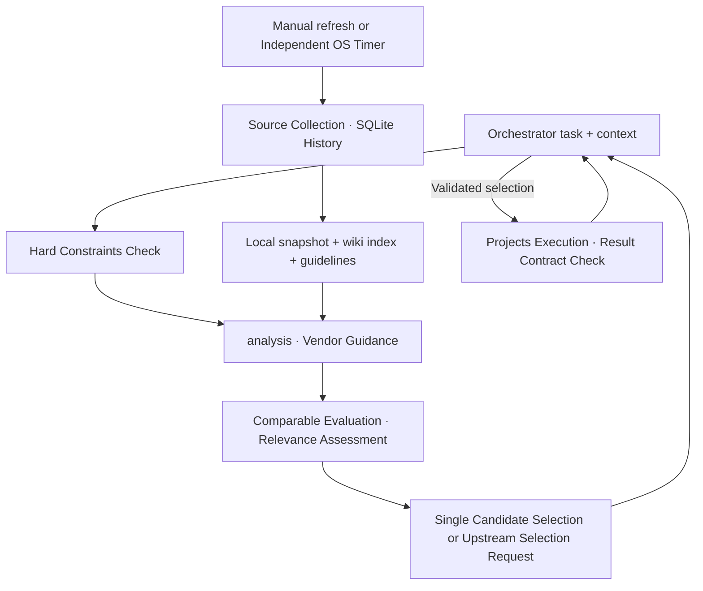

# Data, Classification, and Routing Specification

Updated: 2026-10-24. Current selection follows [Vendor-guided Policy 6](docs/vendor-guided-routing.md), and public contracts follow [Routing Contracts](docs/routing-contracts.md).

## Separation of Request and Refresh Paths

The request path never queries benchmark sources over the network or triggers automatic refresh. It reads snapshots, indices, and guidelines locally. `dry-run`, `explain`, `evaluate`, and `evidence` perform zero network requests, Herdr invocations, or file writes. Live `route`/`parallel` may use a configured Jev instance for semantic decisions; when unavailable, it outputs a native decision packet. These decision calls are entirely distinct from benchmark data refresh.

## Storage Locations and Persistence

| Path | Contents |
|---|---|
| `$XDG_CONFIG_HOME/bench-router` or `~/.config/bench-router` | profiles, aliases, optional categories, env |
| `$XDG_CACHE_HOME/bench-router` or `~/.cache/bench-router` | SQLite `bench-router.db`, snapshots, last-known-good, 30-day replay copies, compiled index |
| `bench_router/index.json`, `bench_router/guidelines.toml` | Packaged benchmark index and version-pinned official guidelines |
| `<cwd>/.bench-router/runs/<run_id>/` | receipt, input.txt, decision.json, result.md/json, feedback.jsonl |
| `<cwd>/.bench-router/groups/<group_id>/` | Group plan and results |

SQLite maintains `sources`, `snapshots`, and `observations`. Selection, execution, and feedback are recorded in run directory files rather than dedicated decisions/feedback tables. Because selection records contain replayable task and decision phases, prompt contents are persisted. Keys and secrets are never recorded.

## Sources and Refresh

| Source | Collection Path | TTL / max_stale |
|---|---|---|
| AA | Free API full pagination; baseline Intelligence/Coding and active `aa:*` wiki units | 24h / 7d |
| Arena | Revision SHA pinned config-specific `latest` Parquet, pyarrow decoding, local category filtering | 24h / 7d |
| The Model Gap (`mg`) | Active `mg:*` wiki units from public JSON | 24h / 7d |
| SWE / TB | Approved manual imports; SWE-bench Verified / Terminal-Bench 4.0 pinned | 168h / 30d |

1. OS file locking restricts refresh to a single writer. Linux/WSL2 uses `fcntl`; Windows uses `msvcrt`. The two environments must never share the same physical cache concurrently.
2. Skips if within TTL. `--force` bypasses TTL. No automatic timers are installed by the application.
3. Enforces per-request size limits, counts, timeouts, and source-level deadlines (default 180s, Arena 600s). 401/403/429 errors are not retried; 5xx and network errors retry at most twice.
4. Partial page failures or corrupted payloads are isolated as failures of that source, preserving last-known-good while other sources continue. `null` denotes missing data, whereas measured `0` is valid.
5. Identical payload hashes are marked `unchanged`, updating only verification timestamps. Conditional GET / 304 is not implemented.
6. Changes to profiles, aliases, or wiki index trigger a snapshot rebuild. Snapshots are published via `os.replace` after temp file flush/fsync, archiving the prior valid snapshot as last-good.
7. Retains the latest 3 successful payloads per source, and 30 days of routing snapshot replay copies.

Only Arena refresh requires `pyarrow`. Offline evaluation, routing, and manual imports function purely on standard library. Installation is via `mise install` followed by `mise run setup`, or `uv sync --extra arena`.

## Model and Evaluation Identity

Model-level observations are linked to profile `model_id`. Explicit aliases take precedence; otherwise, automatic matching normalizes case, delimiters, and trailing effort notations. Unregistered models or ambiguous matches are recorded as diagnostics. Similar names or preview variants are never merged into the same model identifier. Guideline model ID matching requires exact IDs, unlike collection-time normalization.

`exact_profile` requires exact agreement on model, harness, effort, and evaluation conditions. A fingerprint bundles execution profile settings, while CLI version currently defaults to `unknown`. Snapshot observations with altered profiles are excluded as `stale_config`. Simple model proxies are never scaled into exact scores via harness adjustment factors.

Evaluation conditions preserve suite, version, subset, metric, variant, dataset revision, evaluation harness, aggregation, etc. Never mix SWE Verified/Pro, TB 2.0/4.0, or Arena text/style-control/agent metrics. Legacy exact caches lacking condition metadata are excluded as `missing_conditions`. Manual import formats follow [Reference](docs/reference.md#데이터-수집-refresh).

## Freshness and Missing Data

Source `last_success_at` determines TTL and max_stale, while published/evaluated dates are preserved independently. Exceeding TTL emits a stale warning; exceeding max_stale excludes observations. Publication timestamp alone does not guarantee evaluation freshness.

When a snapshot is missing or corrupted, the system attempts recovery from last-known-good. Profiles passing hard constraints can still be evaluated alongside recorded data gaps even if no benchmark data is available. Configured default/fallback profiles are never executed automatically. If no viable profile exists at all, the router terminates with `no_eligible_profile` (exit code 13). Incomplete decisions, abstentions, or upstream selection requirements are distinguished by exit code 17.

## Classification, Hard Constraints, and Basic Evaluation

`routing.classify()` applies L1 summary and file path rules with a general fallback for category aggregation in `evaluate` formats 1 and 2. A category requires matching at least two distinct rules to be adopted. `task.categories` and L0 classification inputs are currently unsupported. Facet lookups rely on `evidence.py` rules and explicit `task.facets`. File contents are not inspected automatically.

Vendor-guided `analysis` semantically evaluates unconfirmed facets and workload attributes. Automated rules serve as dismissible `rule_hints`, while user-specified facets and structural facts are preserved. This analysis does not trigger task decomposition or worker spawning.

`routing.CONSTRAINTS` validates enabled status, exclusions, cost tier, context capacity, capabilities, `local_only`, availability, and estimated cost. Context required tokens and cost caps are also enforced. Cost tiers and dollar estimates are independent constraints and do not guarantee actual spending limits. Current availability and constraints are re-verified immediately before live dispatch.

## Three Evaluation and Selection Touchpoints

| Touchpoint | Output Provided | Selection Semantics |
|---|---|---|
| `evaluate --format 1` / `--format 2` (default 2) | ID-ordered candidates, facts, constraints, category benchmark quality/coverage | No semantic suitability assessment; factual evidence for selection 2.0 override or `--profile` |
| `evidence` | Per-facet raw values, percentiles, effort levels, data gaps, conditions table; default 12 units | Query order is not a model ranking |
| `evaluate --format 3` / default `route` | Policy 6 analysis, vendor guidance, benchmark relevance if needed, candidate suitability | In candidate evaluation schema 4.0, upstream produces selection 6.0 via `select`; bounded single-candidate path uses automatic 5.0 |

Weights in `categories.toml` are used solely for basic evaluation evidence summarization. Cohort percentile is calculated as `(average_rank_ascending−1)/(N−1)`, with ties taking average rank, and 0.5 when N=1. Reflects relative direction; must not be interpreted as probability of success.

`coverage C` is the weighted sum of valid observations. `Q_obs` is the weighted average of observed normalized values, and `quality Q = C×Q_obs + (1−C)×0.5 − 0.1×(1−C)`. When no observations exist, Q is `null`. Coverage bands are sufficient (≥0.8), partial (≥0.5), and insufficient (<0.5). These figures serve as diagnostic evaluation metrics and are not used for candidate ranking or automated selection. `score`, `legacy_score`, `cost_proxy`, lambda, and near-tie selections have been removed. `examples/scoring.synthetic.json` serves as an early fixture for Q/C mathematical validation.

## Policy 6 and Record Versions

Policy 6 evaluates baseline configurations against official vendor guidance texts. Guidance principles are never cross-applied across vendors on a common scale. Identifies candidates as documented, provisional, alternative, or unsuitable, providing comparable fresh raw observations and relevance rationale to upstream. Does not tally votes or weighted sums across units. Effort levels requiring workflow evaluation are marked `workflow_gain_unverified`.

When multiple viable candidates exist, `upstream_selection_required` is emitted without narrowing candidates by priority, cost, or default order. `select --accept-provisional` records acceptance of provisional or alternative selection conditions, but does not certify measured performance improvements. Selection 5.0 is pinned to single recommendations, while 6.0 records external upstream selections. Selection 2.0 overrides and `--profile` are maintained alongside explicit warnings. Historical vendor-guided selection schemas 3.0 and 4.0 are unsupported as inputs and require re-evaluation.

The composite decision digest binds inputs to decision evidence, whereas each phase request digest binds only the actual dependencies of that specific phase. If only the snapshot changes, analysis and guidance responses may be reused, but final selection must be regenerated. Selections under Policies 1–5 must be re-evaluated before new execution. Receipts for previously submitted identical task/rounds are retrieved first, regardless of policy changes.
