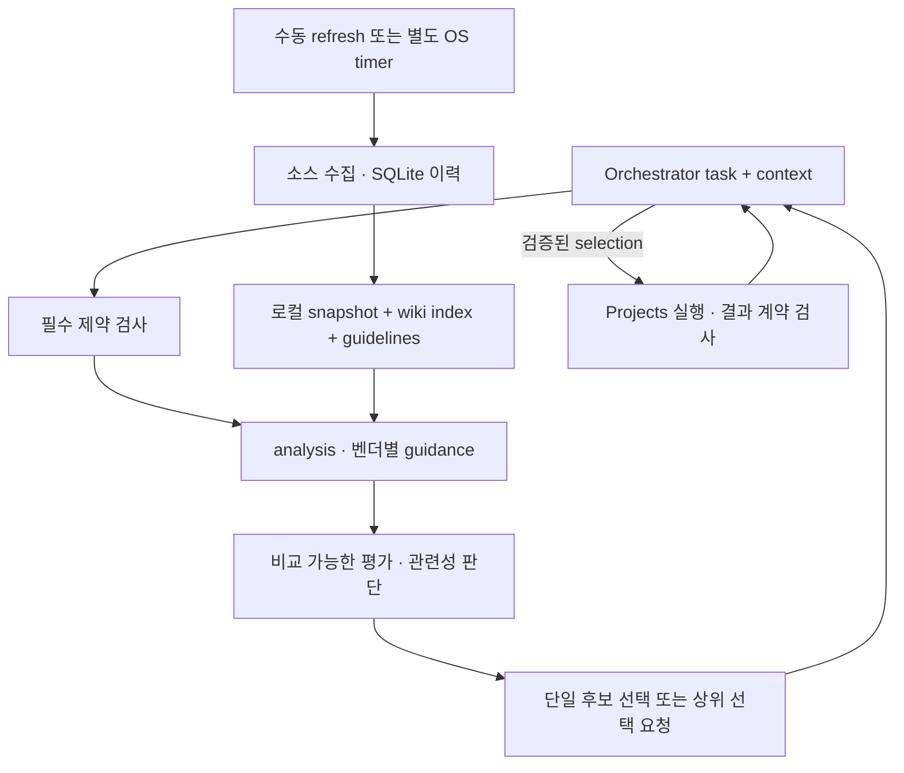

# 데이터·분류·선택 명세

갱신: 2026-10-24. 현재 선택은 [vendor-guided 정책 6](docs/vendor-guided-routing.md), 공개 계약은 [라우팅 계약](docs/routing-contracts.md)을 따른다.

## 요청과 갱신의 분리

요청 경로는 벤치마크 소스를 호출하거나 자동 refresh하지 않는다. snapshot·index·가이드를 로컬에서 읽는다. dry-run·explain·evaluate·evidence는 네트워크·Herdr·파일 쓰기가 없다. live route/parallel은 설정된 Jev를 의미 판단에 사용할 수 있으며, 사용 불가 시 native 판단 패킷을 반환한다. 이 호출은 benchmark refresh와 별개다.

## 저장 위치와 기록

| 위치 | 내용 |
|---|---|
| `$XDG_CONFIG_HOME/bench-router` 또는 `~/.config/bench-router` | profiles·aliases·선택적 categories·env |
| `$XDG_CACHE_HOME/bench-router` 또는 `~/.cache/bench-router` | SQLite `bench-router.db`, snapshot·last-good·30일 재현본·컴파일된 index |
| `bench_router/index.json`, `bench_router/guidelines.toml` | 설치본에 포함되는 benchmark index와 버전 고정 공식 가이드 |
| `<cwd>/.bench-router/runs/<run_id>/` | receipt·input.txt·decision.json·result.md/json·feedback.jsonl |
| `<cwd>/.bench-router/groups/<group_id>/` | 그룹 plan과 결과 |

SQLite에는 `sources`, `snapshots`, `observations`를 둔다. 선택·실행·feedback은 run 디렉터리 파일에 기록하며 별도 decisions/feedback 테이블은 없다. 선택 기록에는 재생용 task·판단 단계가 포함되므로 prompt가 남는다. 키·secret은 기록하지 않는다.

## 소스와 refresh

| 소스 | 수집 경로 | TTL / max_stale |
|---|---|---|
| AA | Free API 전체 pagination; 기본 Intelligence/Coding 및 활성 `aa:*` wiki unit | 24h / 7d |
| Arena | revision SHA에 고정한 config별 `latest` Parquet, pyarrow 디코드 후 category 로컬 필터 | 24h / 7d |
| The Model Gap (`mg`) | 공개 JSON의 활성 `mg:*` wiki unit | 24h / 7d |
| SWE / TB | 승인된 수동 import; SWE-bench Verified / Terminal-Bench 4.0 고정 | 168h / 30d |

1. 운영체제 파일 잠금으로 refresh writer를 하나로 제한한다. Linux/WSL2는 `fcntl`, Windows는 `msvcrt`를 사용한다. 두 환경이 같은 물리 캐시를 동시에 쓰지 않는다.
2. TTL 이내이면 skip한다. `--force`는 TTL을 무시한다. 자동 timer는 설치하지 않는다.
3. 요청별 크기·횟수·timeout과 소스 전체 deadline을 제한한다. 기본 180초, Arena는 600초다. 401/403/429는 재시도하지 않고, 5xx·네트워크 오류는 최대 2회 재시도한다.
4. 페이지 일부 실패·잘못된 payload는 해당 소스의 실패로 격리하고 last-good을 유지한다. 다른 소스 갱신은 계속한다. null은 결측이며 측정된 0은 유효하다.
5. 동일 payload hash는 `unchanged`로 확인 시각만 갱신한다. conditional GET/304는 구현하지 않았다.
6. 프로필·alias·wiki index 변경도 snapshot 재빌드에 반영한다. snapshot은 임시 파일 flush/fsync 후 `os.replace`로 게시하고 직전 유효본을 last-good으로 보관한다.
7. 소스별 정상 payload 최근 3개, routing snapshot 재현본 30일을 보관한다.

Arena refresh만 `pyarrow`가 필요하다. 오프라인 평가·라우팅·수동 import는 표준 라이브러리로 동작한다. 설치는 `mise install` 후 `mise run setup` 또는 `uv sync --extra arena`다.

## 모델과 평가 identity

모델 수준 observation은 프로필 `model_id`와 연결한다. 명시 alias가 우선하고, 그 외에는 대소문자·구분자·끝 effort 표기를 정규화해 자동 매칭한다. 미등록 모델이나 모호한 매칭은 진단으로 남긴다. 비슷한 이름·preview 변형을 임의로 동일 모델로 만들지 않는다. 가이드의 모델 ID 매칭은 이 수집용 정규화와 달리 정확한 ID를 사용한다.

`exact_profile`에는 model·harness·effort와 평가 조건의 일치가 필요하다. fingerprint는 실행 프로필 설정을 묶으며 CLI 버전은 현재 `unknown`이다. 프로필이 달라진 snapshot observation은 `stale_config`로 제외한다. 단순 모델 proxy를 하네스 보정 계수로 exact 점수로 변환하지 않는다.

평가 조건은 suite/version/subset/metric·variant·dataset revision·evaluation harness·aggregation 등을 보존한다. SWE Verified/Pro, TB 2.0/4.0, Arena text/style-control/agent 지표를 섞지 않는다. 조건 없는 구 exact 캐시는 `missing_conditions`로 제외한다. 수동 import 형식은 [reference](docs/reference.md#데이터-수집-refresh)를 따른다.

## 신선도와 결측

소스 `last_success_at`으로 TTL·max_stale를 판단하고 published/evaluated 날짜는 별도로 보존한다. TTL 초과는 stale 경고, max_stale 초과는 observation 제외다. 게시 시각만으로 평가가 최신이라고 판단하지 않는다.

snapshot이 없거나 손상되면 last-good을 시도한다. 쓸 수 있는 데이터가 없어도 하드 제약을 통과한 프로필은 근거 결측과 함께 평가할 수 있다. configured default/fallback을 자동 실행하지 않는다. 실행 가능한 프로필 자체가 없을 때는 `no_eligible_profile`(13)이다. 판단 미완료·기권·상위 선택 필요는 종료 17로 구분한다.

## 분류·필수 제약·기본 평가

`routing.classify()`의 L1 summary·파일 경로 규칙과 general fallback은 `evaluate` 1·2의 category 집계에 사용한다. 한 카테고리에서 서로 다른 규칙이 2개 이상 일치해야 채택한다. task.categories·L0 분류 입력은 현재 지원하지 않는다. facet 조회는 `evidence.py`의 규칙과 명시 `task.facets`를 사용한다. 파일 본문을 자동으로 조사하지 않는다.

vendor-guided의 `analysis`는 미확정 facet과 workload를 의미 판단한다. 자동 규칙은 거부 가능한 `rule_hints`이고, 상위가 지정한 facet과 구조적 사실은 보존한다. 이것이 작업 분해나 새 worker 생성으로 이어지지는 않는다.

`routing.CONSTRAINTS`는 enabled·exclude·cost tier·context capacity·capabilities·local_only·가용성·예상 비용을 검사한다. context의 필요 토큰과 비용 상한도 적용한다. 비용 등급과 달러 견적은 독립된 제약이며 실제 지출 한도를 보장하지 않는다. live dispatch 직전에 현재 가용성과 제약을 재검사한다.

## 세 가지 평가·선택 접점

| 접점 | 제공하는 것 | 선택 의미 |
|---|---|---|
| `evaluate --format 1` / `--format 2` (기본 2) | ID순 후보·facts·제약·category benchmark의 quality/coverage | 의미 적합성 판단 없음; selection 2.0 override 또는 `--profile`의 사실 근거 |
| `evidence` | facet별 raw·percentile·effort·결측·조건 표, 기본 12 unit | 조회 순서는 모델 순위가 아님 |
| `evaluate --format 3` / 기본 `route` | 정책 6의 analysis·벤더별 guidance·필요 시 benchmark 관련성·후보 적합성 | 후보 평가 schema 4.0에서 상위가 `select`로 selection 6.0 생성; 제한된 단일 후보 경로는 자동 5.0 |

`categories.toml`의 가중치는 기본 평가의 근거 요약용이다. 같은 cohort의 percentile은 `(average_rank_ascending−1)/(N−1)`, 동점은 평균 rank, N=1이면 0.5다. 방향을 반영하며 성공 확률로 읽지 않는다.

`coverage C`는 유효 observation의 가중치 합이다. `Q_obs`는 관측된 normalized 값의 가중 평균, `quality Q = C×Q_obs + (1−C)×0.5 − 0.1×(1−C)`다. 관측이 전혀 없으면 Q는 null이다. coverage band는 sufficient(≥0.8), partial(≥0.5), insufficient(<0.5)다. 이 수치는 평가 진단이며 후보 순위·자동 선택에 쓰이지 않는다. `score`, `legacy_score`, `cost_proxy`, lambda·near-tie 선택은 제거됐다. `examples/scoring.synthetic.json`은 Q/C 수학 검증용 초기 fixture다.

## 정책 6과 기록 버전

정책 6은 적격 벤더별 공식 가이드 원문으로 시작점 구성을 판정한다. 다른 벤더의 원칙을 공통 척도로 적용하지 않는다. documented/provisional/alternative/unsuitable을 구분하고, 비교 가능한 fresh raw observation과 관련성 근거를 상위에 제공한다. unit별 승패를 투표·가중합하지 않는다. workflow 평가가 필요한 effort는 `workflow_gain_unverified`로 남긴다.

복수 적합 후보이면 `upstream_selection_required`이며 priority·비용·default 순서로 축소하지 않는다. `select --accept-provisional`은 provisional·alternative 선택 조건의 수용을 기록할 뿐 측정된 개선을 증명하지 않는다. 선택 5.0은 단일 추천에 고정되고 6.0은 외부 선택을 기록한다. 2.0 override와 `--profile`은 별도 경고와 함께 유지한다. 과거 vendor-guided selection 3.0·4.0은 지원 입력이 아니므로 재평가해야 한다.

전체 decision digest는 입력과 판단 근거를 묶고, 각 request digest는 단계의 실제 의존성만 묶는다. snapshot만 바뀌면 analysis·guidance 응답은 재사용할 수 있지만 최종 selection은 다시 생성해야 한다. 정책 1–5의 선택은 새 실행 전에 재평가한다. 이미 제출한 같은 task/round의 receipt는 정책 변경과 무관하게 먼저 회수한다.
