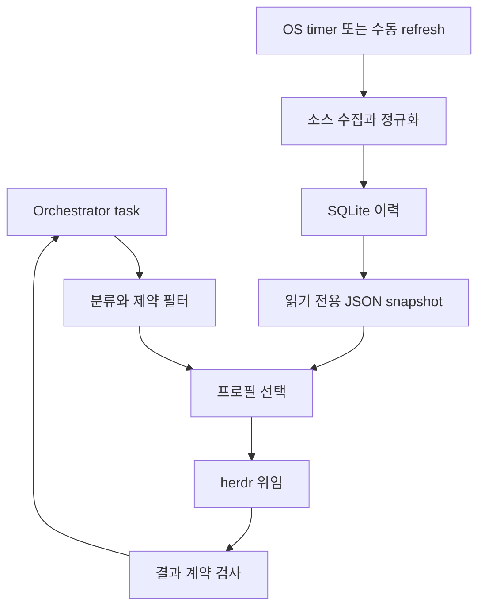

# 데이터·분류·선택 v1 명세

이 문서는 구현 기준선이다. 가중치·임계값은 **P: 초기 정책**이며 학습된 최적값이 아니다. 실제 가용 모델과 결과가 없는 상태에서 특정 Agent를 최적이라고 선언하지 않는다.

## 경로 분리

route는 benchmark source를 호출하지 않고 snapshot을 한 번 읽어 해당 결정에 고정한다. herdr 로컬 제어와 Agent 자체 모델 통신은 이 금지 대상이 아니다. 원격 분류기를 활성화할 때는 별도 명시 설정이 필요하며, benchmark refresh와 혼동하지 않는다.

## 저장 위치와 최소 데이터 모델

- 캐시 기본: XDG_CACHE_HOME/bench-router 또는 ~/.cache/bench-router.
- 운영 receipt/결과 기본: task.cwd/.bench-router/runs/<run_id>/.
- secret은 환경변수/사용자 기존 secret 관리에 두고 JSON/TOML/DB에 넣지 않는다.
- prompt 원문은 실행 receipt에 꼭 필요한 파일로만 보관한다. 결정 DB는 hash·분류·근거 중심이고 원문 수집은 기본 비활성이다.

SQLite는 표준 sqlite3를 사용한다. 스키마 버전과 migration은 v1 한 번의 초기화부터 시작한다. 다음은 최소 엔터티이며 테이블 분할은 구현의 필요에 따라 합칠 수 있다.

| 엔터티 | 필요한 필드 |
| --- | --- |
| sources | id, URL, adapter_version, TTL, max_stale, last_attempt_at, last_success_at, last_error, ETag/Last-Modified(제공된 경우), attribution |
| snapshots | id, source_id, fetched_at, payload hash, source revision, 원본 또는 원본 파일 경로 |
| observations | canonical model, benchmark identity, harness/config signature, scope, raw/normalized, cohort id, metric direction, published/evaluated_at, snapshot id |
| decisions | run/task/round, task hash, policy/config/snapshot hash, classification, 후보별 점수 분해, 선택/제외 이유 |
| feedback | run_id, outcome, evaluator, verification command/result, feedback_at |

refresh DB와 실행 receipt는 역할이 다르다. receipt는 재시작 후 같은 작업을 재전송하지 않기 위한 작은 원장이고, Agent 실제 상태의 source of truth는 herdr다.

hot snapshot의 최소 top-level key는 schema_version, snapshot_id, generated_at, policy_version, config_hash, sources, cohorts, profiles다. sources는 id별 freshness/provenance, cohorts는 benchmark identity와 percentile 모집단, profiles는 fingerprint와 evidence ID별 raw/normalized/scope/provenance를 담는다. 파일 전체를 읽은 뒤 version·필수 필드·finite 수치를 검사한다. 파일 hash를 snapshot_id로 사용할 때 자기 자신인 snapshot_id 필드를 제외한 canonical JSON을 hash한다. profile config hash가 현재 설정과 다르면 기존 점수를 새 config의 exact score로 쓰지 않고 stale_config 경고 및 constrained fallback으로 간다. threshold와 weights가 달라지면 policy version도 갱신한다.

## 모델·평가 identity

model identity는 이름만으로 합치지 않는다. provider, 정확한 model revision, reasoning effort, serving variant를 가능한 한 분리한다. alias는 출처별 정확한 문자열 → canonical ID로 수동 관리한다.

profile fingerprint는 kind, CLI version, model ID/revision, reasoning 설정, tool/permission config, launch args로 계산한다. 환경에 따라 CLI 버전을 얻지 못하면 unknown을 기록한다.

benchmark identity는 최소 source, suite, version, subset/category, metric, scoring/methodology version, evaluation config를 포함한다. 다음은 서로 다른 cohort다.

- SWE Verified / SWE Pro / Bash Only.
- Terminal-Bench 2.0 / 4.0.
- Arena text / text_style_control / Agent Arena IPS.
- 서로 다른 reasoning effort, 도구 구성, budget, attempt 설정.

같은 문자열 “coding”이라도 직접 합치지 않는다. cli args의 동적 alias(예: 최신 opus)가 실제 revision을 확정하지 못하면 exact-profile evidence로 표시하지 않는다. “모델이 같다”와 “Agent 평가 환경이 같다”는 별개다.

## refresh 절차

1. 단일 refresh file lock을 취한다. Linux/macOS MVP는 fcntl.flock을 사용하고 동시 실행은 빠르게 종료한다. Windows lock 지원은 별도 검증 전까지 미지원으로 표시한다.
2. 소스별 TTL을 확인한다. default AA/Arena 24h, 수동 TB/SWE import 점검 168h. 스케줄 default는 하루 한 번이며 시간대는 배포 설정으로 명시한다.
3. HTTP timeout, 최대 응답 크기, 최대 페이지/요청 예산을 둔다. AA는 pagination.has_more/total_pages를 보고 완주한다. 여러 페이지 중 하나라도 실패하면 해당 소스의 새 snapshot은 게시하지 않는다.
4. 서버가 제공하는 경우에만 conditional GET을 쓴다. 304는 last_success_at를 갱신하지만 publish date를 바꾸지 않는다.
5. 원본 hash가 같으면 중복 payload/정규화 저장은 생략할 수 있다. 정책/alias/config가 바뀌면 데이터가 같아도 routing snapshot을 다시 계산한다.
6. 스키마·metric version·타입·범위·중복 identity를 검사한다. null은 결측이다. 평가된 0점은 유효한 값이다. 알 수 없는 모델은 unmatched 목록으로 분리한다.
7. 소스 단위로 DB transaction commit한다. 전체 소스가 동일 시각일 필요는 없으나 각각의 날짜와 성공 상태를 보존한다.
8. 전체 JSON을 같은 디렉터리 임시 파일에 쓰고 flush/fsync 후 os.replace한다. writer lock은 게시까지 유지한다. 이전 유효본을 last-good으로 유지한다.
9. 소스별 최근 정상 payload 3개를 기본 보관한다. route 결정에 쓰인 JSON snapshot의 재현본은 기본 30일 유지한다. 이 기간 밖 replay가 필요한 운영은 보존 기간을 조정한다.

401/403은 인증/권한 문제로 기록하고 자동 반복하지 않는다. 429는 Retry-After와 quota를 존중한다. 일시 장애 재시도는 refresh 안에서 최대 2회로 제한하며 timer가 연속 실패를 폭증시키지 않게 한다. 스키마 변경은 last-good을 유지하고 adapter 오류로 보고한다. failure count 3은 표시 기준일 뿐 자동으로 점수 가중치를 바꾸지 않는다.

OS timer는 별도 설정이며 이번 handoff 작성으로 자동화가 실제 생성된 것은 아니다.

## 신선도와 장애

- freshness 기준은 **소스별 last_success_at**이며 데이터의 published/evaluated_at도 별도로 표시한다.
- snapshot generated_at만 최신이라고 모든 평가 결과가 최신인 것은 아니다.
- TTL 초과 → stale 경고를 반환하고 last-good 사용 가능.
- max_stale 초과 → 그 소스 observation을 점수에서 제외한다. 기본 AA/Arena 7일, TB/SWE 수동 snapshot 30일. 날짜 불명 수동 소스는 실행용 데이터로 승인하지 않는다.
- refresh가 구 데이터임을 정상 확인했을 때 published_at는 과거로 유지한다. publication_age를 근거로 따로 보고하며 자동 점수 감쇠는 MVP에서 하지 않는다.
- snapshot 없음/파싱 실패/지원 안 되는 버전 → last-good 시도 → 제약을 만족하는 configured default. 그마저 없으면 no_eligible_profile.
- route에서 자동 background refresh를 시작하지 않는다. 운영 경고와 별도 timer 실패 알림으로 갱신을 유도한다.

fallback에서도 설치 여부, local_only, capability, exclude, context, cost tier 제약을 모두 적용한다. 후보 없는 경우는 CLI 13이고 herdr prompt를 보내지 않는다.

## 분류

카테고리 enum: coding_repo, terminal_ops, code_gen, webdev, math_reasoning, analysis, writing, vision_doc, general.

L1: orchestrator summary의 명시 패턴·파일 확장자·context_files로 분류한다. 파일 내용을 열거나 전체 prompt를 LLM으로 해석하지 않는다. 규칙 버전과 matched rule을 기록한다. 서로 다른 영역의 규칙이 충돌하면 고정 우선순위를 숨겨 쓰지 않고 general로 abstain한다. SQL/pytest 같은 문자열 하나만으로 고확신 의미 판단을 하지 않는다.

Fallback: general. 이 경우 fallback_reason을 반환한다. 분류 결과의 categories는 정책 가중치이지 통계적으로 보정된 성공확률이 아니다.

요약이 없으면 전체 prompt 앞부분을 임의로 자르는 대신 입력 계약 오류로 처리한다. summary는 Orchestrator가 작업 의도를 압축하되 도구·언어·제약·입력 modality를 빠뜨리지 않게 작성한다.

### 보류된 L2/L3

- L2: 다국어 로컬 embedding + 적은 카테고리 exemplar로 시작한다. vector DB는 불필요하다. 모델 revision, tokenizer, prefix/pooling/normalization, exemplar hash를 고정한다.
- cosine 유사도/softmax를 calibrated probability라고 부르지 않는다. “top1-top2 < 0.05”는 미검증 초안값이므로 holdout으로 threshold를 정한다.
- 분류 캐시는 hash(normalized summary, taxonomy version, rules/model/exemplar version, locale, relevant constraints)로 키를 만든다. benchmark snapshot 갱신만으로 분류 캐시를 전부 지울 필요는 없다.
- L3: Jev 등 hosted model은 allow_remote_classification 설정, 데이터 전송 범위, 키, 비용 예산을 확인한 뒤 shadow mode에서 시험한다. local_only 요청은 원격 분류도 금지한다.
- 임베딩 CPU 5–20ms나 Jev 70–500ms는 목표/주장과 실측을 구분한다. CLI 프로세스 cold start도 측정한다.

## 카테고리와 evidence 매핑

아래 가중치는 P: 초기 정책이다. 실제 observation이 없는 경우 해당 evidence는 missing이며 대체 지수를 만들어 넣지 않는다.

| 카테고리 | evidence ID와 초기 비중 | 해석 |
| --- | --- | --- |
| coding_repo | swe_verified_exact 0.6, aa_coding 0.4 | exact는 실제 프로필의 비교 가능한 평가만; AA는 모델 proxy |
| terminal_ops | terminal_exact 0.7, aa_coding 0.3 | Terminal 버전을 설정에 고정 |
| code_gen | aa_coding 1.0 | 일반 생성에 webdev를 자동 포함하지 않음 |
| webdev | arena_webdev 0.6, aa_coding 0.4 | 웹 개발 작업일 때만 해당 Arena 사용 |
| math_reasoning | arena_text_math 1.0 | 실제 category 존재 확인 후 사용; 없으면 제약 만족 default |
| analysis | aa_intelligence 0.6, arena_text 0.4 | 일반 proxy, 조사 도구 능력은 별도 hard capability |
| writing | arena_text 1.0 | 언어/스타일 적합성은 실작업에서 확인 |
| vision_doc | arena_document 0.5, arena_vision 0.5 | 이미지/PDF 처리 capability도 반드시 필터 |
| general | aa_intelligence 1.0 | 광범위 proxy |

categories.toml에 evidence mapping과 weights를 두며 각 카테고리 내 합은 1이다. 모델 proxy evidence는 scope=model_proxy, exact evidence는 scope=exact_profile로 표시한다. 모델 proxy에 “하네스 할인 0.9”를 붙여 Terminal/SWE 결측을 채우지 않는다.

실제 exact 데이터가 드물면 coding_repo/terminal_ops의 coverage가 낮아 default로 갈 수 있다. 이것은 초기 설계의 정직한 한계다. curated exact snapshot을 추가하거나 평가된 다른 proxy 정책을 명시적으로 도입하기 전에는 “벤치마크 기반 최적 Agent”라는 표현을 쓰지 않는다.

## 정규화

같은 benchmark cohort의 비교 가능한 전체 모델/프로필을 기준으로 계산한다. 활성 후보만 바뀌었다고 percentile 기준을 바꾸지 않는다. 높은 값이 좋도록 direction을 적용한 뒤:

normalized = (average_rank_ascending - 1) / (N - 1)

tie는 평균 rank이고 N=1이면 0.5로 둔다. 범위는 0~1. cohort ID·N·raw·metric·source revision을 저장한다. 95% CI를 제공하면 원본 그대로 보관하지만 percentile을 성공확률/CI로 해석하지 않는다.

percentile은 점수 간 실제 크기 차이를 지운다는 한계가 있다. v1은 비교 척도 통일을 위한 정책으로 사용하고 별도 calibrated 모델 없이 직접 success probability로 변환하지 않는다.

## 제약과 가용성

> 2026-10-13: 제약은 `routing.CONSTRAINTS`의 이름 붙은 검사이며, 통과·실패 모두 관측값·기준값과 함께 기록된다. Orchestrator context의 비용 상한·필요 컨텍스트도 같은 제약이다. 다중 기준 계약은 `docs/routing-contracts.md` §3.

먼저 enabled, 지원 kind, 실제 executable/인증 준비, exclude_profiles, cost_tier, context, modality/tools, local_only를 적용한다. 지원 capability가 unknown이면 해당 capability가 요구된 후보는 제외한다.

cost tier 순서: low < medium < high. 이는 상대 정책이고 monetary budget 보장이 아니다. min_context_tokens는 작업·도구·예상 응답을 포함한 요구치이며 Free API 누락값을 무한대로 간주하지 않는다. live route에서 준비 안 된 프로필은 제외하고, offline dry-run은 availability_unverified를 표시한다.

local_only는 로컬 inference/처리를 뜻한다. herdr가 로컬에서 실행된다고 cloud 모델이 local_only를 충족하는 것은 아니다.

## 점수 계산

> 2026-10-13부터 이 절과 아래 선택 규칙은 **legacy 자동 route 정책**이다(`route`를 `--selection` 없이 쓸 때). evaluate 2.0에서는 `evaluations.benchmark.legacy_score`로만 보이며 종합 순위가 아니다. 최종 선택은 Orchestrator 몫이다(`docs/routing-contracts.md` §1).

카테고리 분포 w와 mapping 비중 v로 evidence별 총 가중치 a_b = Σ_c(w_c × v_cb)를 구한다. 유효 evidence 집합을 A_p라 할 때:

C_p = Σ_(b in A_p) a_b
Q_obs(p) = Σ_(b in A_p) a_b × normalized_pb / C_p     (C_p > 0)
Q(p) = C_p × Q_obs(p) + (1-C_p) × 0.5 - 0.1 × (1-C_p)

결측에는 prior 0.5와 penalty 0.1을 둔다. 이는 P이며 데이터가 없는 점수를 관측치라고 기록하지 않는다. normalized 0점도 coverage에 포함한다.

- 후보 중 C >= 0.5인 프로필이 있으면 그 집합만 score ranking한다.
- 모두 C < 0.5이면 제약 만족 default를 선택하고 selection_mode=default_insufficient_evidence로 기록한다. default가 제외됐다면 명시 configured fallback_order의 첫 eligible 프로필을 쓴다. 아무것도 없으면 종료한다.
- coverage_band: sufficient(C>=0.8), partial(0.5<=C<0.8), insufficient(C<0.5).
- coverage와 exact_profile evidence 비중은 별도 보고한다. sufficient가 “실제 Agent 성공 확신 높음”을 뜻하지 않는다.

S(p) = Q(p) - lambda_cost × cost_proxy(p)

고정 tier proxy는 low=0, medium=0.5, high=1. quality lambda=0, balanced=0.15, cost=0.30. 후보 집합 min-max 정규화는 쓰지 않아 무관한 후보 제거가 남은 후보 점수에 영향을 주지 않는다. API token price를 이 tier 값으로 몰래 치환하지 않는다.

MVP의 latency penalty와 warm bonus는 0이다. 측정 없는 모델 TTFT를 Agent 전체 지연으로 사용하지 않는다. 이후 실행별 latency와 reuse 정책이 준비되면 policy version을 올려 추가한다.

top score와 차이가 0.02 미만인 후보는 near-tie 집합으로 보고, 낮은 cost tier → profile ID 사전순으로 선택한다. quality priority에서는 비용으로 near-tie를 뒤집지 않고 정확한 score 내림차순 → ID로 결정한다. 차이가 정확히 0.02면 near-tie에 포함하지 않는다. float tolerance와 정렬 규칙을 fixture에 고정한다.

정렬은 eligible snapshot·availability·config·task가 같을 때 결정적이다. Agent 가용성이 달라져도 항상 같은 선택이라고 보장하지 않는다.

## 합성 기대값

examples/scoring.synthetic.json의 비중은 b1=0.6, b2=0.4이다.

| 프로필 | 점수 b1/b2 | coverage | Q | tier proxy | balanced S |
| --- | --- | --- | --- | --- | --- |
| synthetic-a | 0.9 / 0.8 | 1.0 | 0.86 | 1.0 | 0.710 |
| synthetic-b | 0.95 / missing | 0.6 | 0.73 | 0.0 | 0.730 |
| synthetic-c | 0.85 / 0.85 | 1.0 | 0.85 | 0.5 | 0.775 |

balanced 선택은 synthetic-c, quality는 synthetic-a, cost는 synthetic-b다. 모두 합성 값이며 실제 모델 점수·가격과 관계없다.

