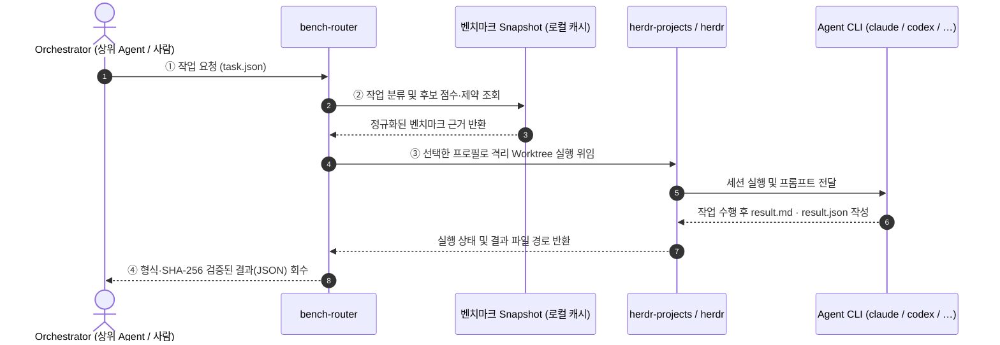
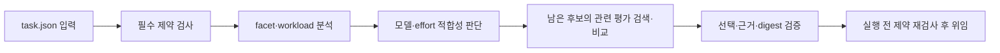

# bench-router


**작업에 가장 잘 맞는 AI 코딩 Agent를 공개 벤치마크 점수로 골라 대신 실행시켜 주는 라우터**입니다.

Claude Code, Codex 같은 CLI Agent는 잘하는 일이 서로 다르고 비용도 다릅니다. "이 버그 수정은 누구에게 맡기지?"를 매번 감으로 정하는 대신, bench-router는 작업 종류를 파악하고 공개 벤치마크(Artificial Analysis, LMArena, The Model Gap, SWE-bench, Terminal-Bench 등) 점수와 비용을 따져 Agent를 고릅니다. 고른 Agent에게 작업을 넘기고, 약속한 형식의 결과 파일이 돌아왔는지 확인한 뒤 돌려줍니다.

<p align="center">
  
</p>

---

## 한눈에 보기



1. **요청**: Orchestrator(작업을 나누고 위임을 결정하는 상위 Agent나 사람)가 할 일을 `task.json`에 적어 넘깁니다.
2. **선택**: bench-router가 작업 종류를 분류합니다(예: 저장소 코드 수정, 터미널 작업, 글쓰기). 조건에 맞는 Agent 프로필 가운데 그 종류의 벤치마크 점수가 높고 비용이 적당한 것을 고르거나(`route`), 작업 성격(facet)에 맞는 벤치마크 증거 표를 뽑아 Orchestrator가 직접 고르게 합니다(`evaluate` + `evidence` → `route --selection`).
3. **실행**: 선택한 Agent를 [herdr](https://herdr.dev)와 `herdr-projects` 터미널 세션의 격리된 Git worktree에서 실행합니다. Agent는 작업을 마치면 정해진 형식의 결과 파일을 씁니다.
4. **회수**: bench-router가 결과 파일의 형식과 무결성을 확인해 Orchestrator에게 돌려줍니다. 작업이 실제로 성공했는지는 Orchestrator가 판단하고 `feedback`으로 기록합니다.

> [!NOTE]
> **오프라인 재현성과 로컬 Snapshot**
> 벤치마크 점수는 요청할 때마다 받지 않습니다. `refresh` 명령을 실행하면 점수를 받아 로컬 snapshot에 저장하고, 선택 단계는 이 파일만 읽습니다. 그래서 선택은 빠르고 네트워크 없이도 재현됩니다. 하루 한 번 정도 갱신하려면 별도로 [정기 실행을 예약](docs/reference.md#정기-실행-예시-설치하지-않음)해야 합니다. 자동 예약은 설치되지 않습니다.

---

## 역할 분담

| 누가 | 무엇을 |
|---|---|
| **Orchestrator** | 위임 여부 결정, 작업 분해, (선택 시) 증거 표 기반 최종 프로필 선정, 결과 검토와 최종 판정 |
| **bench-router** | 벤치마크 근거 조회·집계, 하드 제약 검사, 중복 실행 방지, 결과 형식 검사 |
| **herdr / herdr-projects** | 격리된 Git worktree 생성, Agent 프로세스 실행, 권한 대기(`blocked`)·상태 관찰 및 세션 복구 |
| **Agent CLI** (`claude`, `codex`, `agy`, …) | 실제 작업 수행 및 결과 계약(`result.md`, `result.json`) 작성 |

> [!TIP]
> bench-router는 일부러 얇게 만들었습니다. 단순 `subprocess` 호출 대신 `herdr` / `herdr-projects`를 쓰는 이유는 각 작업을 격리된 Git worktree에서 실행하고, 권한 승인 대기(`blocked`)나 타임아웃 시에도 프롬프트 중복 전송 없이 안전하게 관찰·복구(`collect`, `resume`)하기 위해서입니다. Python 3.11 이상에서 외부 패키지 없이 **표준 라이브러리만** 사용합니다.

---

## 핵심 개념과 선택 흐름

기본 정책은 **공식 가이드 기반 선택(`vendor-guided`)**입니다. Jev 또는 native `bench-decider`가 작업 특성 분석 후 정확한 모델·effort 권고로 후보를 정합니다. 코드는 남은 후보의 관련 평가를 검색하고 비교 가능한 raw 점수·비용으로 선택합니다. 평가가 상충할 때만 점수 없이 평가의 작업 관련성을 추가 판단합니다. `route`·`parallel`·Skill이 같은 정책을 사용합니다.

- **기본 선택 (`route`)**: 작업에 충분한 가벼운 구성을 우선하며, 근거 부족은 잠정 선택으로 표시합니다. 판단 도구가 없으면 `decision_required`를 반환합니다.
- **명시적 선택 (`route --selection` / `--profile`)**: 저장된 선택을 검증하거나 지정한 프로필을 실행합니다. 기존 2.0 기록과 수동 지정은 새 정책 검증과 구분됩니다.
- **기존 점수식 (`--policy legacy`)**: 카테고리 가중치와 비용 등급으로 선택하는 이전 정책을 명시적으로 사용할 수 있습니다.

사용법과 응답 형식은 [공식 가이드 기반 정책](docs/vendor-guided-routing.md)을 참고하세요.



- **프로필(profile)**: "어떤 Agent CLI를, 어떤 모델과 설정으로 실행할지"의 묶음입니다. 예: `claude-opus-high` = Claude Code + Opus + high effort. 라우터는 프로필 단위로 고릅니다.
- **근거(evidence)**: 공식 가이드와 관련 평가의 관측값입니다. 벤치마크의 effort·harness·결측·최신성을 함께 검토하며 새 정책은 가중합 점수를 만들지 않습니다.
- **근거가 부족할 때**: 잠정 선택과 불확실성을 기록합니다. 가이드 미등재 모델도 후보로 유지하고, 판단 agent가 기권하면 실행하지 않습니다.
- **결과 계약**: Agent는 `result.md`(사람이 읽는 보고)와 `result.json`(상태·해시 등 기계용 요약)을 남겨야 합니다. 라우터는 두 파일이 규칙대로 작성됐는지만 확인합니다. `completed`는 "결과를 형식대로 받았다"는 뜻이지 "작업이 성공했다"는 뜻이 아닙니다.
- **중복 전송 방지**: 같은 작업을 다시 요청해도 프롬프트를 두 번 보내지 않고, 이미 진행 중이거나 끝난 실행의 결과를 회수합니다.

<details>
<summary><b>📊 legacy 정책의 카테고리별 벤치마크 가중치 매핑 (<code>categories.toml</code>)</b></summary>

| 카테고리 | 설명 | 반영 벤치마크 및 가중치 |
|---|---|---|
| `coding_repo` | 저장소 코드 수정·디버깅 | SWE-bench Verified (`0.6`) + AA Coding (`0.4`) |
| `terminal_ops` | 셸·터미널·시스템 작업 | Terminal-Bench (`0.7`) + AA Coding (`0.3`) |
| `code_gen` | 단일 코드·알고리즘 생성 | AA Coding (`1.0`) |
| `webdev` | 프론트엔드·웹 UI 구현 | LMArena WebDev (`0.6`) + AA Coding (`0.4`) |
| `math_reasoning` | 수학·논리 추론 | LMArena Math (`1.0`) |
| `analysis` | 로그·데이터·설계 분석 | AA Intelligence (`0.6`) + LMArena Text (`0.4`) |
| `writing` | 문서·릴리스 노트·이메일 작성 | LMArena Text (`1.0`) |
| `vision_doc` | 이미지·문서 시각 이해 | LMArena Document (`0.5`) + LMArena Vision (`0.5`) |
| `general` | 일반 질의·번역·체크리스트 | AA Intelligence (`1.0`) |

</details>

---

## 처음 가져와 사용할 때: 사전 조건 및 설치 가이드

이 저장소를 처음 클론(`git clone`)하거나 Skill로 설치해 사용할 때 필요한 사전 조건과 설정은 다음과 같습니다. Python 3.11 이상만 있으면 `bench-router` 자체의 별도 패키지 설치(`pip install`)는 필요 없습니다.

### 1) 사전 조건 및 설정 체크리스트

| 구분 | 항목 | 필수 여부 | 요구 버전 및 설치·설정 방법 |
|---|---|---|---|
| **기본 런타임** | **Python 3.11+** | **필수** | 외부 패키지 불필요(표준 라이브러리만 사용). 오프라인 평가·데이터 갱신은 Linux / WSL2 / Windows 모두 지원 |
| **라우터 설정** | **`profiles.toml`** | **필수** | `~/.config/bench-router/profiles.toml` — 라우팅 후보 Agent 프로필 목록. 아래 3단계 예시대로 생성·편집 |
| **라우터 설정** | **`aliases.toml`** | 권장 | `~/.config/bench-router/aliases.toml` — 외부 벤치마크 모델명을 프로필 `model_id`와 매칭 ([작성법](docs/reference.md#aliasestoml)) |
| **실제 위임 (Live)** | **[Herdr](https://herdr.dev)** | 실제 위임 시 필수 | **Linux / WSL2**, 버전 **0.9.3 이상** (`herdr --version`, 기본 `~/.local/bin/herdr`) |
| **실제 위임 (Live)** | **`herdr-projects` 플러그인** | 실제 위임 시 필수 | 버전 **1.2.1** 고정 (`herdr plugin install eliasstravik/herdr-projects` → `herdr-projects version` 확인) |
| **실제 위임 (Live)** | **대상 Agent CLI** | 실제 위임 시 필수 | 프로필에 등록한 CLI(`claude`, `codex`, `agy` 등) 설치·로그인 및 작업 대상 Git 저장소 폴더 신뢰(trust) 승인 완료 |
| **선택 API 키** | **`ARTIFICIAL_ANALYSIS_API_KEY`** | 선택 (`refresh` 시) | Artificial Analysis 점수 수집용([무료 발급](https://artificialanalysis.ai)). **없어도 LMArena·The Model Gap 공개 데이터는 정상 수집됨** |
| **선택 API 키** | **`TYPESAFE_API_KEY` (`JEV_API_KEY`)** | 선택 (Skill 결정 시) | Skill의 경량 의사결정(`decide.py`)에서 Jev API를 쓸 때만 사용. **없으면 호스트의 경량 서브에이전트(`bench-decider`)로 자동 폴백** |

> [!NOTE]
> **실제 위임(Live Dispatch) 환경 한 줄 준비 (Linux / WSL2)**
> `--dry-run`, `explain`, `evaluate`, `evidence`만 사용할 때는 Herdr가 필요 없습니다. 실제로 Agent를 띄워 작업을 맡기려면(`route`, `parallel`) 아래 사전 조건이 준비되어 있어야 합니다([상세 안내](docs/projects.md)):
> ```bash
> export PATH="$HOME/.local/bin:$PATH"
> herdr --version                                      # 0.9.3 이상 확인 (https://herdr.dev)
> herdr plugin install eliasstravik/herdr-projects     # herdr-projects 플러그인 설치
> herdr-projects version                               # herdr-projects 1.2.1 확인
> ```

> [!TIP]
> **API 키 안전하게 보관하기**: 키를 발급받았다면 `~/.config/bench-router/env` 파일에 적어 두고 권한을 `600`으로 잠그세요.
> ```bash
> mkdir -p ~/.config/bench-router && chmod 700 ~/.config/bench-router
> cat << 'EOF' > ~/.config/bench-router/env
> ARTIFICIAL_ANALYSIS_API_KEY="your-aa-api-key"
> # TYPESAFE_API_KEY="your-optional-jev-key"
> EOF
> chmod 600 ~/.config/bench-router/env
> ```

---

### 2) 어디서든 Skill로 사용하도록 설치하기 (`npx skills`)

[`npx skills`](https://skills.sh/) 한 줄이면 내 컴퓨터의 모든 코딩 에이전트(Claude Code, Codex, Cursor, Gemini CLI, Windsurf, Cline, Copilot, Antigravity 등 40+ 에이전트)나 다른 프로젝트 경로에 바로 설치됩니다. `skills/bench-router/` 안에 라우터 본체(`bench_router/`, 컴파일된 벤치마크 인덱스 `index.json` 포함)가 번들되어 있어 **원본 저장소를 클론해 두지 않아도 복사된 스킬 폴더(약 250KB)만으로 단독 동작**합니다.

```bash
# A. 내 컴퓨터의 모든 프로젝트에서 쓰기 (글로벌 설치 — 권장)
npx skills add hjlim4u/bench-router -g
# (로컬 클론에서 설치할 때: npx skills add . -g)

# B. 특정 다른 프로젝트(/path/to/my-app)에만 설치하기
cd /path/to/my-app && npx skills add hjlim4u/bench-router
```

---

### 3) CLI로 빠르게 시작하기 (단계별 실습)

저장소 루트(또는 설치된 Skill의 `scripts/cli.py`)에서 바로 실행해 볼 수 있습니다.

```bash
BR="python3 -m bench_router.cli"

# 1. 사용할 Agent 프로필 준비 (예시를 복사해 수정)
mkdir -p ~/.config/bench-router
cp examples/profiles.example.toml ~/.config/bench-router/profiles.toml
```

> [!IMPORTANT]
> 복사한 `profiles.toml`은 **모두 비활성(`enabled = false`)인 placeholder**입니다. 다음 명령 전에 파일을 편집하세요.
> - 사용할 프로필의 `enabled`를 `true`로 바꾸고, `args`의 모델명과 `model_id`를 실제 사용할 값으로 설정합니다. 나머지 실행·모델 정보도 확인하고 `config_revision`을 갱신합니다.
> - `default_profile`과 `fallback_order`가 사용할 프로필의 `id`를 가리키게 합니다. 모든 프로필이 비활성이면 `no_eligible_profile`(종료 코드 13)이 됩니다.
> - 실제 위임용 `args`에는 모델·effort 설정만 넣습니다. 권한은 Projects의 `worker.access`를 따릅니다. [프로필 설정 예시](docs/reference.md#profilestoml)를 참고하세요.

<details>
<summary><b>📝 바로 동작 확인해 볼 수 있는 최소 <code>profiles.toml</code> 편집 예시 보기</b></summary>

`~/.config/bench-router/profiles.toml`을 아래와 같이 수정하면 즉시 `--dry-run`과 `explain`을 실행해 볼 수 있습니다:

```toml
schema_version = "1.0"
default_profile = "claude-opus-high"
fallback_order = ["claude-opus-high", "codex-sol-high"]

[[profile]]
id = "claude-opus-high"
enabled = true
kind = "claude"
executable = "claude"
args = ["--model", "claude-opus-5-5", "--effort", "high"]
model_id = "claude-opus-5-5"
harness_id = "claude-code"
reasoning_effort = "high"
config_revision = "2026-10-18"
cost_tier = "high"
inference_local = false
context_tokens = 200000
capabilities = ["filesystem_write"]

[[profile]]
id = "codex-sol-high"
enabled = true
kind = "codex"
executable = "codex"
args = ["-m", "gpt-6.1-sol", "-c", "model_reasoning_effort=\"high\""]
model_id = "gpt-6.1-sol"
harness_id = "codex-cli"
reasoning_effort = "high"
config_revision = "2026-10-18"
cost_tier = "medium"
inference_local = false
context_tokens = 200000
capabilities = ["filesystem_write"]
```

출처별 모델명을 프로필의 `model_id`에 연결하려면 `~/.config/bench-router/aliases.toml`을 함께 설정합니다([aliases.toml 안내](docs/reference.md#aliasestoml)).

</details>

```bash
# 2. 벤치마크 점수 받기
# - API 키가 없어도 공개 소스(mg, arena)는 바로 수집할 수 있습니다.
$BR refresh --source mg                      # The Model Gap 공개 점수 수집 (API 키 불필요)
$BR refresh --source arena                   # LMArena 공개 점수 수집 (API 키 불필요)

# - Artificial Analysis API 키가 있다면 전체 소스를 한 번에 갱신합니다.
set -a; [ -f ~/.config/bench-router/env ] && . ~/.config/bench-router/env; set +a
$BR refresh                                  # aa, arena, mg 전체 갱신
$BR status                                   # 데이터 상태 및 미매칭 모델 확인

# 3. 실행 없이 판단 요청 보기 (cwd를 현재 저장소 절대 경로로 치환)
sed "s|/ABSOLUTE/PATH/TO/SMOKE_PROJECT|$PWD|" examples/task.synthetic.json > task.json
$BR route --task task.json --host codex --dry-run # decision_required: 판단 패킷 반환, exit 17
$BR explain --task task.json                 # 선택 이유를 사람이 읽는 글로
$BR evidence --task task.json --format table # 작업 성격(facet)에 맞는 프로필별 벤치마크 증거 표 보기
```

`--dry-run`, `explain`, `evidence`는 네트워크·herdr·파일 쓰기 없이 동작합니다. 기본 dry-run은 현재 단계의 판단 패킷을 반환합니다. `decision.completed`와 새 응답을 순서대로 담은 `{"stages": [...]}` 파일을 `--decision-response`로 다시 넣어 단계를 진행하고, 완료된 `--selection`은 오프라인 재검증합니다. snapshot이 없어도 잠정 선택을 위한 요청을 만들 수 있습니다. 이전 오프라인 자동 선택은 `--policy legacy`로 사용할 수 있습니다.

<details>
<summary><b>🔍 입력(<code>task.json</code>), <code>explain</code>, 증거 표(<code>evidence</code>), 결과 계약(<code>result.json</code>) 실제 입출력 예시 보기</b></summary>

#### 1) 라우터에 넘기는 작업 요청 `task.json` 예시 ([`examples/task.synthetic.json`](examples/task.synthetic.json))
```json
{
  "schema_version": "1.0",
  "task_id": "synthetic-smoke-001",
  "round": 1,
  "summary": "Create a short design note in the provided result directory and return the execution manifest.",
  "prompt": "합성 smoke test입니다. 저장소 코드를 변경하지 말고, 결과 디렉터리에 bench-router 실행 계약에 맞는 짧은 설명 결과를 작성하세요.",
  "cwd": "/ABSOLUTE/PATH/TO/SMOKE_PROJECT",
  "context_files": [],
  "constraints": {
    "max_cost_tier": "high",
    "min_context_tokens": 0,
    "local_only": false,
    "timeout_ms": 900000,
    "required_capabilities": ["filesystem_write"]
  },
  "priority": "balanced",
  "exclude_profiles": []
}
```

#### 2) `explain --task task.json --policy legacy` 출력 예시
`priority: "balanced"`($\lambda=0.15$)에서 `claude-opus-high`(원점수 `0.904`, 고비용)와 `codex-sol-high`(원점수 `0.852`, 중비용)를 비교해 가성비가 높은 `codex-sol-high`(`score=0.777`)를 선택한 결과입니다.

```text
task synthetic-smoke-001 round 1 · policy 1.0 · snapshot 3fbd7f5524570e61ab661b75db55f15e1cc0b8f21d9fb6ff4017145db4dd4eac
classification: fallback {'general': 1.0} fallback=no_rule_match
selected: codex-sol-high (benchmark_score)
candidates:
  codex-sol-high: score=0.777 quality=0.852 coverage=1.0 (sufficient) exact=0 cost_proxy=0.5
    aa_intelligence w=0.6 norm=0.86 raw=0.86 scope=model_proxy src=syn@r1 published=unknown
    arena_text w=0.4 norm=0.84 raw=0.84 scope=model_proxy src=syn@r1 published=unknown
  claude-opus-high: score=0.754 quality=0.904 coverage=1.0 (sufficient) exact=0 cost_proxy=1.0
    aa_intelligence w=0.6 norm=0.92 raw=0.92 scope=model_proxy src=syn@r1 published=unknown
    arena_text w=0.4 norm=0.88 raw=0.88 scope=model_proxy src=syn@r1 published=unknown
excluded:
assessment (registry 1, max_estimated_cost_usd=None):
  claude-opus-high: eligible
    constraint enabled pass enabled=True limit=True
    constraint cost_tier pass cost_tier=high limit=high
  codex-sol-high: eligible
    constraint enabled pass enabled=True limit=True
    constraint cost_tier pass cost_tier=medium limit=high
```

#### 3) `evidence --task task.json --format table` 출력 예시
점수를 하나로 합산하거나 순위를 매기지 않고, 작업 성격(facet)에 해당하는 벤치마크 측정값·백분위(`p90`)·측정 당시 effort(`max≠high` 등)를 프로필별로 나란히 보여줍니다.
```text
task synthetic-smoke-001 r1 · snapshot 3fbd7f55 · wiki 9a1c4e20
facets: agent_signal:bash_reliability(rule), lang:ko(rule), task:coding(orchestrator)
units (order = task type matches, then other facet matches, then profiles with a score; not a ranking):
 1 mg:swe_bench_verified [pass@1, verified meaningful_gap=True trust_grade=A] Gives an agent a real closed GitHub issue · task:coding · entities/benchmarks/mg/swe-bench-verified.md
 2 arena:text_style_control/coding [bt_score, verified] Coding prompts in Text Arena · task:coding · entities/benchmarks/lmarena-text.md
profiles (raw pPERCENTILE effort; effort≠profile effort means a different effort was measured; — none; * stale source):
 claude-opus-high (high): 1=0.72 p92 high · 2=1412 p95 high
 codex-sol-high (high): 1=0.69 p86 max≠high · 2=—
```

#### 4) Agent가 작성하고 라우터가 검증하는 `result.json` 계약 예시 ([`examples/result.synthetic.json`](examples/result.synthetic.json))
```json
{
  "schema_version": "1.0",
  "run_id": "r-synthetic-001",
  "nonce": "000102030405060708090a0b0c0d0e0f",
  "profile_fingerprint": "synthetic-profile-fingerprint-not-live",
  "status": "partial",
  "result_file": "result.synthetic.md",
  "result_sha256": "6d1c04f6c831ed0642ab3f24deeac58393cb26de555d13b4c53bbf9ad04d5858",
  "checks": [
    {
      "command": "actual API/herdr smoke",
      "outcome": "not_run",
      "notes": "형식 검증 예제이며 실제 실행 증거가 아님"
    }
  ]
}
```

</details>

실제 위임에는 Herdr, **herdr-projects 1.2.1**, 사용할 Agent CLI의 설치·로그인이 필요합니다. 먼저 [Projects 설정 안내](docs/projects.md)를 따라 준비하세요. task의 `cwd`는 **커밋이 하나 이상 있는 Git 저장소의 최상위**여야 합니다. Agent는 HEAD에서 만든 별도 worktree에서 작업하므로 미커밋 변경은 포함되지 않습니다. 작업 결과는 별도 브랜치에 남으며, 검토·병합은 사용자 또는 Orchestrator가 수행합니다.

```bash
# 4. 실제로 맡기고 회수·검증하기 (Linux/WSL2, herdr·herdr-projects·Agent CLI 준비 필요)
$BR --herdr-session work route --task task.json                     # work는 실제 Herdr 세션 이름으로 변경
$BR --herdr-session work collect --run-id <RUN_ID> --cwd "$PWD"     # 타임아웃/대기 시 재전송 없이 상태 확인·회수
$BR feedback --run-id <RUN_ID> --cwd "$PWD" --outcome success       # Orchestrator의 최종 검증 결과 기록
```

---

## 그 밖에 할 수 있는 일

- **Orchestrator가 직접 고르기 (`evaluate` → `route --selection`)**:
  - `evaluate --task task.json [--context context.json]`으로 모든 프로필의 하드 제약 통과 여부·예상 비용·벤치마크 평가를 받고, 최종 선택은 Orchestrator가 해서 `route --selection selection.json`으로 실행합니다. → [docs/orchestrator.md](docs/orchestrator.md)
- **작업 성격(facet)별 벤치마크 증거 표 보기 (`evidence` & `wiki facets`)**:
  - `evidence --task task.json --format table`은 점수를 합산하거나 순위를 매기지 않고, 작업에서 감지·태그된 facet(언어·작업 유형·에이전트 신호 등)에 맞는 벤치마크 결과를 프로필별 표로 보여줍니다(측정된 effort가 프로필과 다르면 `max≠high`처럼 표시).
  - 컴파일된 벤치마크 인덱스(`bench_router/index.json`)가 기본 내장되어 있어 별도 위키 설정 없이 바로 동작합니다(`wiki/` 문서를 직접 수정한 경우에만 `wiki compile` 실행).
  - 파일 확장자·언어 규칙으로 자동 감지되지 않는 작업 성격(수학, 창작, 웹 검색 등)은 `wiki facets`로 허용 어휘를 확인한 뒤 `task.json`의 `facets` 필드에 직접 태그할 수 있습니다.
- **실행 후 세션 재개 및 슬롯 관리 (`resume` & `coordination`)**:
  - `completed`된 작업의 Agent 터미널 pane은 자원 반환을 위해 자동으로 닫힙니다. 같은 대화 맥락을 이어서 작업하려면 `resume --run-id <RUN_ID> --cwd <DIR>`로 세션을 다시 엽니다.
  - 실패하거나 전달이 불확실한 실행이 동시 실행 제한(최대 4개)을 점유할 때는 작업 정지를 확인한 뒤 `coordination release --key <KEY> --confirmed-stopped --note "..."`로 해제합니다.
- **병렬 위임 (`parallel`)**:
  - 여러 하위 작업을 동시에 맡기거나, 같은 작업을 상위 N개 Agent에게 각자 격리된 worktree로 맡겨 결과를 비교합니다(`isolated` / `shared` 스크래치패드 공유). → [상세 레퍼런스](docs/reference.md#병렬-위임과-협업-수준)
- **여러 Agent에서 Skill로 사용**:
  - `npx skills add hjlim4u/bench-router -g` 한 줄로 [`skills/bench-router`](skills/bench-router/SKILL.md)를 모든 에이전트에 설치하면, 어떤 프로젝트 경로에서든 호스트의 경량 서브에이전트(`bench-decider`)나 Jev API를 활용한 의사결정 워크플로우([`decision.md`](skills/bench-router/references/decision.md))까지 바로 사용할 수 있습니다. → [설정 방법](docs/reference.md#여러-agent에서-skill-사용-글로벌-또는-프로젝트별-설치)

---

## 현재 상태와 한계

| 정책 (20개 과제 × 2 프로필) | 성공 (hidden check 통과) | 성공률 | 중앙값 시간(s) | cost proxy 합 | API 환산 USD 합 ([`v1-cost.md`](eval/results/v1-cost.md)) | 성공 1건당 USD |
|---|---|---|---|---|---|---|
| **fixed-default** (`claude-opus-high`) | 20 / 20 | 100% | 36.2s | 20.0 | $4.69 | $0.234 |
| **low-cost-first** (`codex-sol-high`) | 19 / 20 | 95% | 77.5s | 10.0 | $1.33 | $0.070 |
| **bench-router** (`balanced`) | **20 / 20** | **100%** | **38.2s** | **19.0** | **$4.35** | **$0.217** |

- 오프라인 테스트와 AA·Arena·The Model Gap 실데이터 수집을 검증했습니다. Claude Code·Codex 실제 위임과 20개 과제 비교는 이전 직접 Herdr 실행 경로에서 검증한 기록입니다. 현재 Projects 1.2.1 실행 경로는 fake CLI와 실제 Git worktree를 사용하는 오프라인 테스트로 검증했으며, 이전 live 결과가 현재 경로의 검증을 뜻하지는 않습니다.
- 위 20개 과제 비교는 이전 legacy 정책의 결과이며 새 공식 가이드 기반 정책의 품질·비용 검증 결과가 아닙니다. 새 정책도 작업별 평가가 없으면 품질을 보장하지 않습니다. 이전 비교 결과는 [eval/results/v1.md](eval/results/v1.md)에 있습니다.
- 비용 등급(`cost_tier`)은 실측 요금이 아니라 정책상 상대값입니다.

자세한 검증 기록과 한계 목록은 [상세 레퍼런스](docs/reference.md#검증-현황-2026-10-12)에 있습니다.

---

## 더 읽을거리

| 문서 | 내용 |
|---|---|
| [docs/reference.md](docs/reference.md) | 설정 파일 형식, 모든 명령과 종료 코드, 선택 공식, 데이터 수집, 결과 계약, 테스트 |
| [docs/projects.md](docs/projects.md) | live 실행 환경(herdr-projects 1.2.1) 준비 및 권한·회수·재개 계약 |
| [docs/orchestrator.md](docs/orchestrator.md) · [docs/routing-contracts.md](docs/routing-contracts.md) | Orchestrator 연동(`evaluate`, `context.json`, `selection.json`)과 입출력 계약 |
| [wiki/AGENTS.md](wiki/AGENTS.md) · [docs/benchmark-index-analysis.md](docs/benchmark-index-analysis.md) | 벤치마크 위키(`wiki/`) 스키마와 다중 속성 인덱스 설계 분석 |
| [skills/bench-router/SKILL.md](skills/bench-router/SKILL.md) · [decision.md](skills/bench-router/references/decision.md) | 멀티 에이전트 Skill 사용법 및 경량 의사결정(`decide.py` / `bench-decider`) 워크플로우 |
| [00_START_HERE.md](00_START_HERE.md) ~ [06_VALIDATION_AND_OPEN_ITEMS.md](06_VALIDATION_AND_OPEN_ITEMS.md) | 원래 설계 문서 |
| [docs/implementation-status.md](docs/implementation-status.md) | 구현 진행 기록 |

## 라이선스와 출처

- Arena 데이터: LMArena `leaderboard-dataset`, CC BY 4.0.
- The Model Gap 데이터: `themodelgap.com`, CC BY 4.0.
- AA 데이터: Artificial Analysis (`artificialanalysis.ai`). 공유하거나 표시할 때 출처를 밝혀야 합니다.
- API 키는 설정 디렉터리의 `env` 파일(권한 600)이나 환경변수에만 두고, 저장소에는 커밋하지 마세요.
