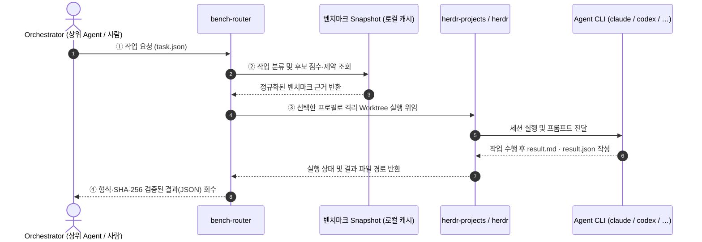
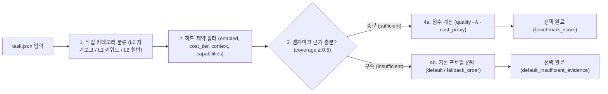

# bench-router


**작업에 가장 잘 맞는 AI 코딩 Agent를 공개 벤치마크 점수로 골라 대신 실행시켜 주는 라우터**입니다.

Claude Code, Codex 같은 CLI Agent는 잘하는 일이 서로 다르고 비용도 다릅니다. "이 버그 수정은 누구에게 맡기지?"를 매번 감으로 정하는 대신, bench-router는 작업 종류를 파악하고 공개 벤치마크(Artificial Analysis, LMArena, SWE-bench 등) 점수와 비용을 따져 Agent를 고릅니다. 고른 Agent에게 작업을 넘기고, 약속한 형식의 결과 파일이 돌아왔는지 확인한 뒤 돌려줍니다.

<p align="center">
  
</p>

---

## 한눈에 보기



1. **요청**: Orchestrator(작업을 나누고 위임을 결정하는 상위 Agent나 사람)가 할 일을 `task.json`에 적어 넘깁니다.
2. **선택**: bench-router가 작업 종류를 분류합니다(예: 저장소 코드 수정, 터미널 작업, 글쓰기). 조건에 맞는 Agent 프로필 가운데 그 종류의 벤치마크 점수가 높고 비용이 적당한 것을 고릅니다.
3. **실행**: 선택한 Agent를 [herdr](https://herdr.dev) 터미널 세션에서 실행합니다. Agent는 작업을 마치면 정해진 형식의 결과 파일을 씁니다.
4. **회수**: bench-router가 결과 파일의 형식과 무결성을 확인해 Orchestrator에게 돌려줍니다. 작업이 실제로 성공했는지는 Orchestrator가 판단합니다.

> [!NOTE]
> **오프라인 재현성과 로컬 Snapshot**
> 벤치마크 점수는 요청할 때마다 받지 않습니다. `refresh` 명령을 실행하면 점수를 받아 로컬 snapshot에 저장하고, 선택 단계는 이 파일만 읽습니다. 그래서 선택은 빠르고 네트워크 없이도 재현됩니다. 하루 한 번 정도 갱신하려면 별도로 [정기 실행을 예약](docs/reference.md#정기-실행-예시-설치하지-않음)해야 합니다. 자동 예약은 설치되지 않습니다.

---

## 역할 분담

| 누가 | 무엇을 |
|---|---|
| **Orchestrator** | 위임 여부 결정, 작업 분해, 결과 검토와 최종 판정 |
| **bench-router** | Agent 선택, 중복 실행 방지, 결과 형식 검사 |
| **herdr / herdr-projects** | Agent 프로세스 실행과 상태 관찰 |
| **Agent CLI** (`claude`, `codex`, …) | 실제 작업 수행 |

> [!TIP]
> bench-router는 일부러 얇게 만들었습니다. Agent를 직접 띄우거나 작업을 쪼개지 않으며, Python 3.11 이상에서 외부 패키지 없이 **표준 라이브러리만** 사용합니다.

---

## 핵심 개념과 선택 흐름



- **프로필(profile)**: "어떤 Agent CLI를, 어떤 모델과 설정으로 실행할지"의 묶음입니다. 예: `claude-opus-high` = Claude Code + Opus + high effort. 라우터는 프로필 단위로 고릅니다.
- **근거(evidence)**: 벤치마크 점수입니다. 작업 종류마다 참고하는 벤치마크와 가중치가 다릅니다. 예를 들어 저장소 코드 수정에는 SWE-bench와 AA coding 점수를 봅니다.
- **근거가 부족할 때**: 점수 데이터가 충분하지 않으면 무리하게 고르지 않고 미리 정한 기본 프로필로 갑니다.
- **결과 계약**: Agent는 `result.md`(사람이 읽는 보고)와 `result.json`(상태·해시 등 기계용 요약)을 남겨야 합니다. 라우터는 두 파일이 규칙대로 작성됐는지만 확인합니다. `completed`는 "결과를 형식대로 받았다"는 뜻이지 "작업이 성공했다"는 뜻이 아닙니다.
- **중복 전송 방지**: 같은 작업을 다시 요청해도 프롬프트를 두 번 보내지 않고, 이미 진행 중이거나 끝난 실행의 결과를 회수합니다.

<details>
<summary><b>📊 작업 카테고리별 벤치마크 가중치 매핑 보기 (<code>categories.toml</code>)</b></summary>

| 카테고리 | 설명 | 반영 벤치마크 및 가중치 |
|---|---|---|
| `coding_repo` | 저장소 코드 수정·디버깅 | SWE-bench Verified (`0.6`) + AA Coding (`0.4`) |
| `terminal_ops` | 셸·터미널·시스템 작업 | Terminal-Bench (`0.7`) + AA Coding (`0.3`) |
| `code_gen` | 단일 코드·알고리즘 생성 | AA Coding (`1.0`) |
| `webdev` | 프론트엔드·웹 UI 구현 | LMArena WebDev (`0.6`) + AA Coding (`0.4`) |
| `math_reasoning` | 수학·논리 추론 | LMArena Math (`1.0`) |
| `analysis` | 로그·데이터·설계 분석 | AA Intelligence (`0.6`) + LMArena Text (`0.4`) |
| `writing` | 문서·릴리스 노트·이메일 작성 | LMArena Text (`1.0`) |
| `vision_doc` | 이미지·문서 시각 이해 | LMArena Document (`0.5`) + LMArena Vision (`0.5`) |
| `general` | 일반 질의·번역·체크리스트 | AA Intelligence (`1.0`) |

</details>

---

## 빠르게 시작하기

Python 3.11 이상이 필요하며, bench-router 자체의 설치 단계는 없습니다. 저장소 루트에서 모듈로 실행합니다. 아래 예시는 Bash 기준입니다. 오프라인 평가와 데이터 갱신은 Linux/WSL2/Windows에서 사용할 수 있고, 실제 위임은 Linux/WSL2에서 준비하세요.

```bash
BR="python3 -m bench_router.cli"

# 1. 사용할 Agent 프로필 준비 (예시를 복사해 수정)
mkdir -p ~/.config/bench-router
cp examples/profiles.example.toml ~/.config/bench-router/profiles.toml
```

> [!IMPORTANT]
> 복사한 `profiles.toml`은 **모두 비활성인 placeholder**입니다. 다음 명령 전에 파일을 편집하세요.
> - 사용할 프로필의 `enabled`를 `true`로 바꾸고, `args`의 모델명과 `model_id`를 실제 사용할 값으로 설정합니다. 나머지 실행·모델 정보도 확인하고 `config_revision`을 갱신합니다.
> - `default_profile`과 `fallback_order`가 사용할 프로필의 `id`를 가리키게 합니다. 모든 프로필이 비활성이면 `no_eligible_profile`(종료 코드 13)이 됩니다.
> - 실제 위임용 `args`에는 모델·effort 설정만 넣습니다. 권한은 Projects의 `worker.access`를 따릅니다. [프로필 설정 예시](docs/reference.md#profilestoml)를 참고하세요.

```bash
# 2. 벤치마크 점수 받기 (Artificial Analysis API 키 필요, Free tier로 충분)
export ARTIFICIAL_ANALYSIS_API_KEY=...
$BR refresh
$BR status                                   # 데이터 상태 확인

# 3. 실행 없이 어떤 Agent가 선택되는지만 보기
cp examples/task.synthetic.json task.json    # "cwd"를 작업할 git 저장소의 절대 경로로 바꾸기
$BR route --task task.json --dry-run
$BR explain --task task.json                 # 선택 이유를 사람이 읽는 글로
```

`--dry-run`과 `explain`은 네트워크·herdr·파일 쓰기 없이 동작하므로 처음 살펴볼 때 쓰기 좋습니다. snapshot이 없어도 제약을 통과한 기본 프로필을 선택할 수 있어, API 키 없이 살펴보려면 2단계를 건너뛸 수 있습니다.

<details>
<summary><b>🔍 <code>explain</code> 및 결과 계약(<code>result.json</code>) 실제 입출력 예시 보기</b></summary>

#### 1) `explain --task task.json` 출력 예시
`priority: "balanced"`($\lambda=0.15$)에서 `claude-opus-high`(원점수 `0.904`, 고비용)와 `codex-sol-high`(원점수 `0.852`, 중비용)를 비교해 가성비가 높은 `codex-sol-high`(`score=0.777`)를 선택한 결과입니다.

```text
task synthetic-smoke-001 round 1 · policy 1.0 · snapshot 3fbd7f5524570e61ab661b75db55f15e1cc0b8f21d9fb6ff4017145db4dd4eac
classification: L0 {'analysis': 1.0} confidence=0.9
selected: codex-sol-high (benchmark_score)
candidates:
  codex-sol-high: score=0.777 quality=0.852 coverage=1.0 (sufficient) exact=0 cost_proxy=0.5
    aa_intelligence w=0.6 norm=0.86 raw=0.86 scope=model_proxy src=syn@r1 published=unknown
    arena_text w=0.4 norm=0.84 raw=0.84 scope=model_proxy src=syn@r1 published=unknown
  claude-opus-high: score=0.754 quality=0.904 coverage=1.0 (sufficient) exact=0 cost_proxy=1.0
    aa_intelligence w=0.6 norm=0.92 raw=0.92 scope=model_proxy src=syn@r1 published=unknown
    arena_text w=0.4 norm=0.88 raw=0.88 scope=model_proxy src=syn@r1 published=unknown
excluded:
assessment (registry 1, max_estimated_cost_usd=None):
  claude-opus-high: eligible
    constraint enabled pass enabled=True limit=True
    constraint cost_tier pass cost_tier=high limit=high
  codex-sol-high: eligible
    constraint enabled pass enabled=True limit=True
    constraint cost_tier pass cost_tier=medium limit=high
```

#### 2) Agent가 작성하고 라우터가 검증하는 `result.json` 계약 예시 ([`examples/result.synthetic.json`](examples/result.synthetic.json))
```json
{
  "schema_version": "1.0",
  "run_id": "r-synthetic-001",
  "nonce": "000102030405060708090a0b0c0d0e0f",
  "profile_fingerprint": "synthetic-profile-fingerprint-not-live",
  "status": "partial",
  "result_file": "result.synthetic.md",
  "result_sha256": "6d1c04f6c831ed0642ab3f24deeac58393cb26de555d13b4c53bbf9ad04d5858",
  "checks": [
    {
      "command": "actual API/herdr smoke",
      "outcome": "not_run",
      "notes": "형식 검증 예제이며 실제 실행 증거가 아님"
    }
  ]
}
```

</details>

실제 위임에는 Herdr, **herdr-projects 1.2.1**, 사용할 Agent CLI의 설치·로그인이 필요합니다. 먼저 [Projects 설정 안내](docs/projects.md)를 따라 준비하세요. task의 `cwd`는 **커밋이 하나 이상 있는 Git 저장소의 최상위**여야 합니다. Agent는 HEAD에서 만든 별도 worktree에서 작업하므로 미커밋 변경은 포함되지 않습니다. 작업 결과는 별도 브랜치에 남으며, 검토·병합은 사용자 또는 Orchestrator가 수행합니다.

```bash
# 4. 실제로 맡기기 (Linux/WSL2, herdr·herdr-projects·Agent CLI 준비 필요)
$BR --herdr-session work route --task task.json  # work는 실제 Herdr 세션 이름으로 변경
```

---

## 그 밖에 할 수 있는 일

- **Orchestrator가 직접 고르기**: `evaluate`로 모든 프로필의 점수와 제약 결과만 받고, 최종 선택은 Orchestrator가 해서 `route --selection`으로 실행합니다. → [docs/orchestrator.md](docs/orchestrator.md)
- **병렬 위임**: `parallel`로 여러 하위 작업을 동시에 맡기거나, 같은 작업을 여러 Agent에게 맡겨 결과를 비교합니다. Agent끼리 메모를 공유하거나 서로의 결과에 투표하게 할 수도 있습니다. → [상세 레퍼런스](docs/reference.md#병렬-위임과-협업-수준)
- **여러 Agent에서 Skill로 사용**: [`skills/bench-router`](skills/bench-router/SKILL.md)를 각 Agent의 Skill 디렉터리에 링크합니다. → [설정 방법](docs/reference.md#여러-agent에서-skill-사용)

---

## 현재 상태와 한계

| 정책 (20개 과제 × 2 프로필) | 성공 (hidden check 통과) | 성공률 | 중앙값 시간(s) | cost proxy 합 | API 환산 USD 합 ([`v1-cost.md`](eval/results/v1-cost.md)) | 성공 1건당 USD |
|---|---|---|---|---|---|---|
| **fixed-default** (`claude-opus-high`) | 20 / 20 | 100% | 36.2s | 20.0 | $4.69 | $0.234 |
| **low-cost-first** (`codex-sol-high`) | 19 / 20 | 95% | 77.5s | 10.0 | $1.33 | $0.070 |
| **bench-router** (`balanced`) | **20 / 20** | **100%** | **38.2s** | **19.0** | **$4.35** | **$0.217** |

- 오프라인 테스트와 AA·Arena 실데이터 수집을 검증했습니다. Claude Code·Codex 실제 위임과 20개 과제 비교는 이전 직접 Herdr 실행 경로에서 검증한 기록입니다. 현재 Projects 1.2.1 실행 경로는 fake CLI와 실제 Git worktree를 사용하는 오프라인 테스트로 검증했으며, 이전 live 결과가 현재 경로의 검증을 뜻하지는 않습니다.
- 최신 모델은 아직 벤치마크 데이터가 부족한 경우가 많습니다. 그래서 코딩 작업은 대개 기본 프로필이 선택됩니다. 20개 과제 비교 결과는 [eval/results/v1.md](eval/results/v1.md)에 있습니다.
- 비용 등급(`cost_tier`)은 실측 요금이 아니라 정책상 상대값입니다.

자세한 검증 기록과 한계 목록은 [상세 레퍼런스](docs/reference.md#검증-현황-2026-10-12)에 있습니다.

---

## 더 읽을거리

| 문서 | 내용 |
|---|---|
| [docs/reference.md](docs/reference.md) | 설정 파일 형식, 모든 명령과 종료 코드, 선택 공식, 데이터 수집, 결과 계약, 테스트 |
| [docs/projects.md](docs/projects.md) | live 실행 환경(herdr-projects) 준비 |
| [docs/orchestrator.md](docs/orchestrator.md) · [docs/routing-contracts.md](docs/routing-contracts.md) | Orchestrator 연동과 입출력 계약 |
| [00_START_HERE.md](00_START_HERE.md) ~ [06_VALIDATION_AND_OPEN_ITEMS.md](06_VALIDATION_AND_OPEN_ITEMS.md) | 원래 설계 문서 |
| [docs/implementation-status.md](docs/implementation-status.md) | 구현 진행 기록 |

## 라이선스와 출처

- Arena 데이터: LMArena `leaderboard-dataset`, CC BY 4.0.
- AA 데이터: Artificial Analysis. 공유하거나 표시할 때 출처를 밝혀야 합니다.
- API 키는 설정 디렉터리의 `env` 파일(권한 600)이나 환경변수에만 두고, 저장소에는 커밋하지 마세요.
