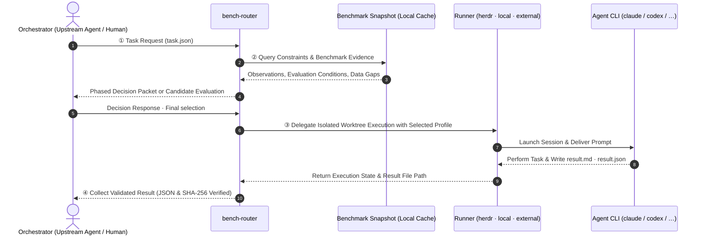
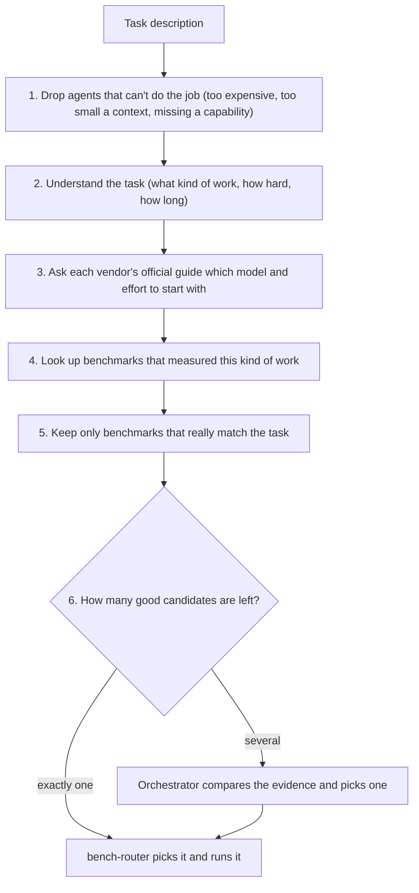

# bench-router


**A router that assists in selecting and executing AI Agent profiles tailored to delegated tasks, guided by official vendor documentation and public benchmarks.**

CLI agents such as Claude Code and Codex have distinct models, effort levels, and execution settings. bench-router checks task requirements and hard constraints, provides baseline configurations derived from official vendor guides, and supplies comparable benchmark evidence. When multiple viable candidates remain, the upstream Orchestrator makes the final selection. The selected Agent executes the task, and bench-router verifies that the returned result files adhere to the contract schema.

<p align="center">
  
</p>

---

## At a Glance



1. **Request**: The Orchestrator (the agent or person handing off work) describes the task in a small `task.json` file.
2. **Selection**: bench-router finds which of your configured agents fit the task and shows the evidence. If exactly one fits, it picks it; if several fit, the Orchestrator chooses.
3. **Execution**: The chosen agent works in its own copy of the repository (a Git worktree) and writes `result.md` and `result.json` when done. A *runner* launches it: [herdr](https://herdr.dev) with `herdr-projects` (used automatically when installed), a plain local subprocess (`local`), or your own executor such as an API or host Agent tool (`external`). Herdr is optional; see [Runners](#runners-herdr-optional).
4. **Collection**: bench-router checks that the result files are complete and untampered (SHA-256) and hands them back. Whether the work is actually correct is the Orchestrator's call, recorded with `bench-router feedback`.

> [!NOTE]
> **Offline Reproducibility and Local Snapshots**
> Benchmark scores are never fetched per request. Running `refresh` fetches scores and stores them in a local snapshot; subsequent routing and evaluation read strictly from this file. Selection is fast and completely reproducible offline. To refresh periodically (e.g. daily), [schedule a periodic job](docs/reference.md#periodic-execution-example-not-installed) independently. No automated scheduler is installed by the application.

---

## Division of Responsibilities

| Actor | Responsibilities |
|---|---|
| **Orchestrator** | Delegation decision, task decomposition, final profile selection based on evidence tables, result review, and final verdict |
| **bench-router** | Benchmark evidence query & aggregation, hard constraint filtering, duplicate execution prevention, result format validation |
| **Runner** (`herdr` / `local` / `external`) | Isolated Git worktree and Agent process execution. `herdr` (with `herdr-projects`) also handles permission waiting (`blocked`), state observation, and session recovery; `local` runs a one-shot CLI subprocess; with `external` the caller runs the agent and bench-router only validates the result |
| **Agent CLI** (`claude`, `codex`, `agy`, …) | Task execution and subagent result contract compliance (`result.md`, `result.json`) |

> [!TIP]
> With the `herdr` runner, bench-router uses `herdr` and `herdr-projects` to run tasks in isolated Git worktrees, handling permission approval pauses (`blocked`) or timeouts via `collect` observation, and `resume` reopens completed conversations. Without Herdr, the `local` and `external` runners keep the same receipts, concurrency limits and result contract. The core CLI relies **strictly on the standard library** for Python 3.11+, with `pyarrow` as an optional dependency for Arena refresh.

---

## Core Concepts and Selection Flow

bench-router does not add up benchmark scores into one magic number. It narrows your agents down in plain, checkable steps, and when the evidence does not clearly favor one agent, it says so and lets the Orchestrator decide.



### How Routing Works, Step by Step

1. **Drop agents that can't do the job.** Each agent you configure (a *profile*, e.g. Claude Code + Opus + high effort) has a cost tier, context size and capabilities. Any profile that breaks a hard limit in the task — too expensive, too small, can't write files, disabled, out of quota — is removed before anything else happens.
2. **Understand the task.** A small, cheap model reads the task description and answers a few fixed questions: what kind of work it is (coding, writing, math…), which language, whether the request is clear or vague, how much reasoning it needs, and how polished the result must be. Guesses from keywords or file extensions are only hints; the model can reject them.
3. **Ask each vendor's guide.** Anthropic, OpenAI and Google each publish advice on which model and effort level to use for which kind of work. bench-router quotes that advice word for word and asks, once per vendor, which starting point fits this task. Agents that match the advice become the main candidates; the vendor's other settings stay available as alternatives, and models the guides don't mention yet are kept but flagged as uncertain.
4. **Look up benchmarks.** bench-router searches its local benchmark copy for scores that measured this kind of work. Scores are only compared when they were measured the same way; a missing score is reported as missing, never as zero.
5. **Keep only benchmarks that really match.** The cheap model sees just the task and what each benchmark measures — not model names or scores, so it can't play favorites — and keeps only benchmarks that directly test what the task needs.
6. **Choose.** If exactly one good candidate is left and nothing is uncertain, bench-router picks it and runs it. If several are left, it does not guess by price or list order: it hands the side-by-side evidence to the Orchestrator, who picks one (`bench-router evaluate --format 3` → `bench-router select` → `bench-router route --selection`).

Steps 2, 3 and 5 need short answers from a model. bench-router does not call one on its own: it returns the question (exit code 17) and the caller answers it, automatically when you use the Agent Skill. You can also skip routing and name a profile yourself with `--profile`.

> [!TIP]
> **Routing stays cheap.** The questions go to a small model — `haiku` on Claude Code, `gpt-6-luna` on Codex, `flash` on Antigravity (the bundled `bench-decider` agent), or the optional Jev API — and contain only a task summary and short guide quotes, never your code or full benchmark tables. Vendor advice is asked once per vendor, not once per profile, and finished answers are reused when benchmark data is refreshed.

<details>
<summary><b>Implementation terms for each step</b></summary>

| Step | Stage / field names you will see in JSON output |
|---|---|
| 1 | hard constraints: `enabled`, `exclude_profiles`, `max_cost_tier`, `min_context_tokens`, `required_capabilities`, `local_only`, `max_estimated_cost_usd` |
| 2 | `analysis` stage: facets such as `task:repo_coding`, `lang:ko`; workload `clarity`, `reasoning`, `autonomy`, `deliverable`; keyword guesses are `rule_hints` |
| 3 | `guidance:<vendor>` stage; candidates are `documented`, `alternative` (needs `select --accept-provisional`) or `provisional` (`guidance_missing`) |
| 4 | snapshot `snapshot.json` + facet index `index.json`; exact protocol match or `model_proxy_comparison` |
| 5 | `benchmark` stage; a unit is `accepted` at relevance ≥ 0.8 tied to a core requirement |
| 6 | pending answer: `decision_required`; several candidates: `upstream_selection_required` (both exit 17); decision models configurable with `BENCH_ROUTER_DECISION_MODEL` |

</details>

For response formats and replay rules, see [Vendor-guided Routing Policy](docs/vendor-guided-routing.md).

<details>
<summary><b>🔖 Schema & Format Version Reference (<code>evaluate</code> / <code>select</code> / <code>route</code>)</b></summary>

- **Upstream Selection (`evaluate --format 3` → `select`)**: Produces selection schema `6.0` from candidate assessment schema `4.0` (`--format 3` is a CLI flag, distinct from JSON `schema_version`).
- **Automatic Single-Candidate Routing (`route`)**: Produces selection schema `5.0` when exactly one candidate is suitable with no pending conditions.
- **Explicit Override (`route --selection` `2.0` / `--profile`)**: Preserves manual overrides with explicit warnings. Historical vendor-guided schemas `3.0` and `4.0` are rejected and must be re-evaluated.

</details>

- **Profile**: A bundle defining "which Agent CLI to run, with which model and execution configuration". E.g., `claude-opus-high` = Claude Code + Opus + high effort. Routing selects at the profile granularity.
- **Evidence**: Observations from official guidelines and comparable benchmark evaluations. Benchmark effort, harness, missing data, and freshness are evaluated side-by-side; the current policy does not calculate weighted-sum composite scores.
- **Handling Data Gaps**: Provisional selections and uncertainties are explicitly recorded. Unlisted models are retained as candidates; if the decision agent abstains, execution is halted.
- **Result Contract**: Agents must output `result.md` (human-readable report) and `result.json` (machine-readable manifest with status and hashes). The router validates only structural compliance. `completed` denotes structural receipt compliance, not task success.
- **Deduplication**: Re-requesting an identical task recovers existing or in-progress receipts rather than dispatching a duplicate prompt.

<details>
<summary><b>📊 Informational Category Mappings in evaluate 1 & 2 (<code>categories.toml</code>, not used for automated selection)</b></summary>

| Category | Description | Benchmarks & Weights |
|---|---|---|
| `coding_repo` | Repository code modifications & debugging | SWE-bench Verified (`0.6`) + AA Coding (`0.4`) |
| `terminal_ops` | Shell, terminal, and system operations | Terminal-Bench (`0.7`) + AA Coding (`0.3`) |
| `code_gen` | Standalone script & algorithm generation | AA Coding (`1.0`) |
| `webdev` | Frontend & web UI implementation | LMArena WebDev (`0.6`) + AA Coding (`0.4`) |
| `math_reasoning` | Mathematical & logical reasoning | LMArena Math (`1.0`) |
| `analysis` | Log, data, and architecture analysis | AA Intelligence (`0.6`) + LMArena Text (`0.4`) |
| `writing` | Documentation, release notes, and email drafting | LMArena Text (`1.0`) |
| `vision_doc` | Image & document visual comprehension | LMArena Document (`0.5`) + LMArena Vision (`0.5`) |
| `general` | General queries, translations, checklists | AA Intelligence (`1.0`) |

</details>

---

## Setup and Installation Guide

Choose the integration mode that matches your workflow before configuring prerequisites:

| Workflow Mode | Best For | How Phased Decisions (`exit 17`) Are Handled | Entry Point |
|---|---|---|---|
| **Agent Skill Mode** *(Recommended)* | Using `bench-router` inside Claude Code, Codex, Antigravity, or Cursor | Automated by the host agent's native `bench-decider` subagent or `decide.py` helper | `mise run install` ([Step 2](#2-installing-as-a-skill-across-environments-npx-skills)) |
| **Direct CLI Mode** | Custom orchestrator scripts, CI pipelines, or manual benchmark inspection | Caller inspects JSON decision packets and passes `--decision-response` / `--selection` explicitly | `bench-router` ([Step 3](#3-quick-start-with-the-cli)) |

**Quick install (Python 3.11+, `uv`, `mise`, Node for `npx`):** the `bench-router` CLI is for you and your scripts; the Agent Skill is how Claude Code / Codex / Antigravity call it. Both share `~/.config/bench-router/` and `~/.cache/bench-router/`.

```bash
git clone https://github.com/hjlim4u/bench-router ~/bench-router && cd ~/bench-router
mise install && mise run setup   # profiles, aliases (bench-router init) and initial public data
mise run install                 # editable CLI (follows this clone) + global Agent Skill
# Now run from any project directory:
bench-router status
```

`mise` only wraps plain commands. With just `uv` and Node (e.g. `brew install uv node` on macOS/Linuxbrew, or the [uv installer](https://docs.astral.sh/uv/getting-started/installation/)), run the same steps directly from the clone:

```bash
uv tool install --force --editable "$PWD[arena]"                     # CLI on PATH, follows this clone
bench-router init && bench-router refresh --source mg                # = mise run setup
npx -y skills add "$PWD" -g -a claude-code codex antigravity -y       # global Agent Skill
```

After `git pull`, rerun `mise run install` (or the `uv tool install` and `npx skills add` lines): the editable CLI already follows the clone, but the Skill is a copy.
If `bench-router` is not on PATH, run `uv tool update-shell` and restart the shell.
`init` creates shared profiles and aliases, preserves existing files, and needs no network or Herdr.
Without a clone, install the CLI with `uv tool install 'bench-router[arena] @ git+https://github.com/hjlim4u/bench-router'` (rerun with `--force` to update) and the Skill as in [Step 2](#2-installing-as-a-skill-across-environments-npx-skills) B. Such installs carry the compiled facet index but not `wiki/`; `wiki compile` then needs `--vault /absolute/path/to/bench-router/wiki`.

### 1) Prerequisites Checklist

> [!TIP]
> **One-Stop Setup (`mise` or `uv`)**:
> Run `mise install && mise run setup` (or manually from the clone: `uv sync --extra arena && uv run bench-router init && uv run bench-router refresh --source mg`).
> This provisions the virtual environment, copies ready-to-run profiles and aliases for standard Claude / Codex / Gemini CLI models, and fetches initial public benchmark data in one command.

| Component | Item | Required? | Version & Setup Instructions |
|---|---|---|---|
| **Base Runtime** | **Python 3.11+** | **Required** | Core CLI uses the standard library only. Offline evaluation and data refresh supported on Linux / WSL2 / Windows |
| **Arena Refresh** | **`pyarrow`** | Required for Arena refresh | Handled automatically by `mise run setup` (or `uv sync --extra arena`) |
| **Router Config** | **`profiles.toml`** | **Required** | `~/.config/bench-router/profiles.toml` — Handled automatically by `mise run setup` (or copy from `examples/profiles.default.toml`) |
| **Router Config** | **`aliases.toml`** | Recommended | `~/.config/bench-router/aliases.toml` — Handled automatically by `mise run setup` (or copy from `examples/aliases.example.toml`) |
| **Live Dispatch** | **[Herdr](https://herdr.dev)** | Only for `--runner herdr` | **Linux / WSL2**, version **0.9.3+** (`herdr --version`, default `~/.local/bin/herdr`) |
| **Live Dispatch** | **`herdr-projects` plugin** | Only for `--runner herdr` | Version **>= 1.2.1** (`herdr plugin install eliasstravik/herdr-projects` → verify `herdr-projects version`). Its presence on PATH is what makes `auto` choose `herdr` |
| **Live Dispatch** | **Target Agent CLIs** | Required for `herdr` and `local` runs | Target CLIs (`claude`, `codex`, `agy`, etc.) installed, authenticated, and project directories trusted. Not needed by `external`, where your executor runs the agent |
| **Optional API Key** | **`ARTIFICIAL_ANALYSIS_API_KEY`** | Optional (for `refresh`) | For fetching Artificial Analysis scores ([free key](https://artificialanalysis.ai)). **LMArena and The Model Gap public data work without it** |
| **Optional API Key** | **`TYPESAFE_API_KEY` (`JEV_API_KEY`)** | Optional (Skill helper) | Optional external LLM decision API key for `decide.py` in Skill workflows. **Not needed if using the host agent's built-in `bench-decider` subagent** |

> [!NOTE]
> **Live Dispatch Environment Setup (Linux / WSL2)**
> `--dry-run`, `explain`, `evaluate`, and `evidence` require no Herdr installation, and live runs can also work without it: see [Runners](#runners-herdr-optional). Only the `herdr` runner (the `auto` choice when `herdr-projects` is on PATH) needs the following environment ([Details](docs/projects.md)):
> ```bash
> export PATH="$HOME/.local/bin:$PATH"
> herdr --version                                      # Confirm 0.9.3+ (https://herdr.dev)
> herdr plugin install eliasstravik/herdr-projects     # Install herdr-projects plugin
> herdr-projects version                               # Confirm 1.2.1
> ```

> [!TIP]
> **Securing API Credentials**: Store keys in `~/.config/bench-router/env` locked to `chmod 600`.
> ```bash
> mkdir -p ~/.config/bench-router && chmod 700 ~/.config/bench-router
> cat << 'EOF' > ~/.config/bench-router/env
> ARTIFICIAL_ANALYSIS_API_KEY="your-aa-api-key"
> # TYPESAFE_API_KEY="your-optional-jev-key"
> EOF
> chmod 600 ~/.config/bench-router/env
> ```

---

### 2) Installing as a Skill Across Environments (`npx skills`)

Install into supported coding agents via [`npx skills`](https://skills.sh/). The installer copies `skills/bench-router/` once into `~/.agents/skills/bench-router` (Codex and Antigravity read it there; Claude Code gets a symlink). The copy bundles the core engine (`bench_router/`, `index.json`, `guidelines.toml`) and the `bench-decider` definitions (`references/agents/`), so **any repository can route with it without the clone, `wiki/`, or a per-repo install**.

**Recommended layout**: keep one clone at a fixed path for setup, `refresh`, and `wiki compile`, and install the skill globally from it. Shared state lives outside the skill (`~/.config/bench-router/` for profiles, `~/.cache/bench-router/` for snapshots), so every repository sees the same profiles and data.

```bash
# A. Global installation from a fixed clone (recommended)
cd ~/bench-router && mise run setup       # profiles, aliases, initial data (once)
mise run install                          # editable CLI + npx skills add "$PWD" -g -a claude-code codex antigravity -y
# After `git pull`, rerun `mise run install`; the installed Skill copy is not linked to the clone.
# Keep data current with one scheduled `mise run refresh` in this clone (needs pyarrow from `mise run setup`).

# B. Without a clone (another machine)
npx skills add hjlim4u/bench-router -g -a claude-code codex antigravity -y
# Prepare shared configuration once, then fetch public benchmark data:
python3 ~/.agents/skills/bench-router/scripts/cli.py init
python3 ~/.agents/skills/bench-router/scripts/cli.py refresh --source mg
```

Delegated runs write state and worktrees to `<repo>/.bench-router/`; add `.bench-router/` to your global gitignore. When `bench-decider` is not discovered in a repository, the host reads the bundled definition and invokes an equivalent subagent ([decision.md](skills/bench-router/references/decision.md)).

---

### 3) Quick Start with the CLI

The examples use the installed `bench-router` command, which works from any directory. Without the CLI install, replace `bench-router` with `python3 -m bench_router.cli` from the clone root, or with `python3 <skill path>/scripts/cli.py`.

```bash
# 1. Prepare Agent profiles (copy ready-to-run default profiles, or use profiles discover)
bench-router init
```

`init` installs defaults matching `examples/profiles.default.toml`, with active profiles for standard Claude (`claude-opus-high`), Codex (`codex-sol-high`), and Gemini (`agy-argon-medium`). It never overwrites existing files. Alternatively, `bench-router profiles discover` scans locally available model/effort configurations from installed CLIs; replacing existing profiles requires `--force`.

> [!NOTE]
> If using `examples/profiles.example.toml` instead, note that it contains disabled placeholders (`enabled = false`) for custom setups. At least one profile must be enabled to prevent `no_eligible_profile` (exit 13). Live dispatch `args` must contain only model and effort flags; with the `herdr` runner, execution permissions follow Projects `worker.access`. Profiles for agents your own executor runs (API, host tool) can omit `kind`/`executable`/`args` under `schema_version = "2.0"`. See [Profile Configuration Reference](docs/reference.md#profilestoml).

<details>
<summary><b>📝 Minimal working <code>profiles.toml</code> configuration example</b></summary>

Modify `~/.config/bench-router/profiles.toml` as follows to test `--dry-run` and `explain` immediately:

```toml
schema_version = "1.0"

[[profile]]
id = "claude-opus-high"
enabled = true
kind = "claude"
executable = "claude"
args = ["--model", "claude-opus-5-5", "--effort", "high"]
model_id = "claude-opus-5-5"
harness_id = "claude-code"
reasoning_effort = "high"
config_revision = "2026-10-18"
cost_tier = "high"
inference_local = false
context_tokens = 200000
capabilities = ["filesystem_write"]

[[profile]]
id = "codex-sol-high"
enabled = true
kind = "codex"
executable = "codex"
args = ["-m", "gpt-6.1-sol", "-c", "model_reasoning_effort=\"high\""]
model_id = "gpt-6.1-sol"
harness_id = "codex-cli"
reasoning_effort = "high"
config_revision = "2026-10-18"
cost_tier = "medium"
inference_local = false
context_tokens = 200000
capabilities = ["filesystem_write"]
```

To map external benchmark model names to profile `model_id`, configure `~/.config/bench-router/aliases.toml` ([Documentation](docs/reference.md#aliasestoml)).

</details>

```bash
# 2. Refresh benchmark data
# - Public sources (mg, arena) can be retrieved without API credentials:
bench-router refresh --source mg  # The Model Gap public scores (no key needed)
# Requires installation with the [arena] extra shown above:
bench-router refresh --source arena  # Fetch Arena data (no key needed)

# - With an Artificial Analysis API key, refresh all sources at once:
set -a; [ -f ~/.config/bench-router/env ] && . ~/.config/bench-router/env; set +a
bench-router refresh  # Refreshes aa, arena, and mg
bench-router status   # Inspect data status and unmatched models

# 3. Inspect decision requests without execution (substitute cwd with current absolute path)
# Run this sample-generation command from the clone; elsewhere, provide your own task.json.
sed "s|/ABSOLUTE/PATH/TO/SMOKE_PROJECT|$PWD|" examples/task.synthetic.json > task.json
bench-router route --task task.json --host codex --dry-run  # decision_required: outputs decision packet, exit 17
bench-router explain --task task.json                       # Human-readable explanation of selection rationale
bench-router evidence --task task.json --format table       # Tabulate benchmark evidence matching task facets
```

`--dry-run`, `explain`, `evaluate`, and `evidence` run without network access, Herdr invocations, or file writes. Default dry-run outputs the decision packet for the current stage. Supply `{"stages": [...]}` containing completed responses via `--decision-response` to advance phases, and validate finalized `--selection` offline. Even without a snapshot, decision requests with recorded data gaps can still be produced. Weighted-sum automated selection and `--policy legacy` have been removed.

When multiple viable candidates remain, complete evaluation with the same response file and select via upstream policy. Extract only the inner `selection` object from `select` output:

```bash
bench-router evaluate --format 3 --task task.json --host codex --decision-response responses.json > assessment.json
bench-router select --assessment assessment.json --profile PROFILE --policy-id my-policy --policy-version 1 \
  --reason "Selection based on task requirements and candidate evidence" > selection-output.json
python3 -c 'import json; print(json.dumps(json.load(open("selection-output.json"))["selection"]))' > selection.json
bench-router route --task task.json --selection selection.json --dry-run
```

Use `assessment.json` only when `status: "ok"`. Accepting provisional or alternative candidates requires `select --accept-provisional`. Refer to [Upstream Integration](docs/orchestrator.md) for response construction.

<details>
<summary><b>🔍 Sample I/O: <code>task.json</code>, <code>explain</code>, <code>evidence</code> table, and <code>result.json</code></b></summary>

#### 1) Task Request `task.json` ([`examples/task.synthetic.json`](examples/task.synthetic.json))
```json
{
  "schema_version": "1.0",
  "task_id": "synthetic-smoke-001",
  "round": 1,
  "summary": "Create a short design note in the provided result directory and return the execution manifest.",
  "prompt": "Synthetic smoke test. Do not modify repository code; write a concise design note in the result directory complying with bench-router result contracts.",
  "cwd": "/ABSOLUTE/PATH/TO/SMOKE_PROJECT",
  "context_files": [],
  "constraints": {
    "max_cost_tier": "high",
    "min_context_tokens": 0,
    "local_only": false,
    "timeout_ms": 900000,
    "required_capabilities": ["filesystem_write"]
  },
  "priority": "balanced",
  "exclude_profiles": []
}
```

#### 2) `evidence --task task.json --format table` Output
Displays benchmark values, percentiles (`p90`), and recorded evaluation efforts (`max≠high`) per profile side-by-side without aggregate sums or artificial rankings:
```text
task synthetic-smoke-001 r1 · snapshot 3fbd7f55 · wiki 9a1c4e20
facets: agent_signal:bash_reliability(rule), lang:ko(rule), task:coding(orchestrator)
units (order = task type matches, then other facet matches, then profiles with a score; not a ranking):
 1 mg:swe_bench_verified [pass@1, verified meaningful_gap=True trust_grade=A] Gives an agent a real closed GitHub issue · task:coding · entities/benchmarks/mg/swe-bench-verified.md
 2 arena:text_style_control/coding [bt_score, verified] Coding prompts in Text Arena · task:coding · entities/benchmarks/lmarena-text.md
profiles (raw pPERCENTILE effort; effort≠profile effort means a different effort was measured; — none; * stale source):
 claude-opus-high (high): 1=0.72 p92 high · 2=1412 p95 high
 codex-sol-high (high): 1=0.69 p86 max≠high · 2=—
```

#### 3) Agent `result.json` Contract ([`examples/result.synthetic.json`](examples/result.synthetic.json))
```json
{
  "schema_version": "1.0",
  "run_id": "r-synthetic-001",
  "nonce": "000102030405060708090a0b0c0d0e0f",
  "profile_fingerprint": "synthetic-profile-fingerprint-not-live",
  "status": "partial",
  "result_file": "result.synthetic.md",
  "result_sha256": "6d1c04f6c831ed0642ab3f24deeac58393cb26de555d13b4c53bbf9ad04d5858",
  "checks": [
    {
      "command": "actual API/herdr smoke",
      "outcome": "not_run",
      "notes": "Format validation fixture, not live execution evidence"
    }
  ]
}
```

</details>

<a id="runners-herdr-optional"></a>
#### Runners (Herdr optional)

Live `route` and `parallel` run through a *runner*, chosen with the global `--runner auto|herdr|local|external` option (environment variable `BENCH_ROUTER_RUNNER`, default `auto`). `auto` uses `herdr` when `herdr-projects` is on PATH and `local` otherwise. The chosen runner is recorded in the run's receipt: `collect`, `stop` and re-running the same task/round follow the recorded runner, never the current flag, so a run is not resent through another runner. All runners share the receipts, the limit of 4 active runs, the workspace-overlap guard and the result contract.

| Runner | Needs | Runs | Notes |
|---|---|---|---|
| `herdr` | Herdr, `herdr-projects` >= 1.2.1, Agent CLI | Board agent (`interactive`) or Herdr pane (`headless`) | Permission waiting (`blocked`), `tell`, `resume`; see [Projects Setup Guide](docs/projects.md) |
| `local` | Agent CLI only | The profile's one-shot CLI (`claude -p`, `codex exec`, `agy -p`) as a local subprocess | `"execution": "headless"` tasks only; approvals are off; `stop` ends the process; no `tell`/`resume` |
| `external` | Nothing | Nothing: the router returns `handed_off` (exit 11) with an `invocation` | Your API/host-tool executor runs the agent and writes the result files into `invocation.result_dir`, then you `collect`. Caller-owned schema 2.0 profiles are eligible |

Task `cwd` must be the **root of a Git repository containing at least one commit**. Agents operate within dedicated worktrees branched from `HEAD`; uncommitted changes are not transferred. Results are preserved on dedicated branches, leaving review and merging to the human operator or Orchestrator. Details: [Runners reference](docs/reference.md#runners) and [execution boundary](docs/execution-boundary.md).

```bash
# 4. Live execution, collection, and verification (Linux/WSL2)
# Herdr runner (herdr, herdr-projects, and Agent CLIs installed):
bench-router --herdr-session work route --task task.json --selection selection.json  # 'work' is the herdr session name
# Without Herdr: a local one-shot CLI (task.json needs "execution": "headless") ...
bench-router --runner local route --task task.json --selection selection.json
# ... or hand the run to your own executor, which writes the results into invocation.result_dir
bench-router --runner external route --task task.json --selection selection.json     # → status handed_off + invocation
# Any runner: collect without resubmission, then record the verdict
bench-router collect --run-id <RUN_ID> --cwd "$PWD"                                  # Check state & collect without resubmission on timeout
bench-router feedback --run-id <RUN_ID> --cwd "$PWD" --outcome success               # Record Orchestrator's final verification verdict
```

---

## Additional Capabilities

- **Upstream Orchestrator Selection (`evaluate --format 3` → `select` → `route --selection`)**:
  - Reviews guideline suitability and evaluation evidence to record the final profile selection. Default `evaluate` (format 2) provides factual constraint lookup without selecting. → [docs/orchestrator.md](docs/orchestrator.md)
- **Per-Facet Benchmark Evidence Tables (`evidence` & `wiki facets`)**:
  - `evidence --task task.json --format table` displays benchmark observations matching detected or tagged facets (language, task type, agent signal) per profile without composite scores (differences in evaluated effort appear as `max≠high`).
  - Bundles a pre-compiled index (`bench_router/index.json`) for immediate use without wiki setup (run `wiki compile` only when modifying `wiki/` files).
  - Explicit task facets (math, creative, web search) not covered by automatic filename/extension heuristics can be tagged in `task.json` using vocabulary from `wiki facets`.
- **Post-Execution Session Resumption and Slot Management (`resume` & `coordination`)**:
  - With the `herdr` runner, completed agent terminal panes close automatically to release system resources. Reopen the conversation context using `resume --run-id <RUN_ID> --cwd <DIR>` (not available for `local`/`external` runs).
  - When failed or uncertain executions occupy shared concurrency slots (limit 4), verify process termination and release manually via `coordination release --key <KEY> --confirmed-stopped --note "..."`.
- **Parallel Dispatch (`parallel`)**:
  - Dispatches an explicit list of selections from group 2.0 into isolated worktrees. Repeated profiles run as separate workers, bounded by 8 tasks per group, 16 items per group, and `max_parallel` 1–4. Group 1.0 also uses vendor-guided selection without automatic fan-out across multiple candidates. → [Detailed Reference](docs/reference.md#parallel-dispatch-and-collaboration-levels)
- **Multi-Agent Skill Integration**:
  - Install [`skills/bench-router`](skills/bench-router/SKILL.md) across agents with `mise run install` (or `npx skills add hjlim4u/bench-router -g` without a clone). Enables automated decision workflows via the host's native `bench-decider` subagent or the optional `decide.py` API helper ([`decision.md`](skills/bench-router/references/decision.md)) from any project path. → [Skill Setup Guide](docs/reference.md#using-as-a-skill-across-multiple-agents)

---

## Testing and Operational Limits

The offline test suite runs with standard library tools (or `mise run test`) without requiring external services or network access:

```bash
python3 -m unittest test_p0 test_p1 test_p2 test_p3 test_coordination test_codeburn
```

- **Scope of Offline Tests**: Verifies facet filtering, hard constraint enforcement, guideline parsing, snapshot publishing, parallel worktree isolation, and receipt validation contracts using synthetic test doubles and isolated Git repositories.
- **Contract Verification vs. Task Correctness**: A `completed` status certifies that output files comply with the result contract schema and SHA-256 integrity. It does not certify substantive code correctness, which is judged and recorded by the upstream Orchestrator via `feedback`.
- **Cost Categories**: `cost_tier` represents policy-level relative groupings (low / medium / high), not empirical billing invoice amounts.
- **Historical Benchmarks & Logs**: Historical v1 evaluation comparisons and live dispatch tracking are archived in [Implementation Status](docs/implementation-status.md) and [eval/results/v1.md](eval/results/v1.md).

---

## Further Reading

| Document | Language | Contents |
|---|---|---|
| [docs/reference.md](docs/reference.md) | EN | Configuration formats, complete CLI reference, exit codes, evaluation pathways, data refresh, result contracts, test guides |
| [docs/vendor-guided-routing.md](docs/vendor-guided-routing.md) | EN | Vendor-guided routing policy (Policy 6), phased decision packets, and selection rules |
| [docs/projects.md](docs/projects.md) | EN | Live execution setup (herdr-projects 1.2.1), permissions, collection, and session resumption contracts |
| [docs/orchestrator.md](docs/orchestrator.md) · [docs/routing-contracts.md](docs/routing-contracts.md) | EN | Orchestrator integration (`evaluate`, `context.json`, `selection.json`) and I/O contracts |
| [docs/execution-boundary.md](docs/execution-boundary.md) | KO | Herdr-optional execution boundary: selection-only use, caller-owned profiles, local/external runners and auto detection (implemented), external availability (proposed) |
| [wiki/AGENTS.md](wiki/AGENTS.md) · [docs/benchmark-index-analysis.md](docs/benchmark-index-analysis.md) | EN | Benchmark wiki (`wiki/`) schema and multi-attribute index architecture |
| [skills/bench-router/SKILL.md](skills/bench-router/SKILL.md) · [decision.md](skills/bench-router/references/decision.md) | EN | Multi-agent Skill usage and lightweight decision workflows (`decide.py` / `bench-decider`) |
| [00_START_HERE.md](00_START_HERE.md) ~ [06_VALIDATION_AND_OPEN_ITEMS.md](06_VALIDATION_AND_OPEN_ITEMS.md) | EN | Architectural and design specification documents |
| [docs/implementation-status.md](docs/implementation-status.md) | EN | Implementation tracking and historical run logs |

## Licenses and Attribution

- Arena data: LMArena `leaderboard-dataset`, CC BY 4.0.
- The Model Gap data: `themodelgap.com`, CC BY 4.0.
- AA data: Artificial Analysis (`artificialanalysis.ai`). Attribution required when sharing or displaying.
- Store API credentials exclusively in `~/.config/bench-router/env` (permissions 600) or environment variables; never commit credentials to the repository.
