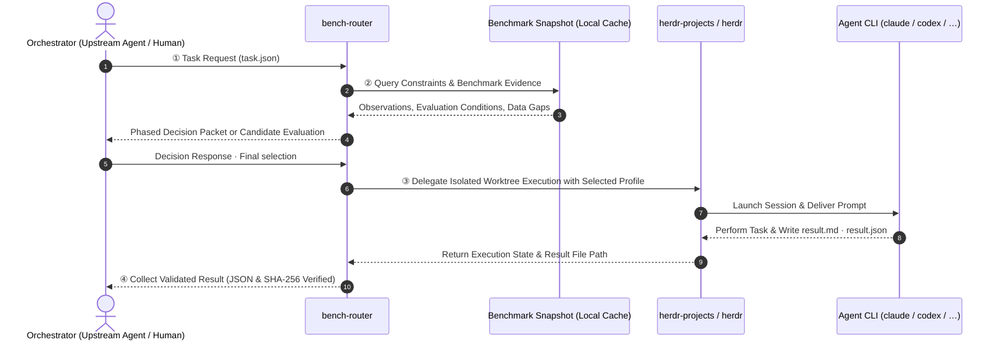
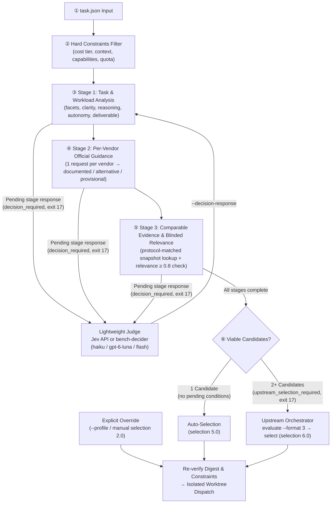

# bench-router


**A router that assists in selecting and executing AI Agent profiles tailored to delegated tasks, guided by official vendor documentation and public benchmarks.**

CLI agents such as Claude Code and Codex have distinct models, effort levels, and execution settings. bench-router checks task requirements and hard constraints, provides baseline configurations derived from official vendor guides, and supplies comparable benchmark evidence. When multiple viable candidates remain, the upstream Orchestrator makes the final selection. The selected Agent executes the task, and bench-router verifies that the returned result files adhere to the contract schema.

<p align="center">
  
</p>

---

## At a Glance



1. **Request**: The Orchestrator (an upstream Agent or human that decomposes tasks and decides delegation) submits work specifications in `task.json`.
2. **Selection**: Assesses candidate suitability via `analysis` and vendor-specific `guidance`, querying comparable evaluations. If multiple candidates remain, upstream selects via `evaluate --format 3` → `select` → `route --selection`. A single viable candidate with no unverified conditions can be selected automatically by the router.
3. **Execution**: Runs the selected Agent inside an isolated Git worktree within a [herdr](https://herdr.dev) and `herdr-projects` terminal session. Upon completion, the Agent writes result files adhering to the contract format.
4. **Collection**: bench-router validates the format and integrity (SHA-256) of result files and returns them to the Orchestrator. Substantive success is judged by the Orchestrator and recorded via `feedback`.

> [!NOTE]
> **Offline Reproducibility and Local Snapshots**
> Benchmark scores are never fetched per request. Running `refresh` fetches scores and stores them in a local snapshot; subsequent routing and evaluation read strictly from this file. Selection is fast and completely reproducible offline. To refresh periodically (e.g. daily), [schedule a periodic job](docs/reference.md#정기-실행-예시-설치하지-않음) independently. No automated scheduler is installed by the application.

---

## Division of Responsibilities

| Actor | Responsibilities |
|---|---|
| **Orchestrator** | Delegation decision, task decomposition, final profile selection based on evidence tables, result review, and final verdict |
| **bench-router** | Benchmark evidence query & aggregation, hard constraint filtering, duplicate execution prevention, result format validation |
| **herdr / herdr-projects** | Isolated Git worktree creation, Agent process execution, permission waiting (`blocked`), state observation, and session recovery |
| **Agent CLI** (`claude`, `codex`, `agy`, …) | Task execution and subagent result contract compliance (`result.md`, `result.json`) |

> [!TIP]
> bench-router uses `herdr` and `herdr-projects` to run tasks in isolated Git worktrees, handling permission approval pauses (`blocked`) or timeouts via `collect` observation. `resume` reopens completed conversations. The core CLI relies **strictly on the standard library** for Python 3.11+, with `pyarrow` as an optional dependency for Arena refresh.

---

## Core Concepts and Selection Flow

The default selection policy is **Vendor-guided Selection (`vendor-guided`, Policy 6)**. Instead of collapsing heterogeneous benchmarks into an arbitrary weighted sum, `bench-router` narrows and evaluates candidates through a transparent **6-step pipeline**:



### Step-by-Step Routing Walkthrough

1. **Step 1 — Hard Constraints Filtering (`routing.CONSTRAINTS`)**:
   - Filters `profiles.toml` against non-negotiable requirements: `enabled`, `exclude_profiles`, `max_cost_tier`, `min_context_tokens`, `required_capabilities`, `local_only`, `max_estimated_cost_usd` (when `context.json` is supplied), and live CLI/quota availability. Candidates failing any hard constraint are immediately excluded.
2. **Step 2 — Semantic Task & Workload Analysis (`analysis` stage)**:
   - Evaluates the task `summary` and `prompt` to confirm task facets (e.g., `task:repo_coding`, `lang:ko`) and classify four workload dimensions: **`clarity`** (`clear` / `ambiguous`), **`reasoning`** (`bounded` / `multistep` / `demanding`), **`autonomy`** (`short` / `extended`), and **`deliverable`** (`revisable` / `finished` / `exacting`).
   - Heuristic keyword and file-extension `rule_hints` are verified and can be rejected by semantic analysis so false-positive rules never pollute benchmark retrieval.
3. **Step 3 — Per-Vendor Official Guidance (`guidance:<vendor>` stage)**:
   - Sends **one request per eligible vendor** (Anthropic, OpenAI, Google) containing verbatim excerpts from that vendor's official model & effort documentation (`bench_router/guidelines.toml`).
   - Selects the documented baseline `(model, effort)` starting point for the task's workload:
     - **`documented`**: Profiles matching the vendor's recommended starting point (eligible for direct comparison and auto-routing).
     - **`alternative`**: Other profiles from the same vendor (e.g., higher-cost escalations meant only for post-evaluation use). Excluded from auto-selection, but selectable by the Orchestrator via `select --accept-provisional`.
     - **`provisional`**: Models not yet listed in official vendor guides (`guidance_missing`), retained with explicit uncertainty warnings.
4. **Step 4 — Comparable Benchmark Evidence Lookup**:
   - Queries the local snapshot (`snapshot.json`) and pre-compiled facet index (`index.json`) for benchmark units matching the confirmed task facets.
   - Compares fresh observations strictly when measurement protocols match (`suite`, `version`, `subset`, `metric`, `evaluation_harness`, `reasoning_effort`), or records `model_proxy_comparison` when comparing base models within the same cohort. Missing scores are never treated as zero, and disparate cohorts are never merged into synthetic rankings.
5. **Step 5 — Blinded Benchmark Relevance Verification (`benchmark` stage)**:
   - When comparable benchmark units exist across candidates, the router issues a `benchmark` decision request containing only the task requirements and each benchmark unit's measurement description—**blinding model names, profile IDs, and raw scores** to prevent judge bias.
   - Only units judged directly relevant to a core task requirement (`score ≥ 0.8`) are marked `accepted: true`.
6. **Step 6 — Final Selection & Isolated Worktree Dispatch**:
   - **Pending phase responses (`exit 17`)**: If any stage above still needs an answer, the CLI outputs `decision_required` with the bounded question packet until completed via `--decision-response`.
   - **Single viable candidate**: When exactly one `documented` candidate remains with no unverified conditions, `bench-router` automatically produces a `selection 5.0` record and dispatches the worker.
   - **Multiple viable candidates (`exit 17`)**: Rather than guessing by cost tier or arbitrary fallback order, the router returns `upstream_selection_required`. The Orchestrator inspects the side-by-side evidence (`evaluate --format 3`), binds its final choice (`select` → `selection 6.0`), and dispatches (`route --selection`) into an isolated `herdr-projects` Git worktree.

> [!TIP]
> **Token Efficiency via Lightweight Decision Models (`Jev` & `bench-decider`)**
> Routing should never cost as much as executing the task itself. `bench-router` maximizes token efficiency during the semantic evaluation stages (`analysis`, `guidance`, `benchmark`) through three design choices:
> 1. **Dedicated Low-Cost Judge Models**: Phased decisions are delegated to **Jev** (`jev-1.13.0`, a fast bounded decision endpoint via `decide.py`) or the host CLI's native **`bench-decider` subagent** pinned to each vendor's lightweight tier (**`haiku`** on Claude Code, **`gpt-6-luna`** on Codex, **`flash`** on Antigravity; customizable via `BENCH_ROUTER_DECISION_MODEL`).
> 2. **Per-Vendor Batching**: `guidance` is evaluated **once per vendor** rather than once per profile, cutting decision calls and token volume by ~75–80% on multi-profile setups.
> 3. **Minimal Context & Digest Caching**: Decision packets send only structured task summaries, facet criteria, and short verbatim guide rows—never repository file contents, full wiki pages, or raw score tables. Stage digests are cached so snapshot refreshes never re-trigger task analysis.

For detailed response schemas and replay rules, see [Vendor-guided Routing Policy](docs/vendor-guided-routing.md).

<details>
<summary><b>🔖 Schema & Format Version Reference (<code>evaluate</code> / <code>select</code> / <code>route</code>)</b></summary>

- **Upstream Selection (`evaluate --format 3` → `select`)**: Produces selection schema `6.0` from candidate assessment schema `4.0` (`--format 3` is a CLI flag, distinct from JSON `schema_version`).
- **Automatic Single-Candidate Routing (`route`)**: Produces selection schema `5.0` when exactly one candidate is suitable with no pending conditions.
- **Explicit Override (`route --selection` `2.0` / `--profile`)**: Preserves manual overrides with explicit warnings. Historical vendor-guided schemas `3.0` and `4.0` are rejected and must be re-evaluated.

</details>

- **Profile**: A bundle defining "which Agent CLI to run, with which model and execution configuration". E.g., `claude-opus-high` = Claude Code + Opus + high effort. Routing selects at the profile granularity.
- **Evidence**: Observations from official guidelines and comparable benchmark evaluations. Benchmark effort, harness, missing data, and freshness are evaluated side-by-side; the current policy does not calculate weighted-sum composite scores.
- **Handling Data Gaps**: Provisional selections and uncertainties are explicitly recorded. Unlisted models are retained as candidates; if the decision agent abstains, execution is halted.
- **Result Contract**: Agents must output `result.md` (human-readable report) and `result.json` (machine-readable manifest with status and hashes). The router validates only structural compliance. `completed` denotes structural receipt compliance, not task success.
- **Deduplication**: Re-requesting an identical task recovers existing or in-progress receipts rather than dispatching a duplicate prompt.

<details>
<summary><b>📊 Informational Category Mappings in evaluate 1 & 2 (<code>categories.toml</code>, not used for automated selection)</b></summary>

| Category | Description | Benchmarks & Weights |
|---|---|---|
| `coding_repo` | Repository code modifications & debugging | SWE-bench Verified (`0.6`) + AA Coding (`0.4`) |
| `terminal_ops` | Shell, terminal, and system operations | Terminal-Bench (`0.7`) + AA Coding (`0.3`) |
| `code_gen` | Standalone script & algorithm generation | AA Coding (`1.0`) |
| `webdev` | Frontend & web UI implementation | LMArena WebDev (`0.6`) + AA Coding (`0.4`) |
| `math_reasoning` | Mathematical & logical reasoning | LMArena Math (`1.0`) |
| `analysis` | Log, data, and architecture analysis | AA Intelligence (`0.6`) + LMArena Text (`0.4`) |
| `writing` | Documentation, release notes, and email drafting | LMArena Text (`1.0`) |
| `vision_doc` | Image & document visual comprehension | LMArena Document (`0.5`) + LMArena Vision (`0.5`) |
| `general` | General queries, translations, checklists | AA Intelligence (`1.0`) |

</details>

---

## Setup and Installation Guide

Choose the integration mode that matches your workflow before configuring prerequisites:

| Workflow Mode | Best For | How Phased Decisions (`exit 17`) Are Handled | Entry Point |
|---|---|---|---|
| **Agent Skill Mode** *(Recommended)* | Using `bench-router` inside Claude Code, Codex, Antigravity, or Cursor | Automated by the host agent's native `bench-decider` subagent or `decide.py` helper | `npx skills add hjlim4u/bench-router -g` ([Step 2](#2-installing-as-a-skill-across-environments-npx-skills)) |
| **Direct CLI Mode** | Custom orchestrator scripts, CI pipelines, or manual benchmark inspection | Caller inspects JSON decision packets and passes `--decision-response` / `--selection` explicitly | `python3 -m bench_router.cli` ([Step 3](#3-quick-start-with-the-cli)) |

### 1) Prerequisites Checklist

> [!TIP]
> **One-Stop Setup (`mise` or `uv`)**:
> Run `mise install && mise run setup` (or manually: `uv sync --extra arena && mkdir -p ~/.config/bench-router && cp -n examples/profiles.default.toml ~/.config/bench-router/profiles.toml && cp -n examples/aliases.example.toml ~/.config/bench-router/aliases.toml`).
> This provisions the virtual environment, copies ready-to-run profiles and aliases for standard Claude / Codex / Gemini CLI models, and fetches initial public benchmark data in one command.

| Component | Item | Required? | Version & Setup Instructions |
|---|---|---|---|
| **Base Runtime** | **Python 3.11+** | **Required** | Core CLI uses the standard library only. Offline evaluation and data refresh supported on Linux / WSL2 / Windows |
| **Arena Refresh** | **`pyarrow`** | Required for Arena refresh | Handled automatically by `mise run setup` (or `uv sync --extra arena`) |
| **Router Config** | **`profiles.toml`** | **Required** | `~/.config/bench-router/profiles.toml` — Handled automatically by `mise run setup` (or copy from `examples/profiles.default.toml`) |
| **Router Config** | **`aliases.toml`** | Recommended | `~/.config/bench-router/aliases.toml` — Handled automatically by `mise run setup` (or copy from `examples/aliases.example.toml`) |
| **Live Dispatch** | **[Herdr](https://herdr.dev)** | Required for live runs | **Linux / WSL2**, version **0.9.3+** (`herdr --version`, default `~/.local/bin/herdr`) |
| **Live Dispatch** | **`herdr-projects` plugin** | Required for live runs | Pinned to version **1.2.1** (`herdr plugin install eliasstravik/herdr-projects` → verify `herdr-projects version`) |
| **Live Dispatch** | **Target Agent CLIs** | Required for live runs | Target CLIs (`claude`, `codex`, `agy`, etc.) installed, authenticated, and project directories trusted |
| **Optional API Key** | **`ARTIFICIAL_ANALYSIS_API_KEY`** | Optional (for `refresh`) | For fetching Artificial Analysis scores ([free key](https://artificialanalysis.ai)). **LMArena and The Model Gap public data work without it** |
| **Optional API Key** | **`TYPESAFE_API_KEY` (`JEV_API_KEY`)** | Optional (Skill helper) | Optional external LLM decision API key for `decide.py` in Skill workflows. **Not needed if using the host agent's built-in `bench-decider` subagent** |

> [!NOTE]
> **Live Dispatch Environment Setup (Linux / WSL2)**
> `--dry-run`, `explain`, `evaluate`, and `evidence` require no Herdr installation. Launching live agents (`route`, `parallel`) requires the following environment ([Details](docs/projects.md)):
> ```bash
> export PATH="$HOME/.local/bin:$PATH"
> herdr --version                                      # Confirm 0.9.3+ (https://herdr.dev)
> herdr plugin install eliasstravik/herdr-projects     # Install herdr-projects plugin
> herdr-projects version                               # Confirm 1.2.1
> ```

> [!TIP]
> **Securing API Credentials**: Store keys in `~/.config/bench-router/env` locked to `chmod 600`.
> ```bash
> mkdir -p ~/.config/bench-router && chmod 700 ~/.config/bench-router
> cat << 'EOF' > ~/.config/bench-router/env
> ARTIFICIAL_ANALYSIS_API_KEY="your-aa-api-key"
> # TYPESAFE_API_KEY="your-optional-jev-key"
> EOF
> chmod 600 ~/.config/bench-router/env
> ```

---

### 2) Installing as a Skill Across Environments (`npx skills`)

Install into supported coding agents or project repositories via [`npx skills`](https://skills.sh/). The `skills/bench-router/` directory bundles the complete core engine (`bench_router/`, `index.json`, `guidelines.toml`), operating **autonomously without requiring the original repository or wiki directories**.

```bash
# A. Global installation for all projects on this machine (recommended)
npx skills add hjlim4u/bench-router -g
# (Or from a local clone: npx skills add . -g)

# B. Install locally into a specific project (/path/to/my-app)
cd /path/to/my-app && npx skills add hjlim4u/bench-router
```

---

### 3) Quick Start with the CLI

Run directly from the repository root (or via `scripts/cli.py` in an installed Skill).

```bash
BR="python3 -m bench_router.cli"

# 1. Prepare Agent profiles (copy ready-to-run default profiles, or use profiles discover)
mkdir -p ~/.config/bench-router
cp -n examples/profiles.default.toml ~/.config/bench-router/profiles.toml
cp -n examples/aliases.example.toml ~/.config/bench-router/aliases.toml
```

`examples/profiles.default.toml` comes pre-configured with active profiles for standard Claude (`claude-opus-high`), Codex (`codex-sol-high`), and Gemini (`agy-argon-medium`). Alternatively, `$BR profiles discover` scans locally available model/effort configurations from installed CLIs. Existing configurations are never overwritten without `--force`.

> [!NOTE]
> If using `examples/profiles.example.toml` instead, note that it contains disabled placeholders (`enabled = false`) for custom setups. At least one profile must be enabled to prevent `no_eligible_profile` (exit 13). Live dispatch `args` must contain only model and effort flags; execution permissions follow Projects `worker.access`. See [Profile Configuration Reference](docs/reference.md#profilestoml).

<details>
<summary><b>📝 Minimal working <code>profiles.toml</code> configuration example</b></summary>

Modify `~/.config/bench-router/profiles.toml` as follows to test `--dry-run` and `explain` immediately:

```toml
schema_version = "1.0"

[[profile]]
id = "claude-opus-high"
enabled = true
kind = "claude"
executable = "claude"
args = ["--model", "claude-opus-5-5", "--effort", "high"]
model_id = "claude-opus-5-5"
harness_id = "claude-code"
reasoning_effort = "high"
config_revision = "2026-10-18"
cost_tier = "high"
inference_local = false
context_tokens = 200000
capabilities = ["filesystem_write"]

[[profile]]
id = "codex-sol-high"
enabled = true
kind = "codex"
executable = "codex"
args = ["-m", "gpt-6.1-sol", "-c", "model_reasoning_effort=\"high\""]
model_id = "gpt-6.1-sol"
harness_id = "codex-cli"
reasoning_effort = "high"
config_revision = "2026-10-18"
cost_tier = "medium"
inference_local = false
context_tokens = 200000
capabilities = ["filesystem_write"]
```

To map external benchmark model names to profile `model_id`, configure `~/.config/bench-router/aliases.toml` ([Documentation](docs/reference.md#aliasestoml)).

</details>

```bash
# 2. Refresh benchmark data
# - Public sources (mg, arena) can be retrieved without API credentials:
$BR refresh --source mg                                    # The Model Gap public scores (no key needed)
uv sync --extra arena                                     # Set up Arena Parquet decoder
uv run python -m bench_router.cli refresh --source arena # Fetch Arena data (no key needed)

# - With an Artificial Analysis API key, refresh all sources at once:
set -a; [ -f ~/.config/bench-router/env ] && . ~/.config/bench-router/env; set +a
uv run python -m bench_router.cli refresh                 # Refreshes aa, arena, and mg
$BR status                                                # Inspect data status and unmatched models

# 3. Inspect decision requests without execution (substitute cwd with current absolute path)
sed "s|/ABSOLUTE/PATH/TO/SMOKE_PROJECT|$PWD|" examples/task.synthetic.json > task.json
$BR route --task task.json --host codex --dry-run         # decision_required: outputs decision packet, exit 17
$BR explain --task task.json                              # Human-readable explanation of selection rationale
$BR evidence --task task.json --format table              # Tabulate benchmark evidence matching task facets
```

`--dry-run`, `explain`, `evaluate`, and `evidence` run without network access, Herdr invocations, or file writes. Default dry-run outputs the decision packet for the current stage. Supply `{"stages": [...]}` containing completed responses via `--decision-response` to advance phases, and validate finalized `--selection` offline. Even without a snapshot, decision requests with recorded data gaps can still be produced. Weighted-sum automated selection and `--policy legacy` have been removed.

When multiple viable candidates remain, complete evaluation with the same response file and select via upstream policy. Extract only the inner `selection` object from `select` output:

```bash
$BR evaluate --format 3 --task task.json --host codex --decision-response responses.json > assessment.json
$BR select --assessment assessment.json --profile PROFILE --policy-id my-policy --policy-version 1 \
  --reason "Selection based on task requirements and candidate evidence" > selection-output.json
python3 -c 'import json; print(json.dumps(json.load(open("selection-output.json"))["selection"]))' > selection.json
$BR route --task task.json --selection selection.json --dry-run
```

Use `assessment.json` only when `status: "ok"`. Accepting provisional or alternative candidates requires `select --accept-provisional`. Refer to [Upstream Integration](docs/orchestrator.md) for response construction.

<details>
<summary><b>🔍 Sample I/O: <code>task.json</code>, <code>explain</code>, <code>evidence</code> table, and <code>result.json</code></b></summary>

#### 1) Task Request `task.json` ([`examples/task.synthetic.json`](examples/task.synthetic.json))
```json
{
  "schema_version": "1.0",
  "task_id": "synthetic-smoke-001",
  "round": 1,
  "summary": "Create a short design note in the provided result directory and return the execution manifest.",
  "prompt": "Synthetic smoke test. Do not modify repository code; write a concise design note in the result directory complying with bench-router result contracts.",
  "cwd": "/ABSOLUTE/PATH/TO/SMOKE_PROJECT",
  "context_files": [],
  "constraints": {
    "max_cost_tier": "high",
    "min_context_tokens": 0,
    "local_only": false,
    "timeout_ms": 900000,
    "required_capabilities": ["filesystem_write"]
  },
  "priority": "balanced",
  "exclude_profiles": []
}
```

#### 2) `evidence --task task.json --format table` Output
Displays benchmark values, percentiles (`p90`), and recorded evaluation efforts (`max≠high`) per profile side-by-side without aggregate sums or artificial rankings:
```text
task synthetic-smoke-001 r1 · snapshot 3fbd7f55 · wiki 9a1c4e20
facets: agent_signal:bash_reliability(rule), lang:ko(rule), task:coding(orchestrator)
units (order = task type matches, then other facet matches, then profiles with a score; not a ranking):
 1 mg:swe_bench_verified [pass@1, verified meaningful_gap=True trust_grade=A] Gives an agent a real closed GitHub issue · task:coding · entities/benchmarks/mg/swe-bench-verified.md
 2 arena:text_style_control/coding [bt_score, verified] Coding prompts in Text Arena · task:coding · entities/benchmarks/lmarena-text.md
profiles (raw pPERCENTILE effort; effort≠profile effort means a different effort was measured; — none; * stale source):
 claude-opus-high (high): 1=0.72 p92 high · 2=1412 p95 high
 codex-sol-high (high): 1=0.69 p86 max≠high · 2=—
```

#### 3) Agent `result.json` Contract ([`examples/result.synthetic.json`](examples/result.synthetic.json))
```json
{
  "schema_version": "1.0",
  "run_id": "r-synthetic-001",
  "nonce": "000102030405060708090a0b0c0d0e0f",
  "profile_fingerprint": "synthetic-profile-fingerprint-not-live",
  "status": "partial",
  "result_file": "result.synthetic.md",
  "result_sha256": "6d1c04f6c831ed0642ab3f24deeac58393cb26de555d13b4c53bbf9ad04d5858",
  "checks": [
    {
      "command": "actual API/herdr smoke",
      "outcome": "not_run",
      "notes": "Format validation fixture, not live execution evidence"
    }
  ]
}
```

</details>

Live delegation requires Herdr, **herdr-projects 1.2.1**, and authenticated Agent CLIs. Complete the [Projects Setup Guide](docs/projects.md) first. Task `cwd` must be the **root of a Git repository containing at least one commit**. Agents operate within dedicated worktrees branched from `HEAD`; uncommitted changes are not transferred. Results are preserved on dedicated branches, leaving review and merging to the human operator or Orchestrator.

```bash
# 4. Live execution, collection, and verification (Linux/WSL2 with herdr, herdr-projects, and Agent CLIs)
$BR --herdr-session work route --task task.json --selection selection.json # 'work' is the herdr session name
$BR --herdr-session work collect --run-id <RUN_ID> --cwd "$PWD"          # Check state & collect without resubmission on timeout
$BR feedback --run-id <RUN_ID> --cwd "$PWD" --outcome success            # Record Orchestrator's final verification verdict
```

---

## Additional Capabilities

- **Upstream Orchestrator Selection (`evaluate --format 3` → `select` → `route --selection`)**:
  - Reviews guideline suitability and evaluation evidence to record the final profile selection. Default `evaluate` (format 2) provides factual constraint lookup without selecting. → [docs/orchestrator.md](docs/orchestrator.md)
- **Per-Facet Benchmark Evidence Tables (`evidence` & `wiki facets`)**:
  - `evidence --task task.json --format table` displays benchmark observations matching detected or tagged facets (language, task type, agent signal) per profile without composite scores (differences in evaluated effort appear as `max≠high`).
  - Bundles a pre-compiled index (`bench_router/index.json`) for immediate use without wiki setup (run `wiki compile` only when modifying `wiki/` files).
  - Explicit task facets (math, creative, web search) not covered by automatic filename/extension heuristics can be tagged in `task.json` using vocabulary from `wiki facets`.
- **Post-Execution Session Resumption and Slot Management (`resume` & `coordination`)**:
  - Completed agent terminal panes close automatically to release system resources. Reopen the conversation context using `resume --run-id <RUN_ID> --cwd <DIR>`.
  - When failed or uncertain executions occupy shared concurrency slots (limit 4), verify process termination and release manually via `coordination release --key <KEY> --confirmed-stopped --note "..."`.
- **Parallel Dispatch (`parallel`)**:
  - Dispatches an explicit list of selections from group 2.0 into isolated worktrees. Repeated profiles run as separate workers, bounded by 8 tasks per group, 16 items per group, and `max_parallel` 1–4. Group 1.0 also uses vendor-guided selection without automatic fan-out across multiple candidates. → [Detailed Reference](docs/reference.md#parallel-dispatch-and-collaboration-levels)
- **Multi-Agent Skill Integration**:
  - Install [`skills/bench-router`](skills/bench-router/SKILL.md) across all agents with `npx skills add hjlim4u/bench-router -g`. Enables automated decision workflows via the host's native `bench-decider` subagent or the optional `decide.py` API helper ([`decision.md`](skills/bench-router/references/decision.md)) from any project path. → [Skill Setup Guide](docs/reference.md#using-as-a-skill-across-multiple-agents)

---

## Testing and Operational Limits

The offline test suite runs with standard library tools (or `mise run test`) without requiring external services or network access:

```bash
python3 -m unittest test_p0 test_p1 test_p2 test_p3 test_coordination test_codeburn
```

- **Scope of Offline Tests**: Verifies facet filtering, hard constraint enforcement, guideline parsing, snapshot publishing, parallel worktree isolation, and receipt validation contracts using synthetic test doubles and isolated Git repositories.
- **Contract Verification vs. Task Correctness**: A `completed` status certifies that output files comply with the result contract schema and SHA-256 integrity. It does not certify substantive code correctness, which is judged and recorded by the upstream Orchestrator via `feedback`.
- **Cost Categories**: `cost_tier` represents policy-level relative groupings (low / medium / high), not empirical billing invoice amounts.
- **Historical Benchmarks & Logs**: Historical v1 evaluation comparisons and live dispatch tracking are archived in [Implementation Status](docs/implementation-status.md) and [eval/results/v1.md](eval/results/v1.md).

---

## Further Reading

| Document | Language | Contents |
|---|---|---|
| [docs/reference.md](docs/reference.md) | EN | Configuration formats, complete CLI reference, exit codes, evaluation pathways, data refresh, result contracts, test guides |
| [docs/vendor-guided-routing.md](docs/vendor-guided-routing.md) | EN | Vendor-guided routing policy (Policy 6), phased decision packets, and selection rules |
| [docs/projects.md](docs/projects.md) | EN | Live execution setup (herdr-projects 1.2.1), permissions, collection, and session resumption contracts |
| [docs/orchestrator.md](docs/orchestrator.md) · [docs/routing-contracts.md](docs/routing-contracts.md) | EN | Orchestrator integration (`evaluate`, `context.json`, `selection.json`) and I/O contracts |
| [wiki/AGENTS.md](wiki/AGENTS.md) · [docs/benchmark-index-analysis.md](docs/benchmark-index-analysis.md) | EN | Benchmark wiki (`wiki/`) schema and multi-attribute index architecture |
| [skills/bench-router/SKILL.md](skills/bench-router/SKILL.md) · [decision.md](skills/bench-router/references/decision.md) | EN | Multi-agent Skill usage and lightweight decision workflows (`decide.py` / `bench-decider`) |
| [00_START_HERE.md](00_START_HERE.md) ~ [06_VALIDATION_AND_OPEN_ITEMS.md](06_VALIDATION_AND_OPEN_ITEMS.md) | EN | Architectural and design specification documents |
| [docs/implementation-status.md](docs/implementation-status.md) | EN | Implementation tracking and historical run logs |

## Licenses and Attribution

- Arena data: LMArena `leaderboard-dataset`, CC BY 4.0.
- The Model Gap data: `themodelgap.com`, CC BY 4.0.
- AA data: Artificial Analysis (`artificialanalysis.ai`). Attribution required when sharing or displaying.
- Store API credentials exclusively in `~/.config/bench-router/env` (permissions 600) or environment variables; never commit credentials to the repository.
