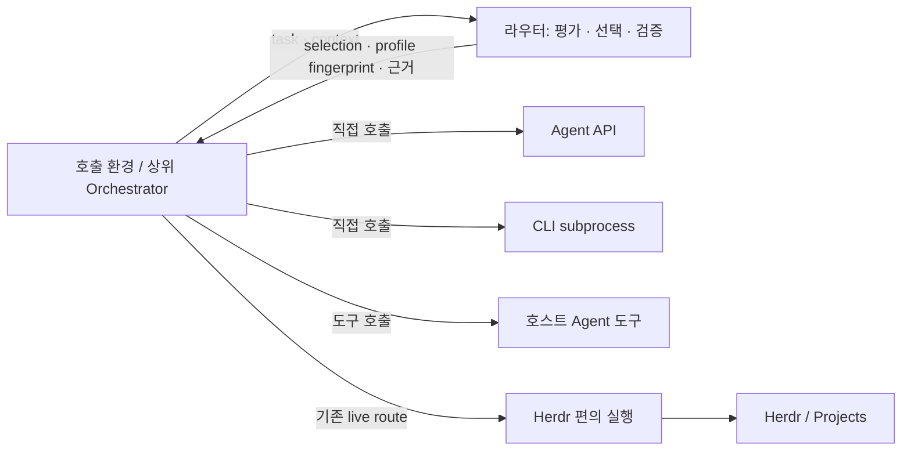

# Herdr 없이 사용하는 라우터와 Agent 실행 경계

작성: 2026-10-25. §8의 1단계(선택 전용 절차)와 2단계(profiles 2.0 상위 소유 프로필)는 구현됐다. 3단계(외부 가용성 입력)는 아직 **제안**이다. 같은 날 사용자 결정으로 이 문서의 대안 C를 넘어 **라우터 내 local/external runner와 herdr 자동 감지**도 구현했다. 아래 본문과 충돌하는 부분은 [§10](#10-결정-변경-runner-구현)이 우선한다. [상위 오케스트레이션 경계](orchestration-boundary.md)를 실행 수단까지 구체화한다.

권고는 **선택·검증은 라우터, 실제 Agent 호출은 호출 환경**이다. 기존 Herdr 실행은 선택 가능한 편의 경로로 유지한다. API·subprocess·호스트의 Agent 도구는 상위에서 연결하고, 라우터에 실행 프레임워크를 먼저 만들지 않는다.

## 1. 현재 의존성은 어디에 있는가

| 경로 | 현재 동작과 결합 지점 |
|---|---|
| `evaluate`, `select`, `route --dry-run` | Herdr 설치 없이 평가·선택·선택 기록 검증 가능. 선택 전용으로 재사용할 경로가 이미 있음 |
| 일반 `route` | [cli._load](../bench_router/cli.py)에서 바로 `herdr.dispatch` 호출 |
| `herdr.dispatch` | CLI/CodeBurn probe, Projects 1.2.1 binding, admission, receipt, 실행·회수를 묶어 처리 |
| `execution: headless` | 직접 subprocess 실행이 아님. [herdr._execute_headless](../bench_router/herdr.py)가 Herdr worktree/pane에서 CLI를 시작하며 Projects binding도 요구 |
| `parallel` | [parallel.py](../bench_router/parallel.py)가 Herdr 모듈의 probe·receipt·dispatch에 직접 의존. dry-run은 실행하지 않음 |
| profiles 1.0 | `kind`, `executable`, `args` 필수. fingerprint에도 실행 인자가 포함되어 순수 API 프로필 표현에 부적합 |
| 배포 Skill | [SKILL.md](../skills/bench-router/SKILL.md)가 선택과 Herdr 실행을 하나의 위임 절차로 안내 |

따라서 “모든 라우팅에 Herdr가 필수”는 아니다. **기본 live 실행과 배포 Skill의 위임 절차가 Herdr 전용**이다. 설정 파일만 수동으로 준비하면 현재도 CLI 프로필을 선택한 후 상위에서 직접 호출할 수 있다. API 후보까지 정식으로 표현하려면 프로필 계약을 바꿔야 한다.

판단용 Agent와 작업용 Agent도 구분한다. `decision_provider.py`의 Jev/native 판단은 facet·적합성·관련성 응답을 얻는 경로다. 작업 실행 backend로 사용하지 않는다. 네트워크 없는 경로에서는 판단 패킷을 반환하고 상위가 응답을 공급한다.

## 2. 대안 비교와 결정

| 대안 | 이점 | 비용·한계 | 결정 |
|---|---|---|---|
| A. 실행을 모두 상위로 이동하고 Herdr 기능 제거 | 라우터 책임이 가장 작음 | 기존 receipt·collect·parallel 사용자가 별도 실행기를 이관해야 함 | 즉시 제거하지 않음 |
| B. 라우터가 Herdr/API/subprocess backend를 모두 제공 | 단일 CLI로 실행·회수 가능 | 공급자별 인증·출력·권한·세션·재시도·취소·프로세스 수명까지 유지해야 함 | 실제 공통 수요 전까지 보류 |
| C. 선택 전용 경로 + 기존 Herdr 편의 실행 | 현재 계약 재사용, 임의 호출 환경 지원, 기존 사용자 보존 | 외부 실행은 상위가 수명·결과·중복 방지를 소유 | **채택** |

C의 핵심 확장 지점은 Python 추상 클래스가 아니라 **task + selection + 신뢰한 profile 설정**이다. 새 호출 방식은 상위의 `profile.id → 실행 설정/호출 함수` 연결을 추가한다. 라우터가 HTTP URL, API key, 임의 명령 문자열을 받아 실행하는 기능은 추가하지 않는다.



API가 모델의 텍스트 생성만 제공하면 코딩 Agent와 같은 기능이 생기지 않는다. 파일 접근·도구·격리·승인 루프를 가진 상위 harness가 있어야 `filesystem_write` 같은 capability를 선언할 수 있다. 실행 경로가 달라진 후보는 실제 `harness_id`와 `config_revision`으로 구분한다.

## 3. 소유권과 최소 호출 계약

| 항목 | 선택 전용 사용 | 기존 Herdr live 사용 |
|---|---|---|
| 적합성·벤치마크·hard 제약·selection 재검증 | 라우터 | 라우터 |
| 실행 가능 후보·인증·quota 확인 | 상위 실행 환경 | Herdr 경로의 probe와 실행 직전 검사 |
| prompt·파일·도구·모델/effort 매핑 | 상위 실행 환경 | Herdr 경로 |
| 작업 디렉터리·worktree·동시 실행 한도 | 상위 실행 환경 | 기존 parallel·coordination·Projects |
| 제출 전 기록·중복 방지·조회·취소·복구 | 상위 실행 환경 | 기존 receipt·coordination·collect·stop |
| 실행 결과 형식·산출물 회수 | 상위 실행 환경 | 기존 result/manifest 계약 |
| 품질 검증·채택·병합·전체 예산·재계획 | 상위 | 상위 |

호출 절차:

1. 상위가 실제 실행 환경에서 쓸 후보만 등록하고 task/context를 만든다.
2. `evaluate --format 3`의 단계별 판단 패킷을 해결한다. 상위 선택이 필요하면 `select`로 selection 6.0을 만든다. 자동 단일 추천의 5.0도 유지한다.
3. `route --task TASK --selection SELECTION --dry-run`으로 현재 입력에 대한 selection을 다시 검증한다. `select` 출력에서는 내부 `selection` 객체만 저장한다.
4. `status == selected`이고 선택한 profile의 fingerprint가 일치할 때 상위 실행기로 넘긴다. 17은 판단 미완료/선택 불가, 14는 stale/conflict다. 이를 실행 성공으로 해석하지 않는다.
5. 상위가 제출 직전 가용성·권한·예산을 확인하고 실행 의도를 기록한 후 API/subprocess/도구를 호출한다. 결과 회수와 검증도 같은 상위 실행기가 담당한다.

선택 전용 응답은 현재 route envelope를 그대로 쓴다. `run_id`는 null이고 `availability_verified`는 기본 false다. **selected는 정책상 선택 결과이며 실행 보장이나 제출 영수증이 아니다.** 호출할 때마다 같은 선택을 돌려줄 수 있고 어떤 실행도 예약하지 않는다.

`selection.decision`에는 판단 기록이 있지만 API 인증·실행 설정은 없다. 상위는 profile ID로 신뢰한 설정을 조회하고, 해당 설정을 `config_revision` 및 선택 fingerprint와 연결한다. 실행 설정이 바뀌면 revision을 올려 재평가한다. 라우터는 외부 실행 설정 본문을 검증했다고 주장하지 않는다.

## 4. 지금 사용할 수 있는 Herdr 없는 경로

아래 명령은 **현재 구현된 경로**다. 유효한 task·profiles 1.0·완료된 판단/selection이 필요하다. `SELECTION`에는 `source` 같은 출력 전용 필드를 제외한 내부 selection 객체를 저장한다.

```bash
# 평가 단계 응답을 공급해 assessment를 완료한 뒤 상위가 선택한다.
python3 -m bench_router.cli select \
  --assessment assessment.json --profile PROFILE_ID \
  --policy-id caller --policy-version 1 --reason "작업과 실행 환경에 적합"

# selection 객체를 selection.json에 저장한 후 실행 없이 검증한다.
python3 -m bench_router.cli route \
  --task task.json --selection selection.json --dry-run
```

이후 상위의 호출은 다음과 같이 구성한다. 아래는 계약을 설명하는 의사 코드이며 새 bench-router API가 아니다.

```python
choice = validate_with_router(task, selection)  # 기존 CLI 또는 routing.route
require(choice["status"] == "selected")
profile = trusted_profiles[choice["selected"]["profile"]]
require(profile_fingerprint(profile) == choice["selected"]["profile_fingerprint"])
executor = caller_bindings[profile["id"]]
executor.recover_or_submit(task=task, selection=selection, profile=profile)
```

`caller_bindings`는 호출 환경의 코드/설정이다. 로컬 CLI면 argv 배열과 `shell=False`를 사용하고 prompt 전달·환경 변수·timeout·프로세스 종료를 그 실행기가 처리한다. API면 그 실행기가 인증·도구 제공·응답/usage 정규화를 처리한다. 특정 벤더의 CLI flags나 SDK 형식을 라우터 계약으로 고정하지 않는다.

현재 task 1.0은 실제 존재하는 절대 `cwd`를 요구한다. API 전용 호출도 우선 로컬 작업 기준 디렉터리를 사용하며, 원격 파일 전달·원격 경로 매핑은 상위 책임이다. cwd 없는 원격 전용 task 지원은 별도 요구가 생길 때 버전을 올린다. 기존 `execution: interactive|headless`는 backend 이름이 아니다. 외부 실행기는 요청 모드를 명시적으로 매핑하거나 지원 불가로 거절한다.

## 5. API·호스트 도구용 프로필: profiles 2.0 (구현됨)

최소 변경은 공통 사실 필드를 유지하고 **CLI 실행 필드 세 개를 선택적 묶음**으로 바꾸는 것이다.

| 필드 | 2.0 제안 |
|---|---|
| `id`, `enabled`, `model_id`, `harness_id`, `reasoning_effort`, `config_revision` | 필수. 현재 검증·의미를 유지 |
| `cost_tier`, `inference_local`, `context_tokens`, `capabilities` | 필수. 실제 harness의 사실만 기재 |
| `kind`, `executable`, `args` | 세 필드 모두 있거나 모두 없음. 있으면 기존 CLI 검증 적용, 없으면 상위 소유 실행 |

실행 설정의 URL·API key·명령은 추가하지 않는다. API·호스트 도구·외부 CLI 모두 이 공통 형식으로 표현하고, 상위가 ID에 따라 호출한다. 예시는 비활성 placeholder이며 등록된 실제 모델·effort로 교체해야 한다.

```toml
# routing.load_profiles가 1.0과 2.0을 모두 받는다. 실행 필드가 일부만 있으면 거절한다.
schema_version = "2.0"

[[profile]]
id = "caller-agent-example"
enabled = false
model_id = "REPLACE_WITH_CANONICAL_MODEL_ID"
harness_id = "caller-tool-harness"
reasoning_effort = "unknown"
config_revision = "replace-after-verification"
cost_tier = "high"
inference_local = false
context_tokens = 0
capabilities = []
```

1.0 입력과 기존 CLI profile fingerprint 계산은 그대로 유지한다. 실행 필드가 없는 새 프로필만 별도 fingerprint 버전으로 공통 식별 필드(`model_id`, `harness_id`, `reasoning_effort`, `config_revision`)를 해시한다. 실행 인자를 빈 문자열로 채워 API를 CLI로 위장하지 않는다.

`profile_fingerprint`의 소비자는 [data.build_snapshot](../bench_router/data.py), [evidence](../bench_router/evidence.py), 라우팅·selection 검증이다. 한 공통 함수에서 새 계산을 적용하고, 이전 CLI의 snapshot·selection 호환 회귀를 확인한다. 새 API 프로필에 과거 CLI의 exact-profile 관측을 복사하지 않는다. 기존 model-level/proxy 조건에 맞는 관측만 재사용한다.

Herdr live는 CLI 실행 필드가 없는 후보를 `unsupported_execution_profile` 사유로 제외한다. API 프로필을 Herdr CLI로 자동 변환하지 않는다. `profiles discover`는 당분간 기존 CLI 발견 도구로 남기고, 상위 소유 프로필은 명시적으로 작성한다.

## 6. 가용성은 실행 환경의 관측

현재 `routing.assess`는 `availability=None`이면 미확인으로 처리하지만, map을 주면 빠진 profile도 `.get()`의 None으로 통과시킨다. **외부의 불완전한 map을 그대로 연결하면 안 된다.** CLI가 로컬에 없다고 원격 API 프로필을 제외해서도 안 된다.

최초 연결은 라우터를 미확인 상태로 사용하고 상위가 제출 직전 검사한다. 가용성 때문에 후보 평가가 반복되는 실제 수요가 있으면, 기존 함수 인자와 얇은 CLI 입력 `--availability FILE`을 연결한다. 새 실행 backend보다 이 입력을 먼저 추가한다.

추가 시 최소 계약은 별도 versioned envelope의 `profiles[profile_id]` 관측이다. 각 관측은 `state: available|unavailable|unknown`, `profile_fingerprint`, 실행 환경을 가리키는 `scope`, `observed_at`, `expires_at`, `reason`을 포함한다. secret은 넣지 않는다.

- 입력 누락 전체는 현재처럼 `availability_verified=false`인 오프라인 평가다.
- 입력을 공급하면 누락·만료·fingerprint 불일치·scope 불일치는 모두 unknown으로 정규화하고 새 실행 후보에서는 제외한다. 검증하지 않은 프로필을 available로 만들지 않는다.
- 잘못된 schema·timestamp·미등록 ID는 입력 오류로 거절한다. 상위 관측은 실행 가능성의 주장이지 원격 환경에 대한 라우터의 독립 검증이 아니다.
- 기존 내부 map으로 변환할 때 available만 None, 나머지는 명시적 제외 사유로 채운다. dry-run은 관측 파일을 읽을 뿐 probe나 네트워크를 호출하지 않는다.
- 가용성은 장기 동일성 digest가 아니라 현재 preflight 입력으로 유지한다. 기존 selection 재생과 동일하게 후보·단계 입력이 달라지면 stale을 반환할 수 있으며, 상위가 재평가한다.

상위 scope와 profile binding을 함께 검사해야 한다. 한 환경에서 얻은 관측으로 다른 계정·endpoint에 제출해서는 안 된다. quota 사전 확인은 예약이 아니며 동시 호출의 총예산은 여전히 상위 책임이다.

## 7. 외부 실행에서 보장할 것과 보장하지 않는 것

외부 실행을 선택하면 Router receipt·`collect`·`tell`·`stop`·result manifest·4개 활성 한도가 자동으로 적용되지 않는다. 상위 실행기는 다음을 소유한다.

- 정규화한 `(cwd, task_id, round)`를 논리 실행 키로 삼고, 선택 fingerprint·입력 hash·실행 설정 revision을 기록한다. 같은 키의 입력이나 backend가 바뀌면 conflict로 거절한다.
- 실제 제출 전에 의도를 영속화한다. API가 idempotency key를 제공하면 같은 키를 사용하되, 지원하지 않는 API나 subprocess에 exactly-once를 주장하지 않는다.
- 제출 여부가 불확실하면 기존 provider job/프로세스를 확인한다. timeout만으로 재제출하거나 Herdr↔API 자동 fallback을 하지 않는다. 확인할 수 없으면 불확실 상태를 유지한다.
- PID 하나만으로 재시작 후 복구를 보장하지 않는다. 시작 식별 정보·로그·exit 상태나 외부 job reference가 필요하다. `shell=False`도 수명 관리의 대체 수단은 아니다.
- 결과는 상위 harness가 해석한다. 파일을 쓸 수 없는 API에 Herdr의 result 파일 생성을 요구하지 않는다. 생성 내용의 품질·적용·검증과 비용 기록도 상위 책임이다.

기존 coordination은 공통 디렉터리를 쓰는 참여자 사이에서만 작동한다. 외부 실행까지 workspace 중첩과 활성 한도를 공유해야 한다면, 상위가 모든 실행을 하나의 admission 아래 두거나 별도 단계에서 coordination 연동을 추가한다. 현재 `observe_receipt`는 Herdr receipt 필드를 전제하므로 임의 외부 receipt를 넣지 않는다. 두 경로의 저장소가 분리되어 있으면 전역 중복 방지를 보장하지 않는다.

병렬 API 실행은 상위 scheduler가 task별 선택 결과를 받아 fanout한다. 기존 `parallel`을 범용 backend 실행기로 바꾸지 않는다. 동일 profile의 반복 호출은 상위 인스턴스 ID로 구분하고 각각 제출·예산·결과를 기록한다. worktree나 prompt가 의미 있게 바뀌면 재평가하며, 외부 호출자에게 `check_digest=False`를 공개 우회 방법으로 제시하지 않는다.

## 8. 구현 순서와 호환성

| 단계 | 변경 범위 | 완료 기준 |
|---|---|---|
| 1. 선택 전용 사용 공식화 | README·Orchestrator 문서·배포 Skill에 선택 전용/Herdr 실행 분기. 기존 `--dry-run` 재사용 | Herdr·Projects·Agent CLI가 없는 환경에서 판단 응답 공급 → 평가 → 선택 → 검증 가능 |
| 2. 상위 소유 프로필 | `routing.load_profiles/profile_fingerprint`, Herdr probe의 지원 범위 검사, 관련 예시·문서·테스트 | profiles 1.0 호환, 2.0 API/호스트 후보 평가 가능, Herdr는 미지원 후보만 명시적으로 제외 |
| 3. 외부 가용성 연결 | 실제 필요 시 validator·공통 가용성 정규화·CLI 입력 | 부분 입력·만료·다른 scope가 실행 가능으로 취급되지 않음 |
| 4. 실행기 추가 여부 재검토 | 같은 subprocess/API 실행 코드가 여러 소비자에 반복될 때 별도 편의 실행기 검토 | 실제 두 번째 구현과 공통 수명 계약이 확인된 뒤 추출 |

일반 `route`의 기본 동작은 호환성을 위해 Herdr live로 유지한다. 선택 전용은 `--dry-run`을 명시한다. 새 `--executor`/`dispatch` 명령, plugin registry, ABC, API SDK, 공통 비동기 job 모델은 당장 추가하지 않는다. Herdr가 없으면 기존 live 경로는 명확히 실패하고 선택 전용 사용법을 안내하며, 다른 실행 수단으로 자동 전환하지 않는다.

배포 Skill은 선택 전용을 호출 환경 공통 절차로 안내하고 Herdr 의존성은 live 분기에 둔다. Herdr/projects 플러그인 설치를 모든 사용자에게 요구하지 않는다. CLI 발견·프로필 포맷 출력은 당분간 herdr.py에 남겨도 되며, 선택 경로가 그 probe를 호출하지 않도록 유지한다. 실제 공통 소비자가 생길 때만 파일을 추출한다.

## 9. 구현 시 검증 기준

현행 기준 검사는 `test_p0.P0VendorGuidance.test_v97_cli_assessment_selection_and_offline_execution_check`다. synthetic 판단으로 evaluate → select → dry-run을 완료하며 network·dispatch·atomic_write가 호출되지 않는지 검사한다. 이 검사는 외부 실행기의 동작까지 검증하지 않는다.

추가 구현의 회귀는 기존 unittest 파일에 집중한다.

1. `test_p0`: 실행 모듈 import와 프로세스 호출을 차단한 환경에서 선택 전용 성공. 상태 17·14에서 상위 실행이 시작되지 않는 예시도 검사한다.
2. `test_p0`/`test_p1`: 외부 프로필·실행 필드 부분 입력 검증, v1 fingerprint 고정, v2 snapshot/evidence 일관성, config_revision 변경 시 stale.
3. `test_p2`/`test_p3`: 기존 Herdr route·회수·headless·parallel 유지, 외부 후보에 명시적 지원 불가 사유. 과거 receipt는 계속 기존 경로로 회수한다.
4. 외부 가용성 추가 시 누락·만료·scope 불일치·unknown 거절과 오프라인 부수효과 없음 검증.
5. 외부 실행기 자체의 중복 제출·불확실 전송·timeout·취소·결과 검증은 그 실행기의 저장소에서 fake API/프로세스로 검사한다.

Herdr live 동작을 바꾸는 구현에서는 전체 offline suite와 별도 수동 smoke 결과를 보고한다. 이번 변경은 설계 문서이며 Agent를 실행하거나 live 호출을 시험하지 않는다.

## 10. 결정 변경: runner 구현

2026-10-25 사용자 결정으로 §2의 대안 B 일부와 §8의 "자동 전환 금지"를 뒤집었다. 범위는 다음으로 제한한다.

- 전역 `--runner auto|herdr|local|external`(`BENCH_ROUTER_RUNNER`). `auto`는 `herdr-projects`가 PATH에 있으면 herdr, 없으면 local이다. 판정 결과는 receipt `backend`(`projects-1.2`, `local-1`, `external-1`)에 기록한다. 기록된 run의 회수·중단·재dispatch는 현재 플래그가 아니라 receipt를 따르므로, 실행 중에 환경이 바뀌어도 다른 수단으로 재전송하지 않는다.
- `local`([runners.py](../bench_router/runners.py)): headless task만 받는다. 기존 `headless_argv`·결과 계약·exit_code 정산을 재사용하고, 라우터가 만든 git worktree에서 분리된 `sh -c` 프로세스로 실행한다. 중단은 process group SIGTERM이다. PID 재사용은 확인하지 않는다(코드의 `shortcut:` 주석 참고).
- `external`: 라우터가 worktree·prompt·receipt를 만들고 `handed_off`와 `invocation`을 반환한다. 호출자가 실행한 뒤 `collect`가 기존 결과 계약을 검사한다. 이 경로에서는 §7의 "receipt·collect·4개 한도 미적용"이 바뀌어, 라우터 receipt·coordination이 그대로 적용된다. 로컬 CLI 가용성은 검사하지 않는다(미확인으로 둠).
- 추가하지 않은 것: API SDK 실행기, plugin registry/ABC, local의 interactive·`tell`. API 호출은 external로 상위가 수행한다.
