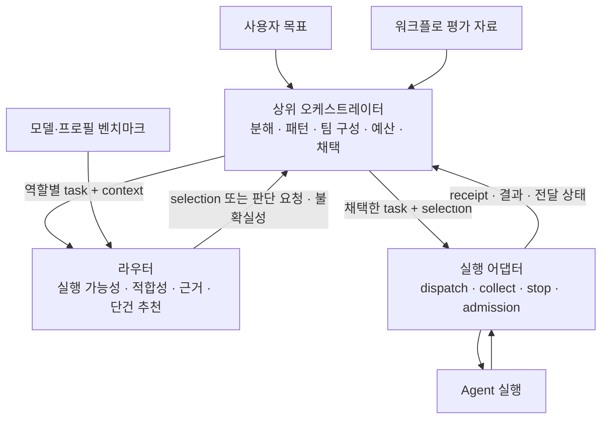

# 상위 오케스트레이션과 라우터의 책임 경계

검토일: 2026-10-23. **두 설계안의 교차 검증을 반영한 통합 권고안이다. 구현된 API 명세나 승인된 구현 계획은 아니다.**

구현 후속: 명시적 반복 선택·그룹 전달 상태와 공개 후보 평가(`evaluate --format 3`)·외부 선택(`select`, selection 4.0)을 적용했다. 현재 사용 계약은 [상위 계층 연동 문서](orchestrator.md)를 따른다. 아래의 “현재 구현”과 가정 실험 설명은 설계 검토 당시의 스냅샷이다. 패턴 선택·워크플로 실측·전체 예산은 계속 상위 책임이다.
2026-10-22에 작성한 이 문서의 초안과 [다른 agent의 경계 설계안](../wiki/projects/bench-router/synthesis/router-orchestrator-boundary.md)을 현재 코드(`2d879cd`)에 대조했다. [multi-agent 패턴 연구](../wiki/projects/bench-router/synthesis/multi-agent-pattern-selection.md)는 연구 배경으로 사용한다. 이후 구현 검토는 이 통합안을 기준으로 하며, 아래에서 `현재`와 `제안`을 구분한다.

권장 경계는 **상위 계층이 실행 흐름과 팀 구성을 결정하고, 라우터는 주어진 작업 단위의 실행 가능성·적합성·벤치마크 근거와 프로필 선택을 제공하는 것**이다. 실행 어댑터는 명시적으로 요청받은 실행·회수·중단을 수행한다. 이 세 책임은 같은 저장소에 있어도 분리할 수 있으며, 별도 서비스나 플러그인 프레임워크는 필요하지 않다.

## 0. 교차 검증 결과와 통합 결정

다른 안의 간결한 단건 경계와 후보 평가 공개 제안을 채택하고, 앞선 안의 선택 기록·실행 복구·예산 경계를 결합한다. 동일 프로필 반복은 검증 결과에 따라 앞선 안의 보류 결정을 수정한다.

| 검토 항목 | 두 안의 차이 또는 확인 결과 | 통합 결정 |
|---|---|---|
| 패턴을 모르는 단건 라우터 | 두 안이 일치 | 유지. 분해·패턴·팀 구성·집계는 상위 소유 |
| 역할명이 입출력에 있으면 경계 위반 | 다른 안의 기준은 과도함. 현재 `fit_request()`도 역할과 조건을 검토하며 prompt에 reviewer 업무가 필요 | 이름의 존재보다 **그 이름에 의해 라우터가 실행 흐름을 정하는지**로 판단 |
| 동률·과반 우승자 없음 | 다른 안은 둘 다 보고만 하는 uncertainty로 설명. 실제 과반 부재는 조건부 `benchmark` 관련도 판단으로 이어질 수 있음 | 현재 단건 판단 절차 유지. 어느 경우에도 패턴 전환이나 worker 추가를 자동 실행하지 않음 |
| 후보별 uncertainty 공개 | 다른 안의 `decision.evaluation` 설명이 현 구조와 다름. `fits` 등은 evaluation 안, `uncertainty`는 decision 수준이며 선택 후보 관련 경고도 포함 | 후보·조회 전체·추천별 진단을 나누는 공개 계약을 설계. 현 객체를 그대로 API로 고정하지 않음 |
| 후보 pool로 상위가 팀 구성 | 다른 안에 후보 공개 이후 선택의 실행 바인딩이 빠짐. 현 3.0은 추천 후보 변경을 거절 | **후보 평가 공개와 외부 선택 검증을 한 쌍으로** 설계 |
| group 2.0의 중복 profile 금지 | 다른 안은 제거 제안, 앞선 안은 별도 task 우회 후 연기. 가정 입력으로 downstream 실행·복구 검증 통과 | 명시적 반복 허용을 작은 우선 개선으로 채택. 새 instance schema는 지금 도입하지 않음 |
| group 1.0을 legacy로 유지 | group schema와 선택 정책은 별개이며 현재 1.0도 기본 `vendor-guided`를 사용 | 호환 경로를 유지한다는 뜻으로 한정. `--policy legacy`로 강제 전환하지 않음 |
| N개 실행 quota preflight | 다른 안은 router 책임도 가능하다고 봄. 현 probe는 provider 상태·모든 window 소진만 확인 | 자원 사실·admission은 실행 어댑터, 팀 구성·예산 배분·축소는 상위. N개 예약 API는 근거 부족으로 보류 |
| 패턴을 호출열로 컴파일 | 정적 compiler만으로는 동적 분해·handoff·반복을 충분히 설명하지 못함 | 상위의 상태·관측 기반 정책이 준비된 실행 묶음을 생성. 패턴 registry나 DSL은 필수 아님 |
| checker/synthesizer의 늦게 생기는 입력 | 두 안이 일치 | 실제 입력 준비 후 선택. 내부 `check_digest=False`를 공개 우회 옵션으로 만들지 않음 |

이 권고에서의 최적화 기준은 현재 계약의 재사용, 패턴 추가 시 라우터 변경 최소화, 재전송·stale 검증 보존이다. 특정 패턴이 실측 품질에서 최적이라는 주장은 아니다.

## 1. 판단의 단위부터 구분한다

| 판단 | 소유자 | 라우터와의 접점 |
|---|---|---|
| 목표 해석, 저장소 조사, 하위 작업·의존성·공유 상태 분석 | 상위 오케스트레이터 | 실행할 작업의 설명·요구사항으로 전달 |
| 단일 agent 유지, 패턴 후보 생성, 조합·집계·종료 정책 | 상위 오케스트레이터 | 역할별 근거와 선택 결과를 참고 |
| 팀 전체 모델 구성, 동일 프로필 반복, 역할 간 독립성 | 상위 오케스트레이터 | 작업별 선택을 채택하거나 외부 선택으로 기록 |
| 주어진 작업의 facet·추론 요구·자율성·완성 기준 분류 | 라우터의 `analysis` | 현재 범위 유지; 작업 자체를 분해하거나 수행하지 않음 |
| 해당 작업에 대한 model/effort 적합성, 비교 가능한 벤치마크, 기본 추천 | 라우터 | 현재 `analysis → fit → benchmark(조건부) → resolve` |
| 전체 예산·deadline·동시 실행 계획·재계획 | 상위 오케스트레이터 | 호출별 allowance와 timeout을 전달 |
| 실행 인자 변환, admission, 가용성 검사, receipt·결과 계약 검증 | 실행 어댑터 | 현재 `herdr.py`, `coordination.py`, `parallel.py` |
| 결과의 실질적 정확성, 채택·병합, 다음 검토·수정·재시도 | 상위 오케스트레이터 | 결과·전달 상태를 읽고 명시적으로 다음 동작 요청 |

여기서 작업 단위는 LLM 한 번의 API 호출이나 최소 크기의 하위 작업을 뜻하지 않는다. 상위 계층이 하나의 프로필에 위임하기로 정한 책임 범위이며, agent 내부의 도구 사용과 여러 추론 단계가 포함될 수 있다.

`analysis`에 작업 난도·자율성 판단이 있다는 이유만으로 모든 분석을 상위로 옮길 필요는 없다. **작업 구조를 만드는 분석**과 **이미 주어진 작업에 프로필을 맞추는 분석**의 차이를 유지하면 된다. 상위가 지정한 facet과 실제 요구사항을 활용하되, 현재 파일 경로 입력을 파일 본문 조사 결과로 간주하지 않는다.

경계 검사는 단어 검사가 아니다. “이 후보 답안을 검토하라”는 prompt와 이에 대한 적합성 근거는 필요하다. 반면 `pattern=debate`를 읽고 라우터가 발언 순서·반복 수·집계를 정하면 상위 책임을 침범한다. 새 `role`/`pattern` enum은 추가하지 않는다. 추후 순수 추적 metadata가 필요하더라도 프로필 정책이나 실행 흐름을 바꾸지 않는 별도 계약으로 다룬다.



라우터가 의미 판단을 위해 쓰는 Jev/native 판단 agent도 이 경계 안의 제한된 판단 수단이다. 그 agent가 있다는 사실을 사용자 작업에 multi-agent 패턴을 적용한 것으로 해석하지 않는다.

## 2. 현재 구현에서 재사용할 것과 제한

| 접점 | 현재 보장·제한 | 설계상 의미 |
|---|---|---|
| [`routing.evaluate()`](../bench_router/routing.py#L957) | 선택 없이 ID순 후보·제약·사실을 반환. benchmark 필드에는 기존 category 집계와 `legacy_score`도 포함 | 사실 조회로 사용. vendor-guided의 `fit`을 완료한 후보 목록으로 읽으면 안 됨 |
| [`evidence.build()`](../bench_router/evidence.py#L154) | facet에 맞는 관측·측정 조건·결측·freshness 제공. 기본 상위 12개 unit 및 생략 정보 | 원자료 조회와 최종 비교를 구분. 조회 순서·normalized 값은 팀 구성 점수가 아님 |
| [`decision.route()`](../bench_router/decision.py#L359) | 단건 추천, 단계별 판단 요청, 적합성·비교 근거·불확실성을 기록 | 상위는 추천을 실행 전에 검토할 수 있음 |
| [`selection 3.0`](../bench_router/decision.py#L339) | 결정 전체와 최종 resolved profile을 다시 검증 | 추천을 다른 profile로 바꿔 같은 기록을 사용할 수 없음 |
| [`selection 2.0`](../bench_router/routing.py#L995) | 외부 정책·이유·assessment digest를 기록하고 필수 제약 검사. vendor-guided 검증과 구분하여 경고 | 팀 구성 정책에 따른 명시적 선택은 현재 이 경로로 표현 가능 |
| [`parallel` group 2.0](../bench_router/parallel.py#L27) | task별 context·selection 목록. 같은 task의 중복 profile은 거절. 의존성·집계·반복 정책 없음 | 독립적인 실행 묶음의 편의 어댑터로 사용 |
| [`parallel.plan()`](../bench_router/parallel.py#L87) | 자동 fanout은 이미 선택한 profile 제외 | 서로 다른 모델을 선호하는 기존 편의 정책. 새 패턴의 기본 구성 원칙으로 일반화하지 않음 |
| [`parallel.run_group()`](../bench_router/parallel.py#L194) | 전체 선택 확인 후 실행 준비, plan 동결·복구. 실행 이후 부분 실패는 보존 | 사전 선택 검증이며 모든 worker 실행의 트랜잭션·자원 예약 보장은 아님 |
| [`herdr.output()`](../bench_router/herdr.py#L787) | `delivery_state`, `reassignment`, receipt, 실제 worktree 등 제공 | 실행 실패와 재전송 가능성을 분리 |
| [`coordination.reserve()`](../bench_router/coordination.py#L83) | 공유 상태 디렉터리 기준 합산 active 4개, 경로 중첩 거절, 제출 의도 기록 | 패턴과 무관한 실행 admission. group의 최대 16명/`max_parallel`과 별개의 제한 |

같은 cwd의 서로 다른 task ID만으로 동시 실행을 구성할 수 없다. 현재 admission은 활성 작업과 cwd가 같거나 상하위 관계이면 거절한다. 병렬 실행은 별도의 worktree와 receipt 공간이 필요하다. 실제 Projects 실행 경로와 반환 worktree는 [Projects 문서](projects.md)를 따른다.

현재 group 응답의 `ROUND_KEYS`에는 `delivery_state`와 `reassignment`가 없다. 따라서 `partial_failure`만 보고 자동 재시도하면 안 된다. 해당 member의 receipt 위치와 run ID로 단건 `collect` 결과를 확인해야 한다. 상위가 조합하기 편한 공통 실행 결과 계약을 만든다면 이 필드 전달부터 보완할 가치가 있다.

## 3. 대안 비교와 권장안

| 대안 | 장점 | 비용·문제 | 판단 |
|---|---|---|---|
| 라우터에 pattern enum·DAG·투표·재시도 엔진 추가 | 호출자가 한 요청으로 실행 가능 | 새 패턴마다 라우터 변경, 단건 정책과 워크플로 상태·예산 결합 | 채택하지 않음 |
| 라우터를 원시 벤치마크 조회로만 축소 | 경계가 작음 | 상위마다 적합성·비교 조건·선택 기록·검증을 재구현 | 현재 재사용 가치를 잃음 |
| **단건 라우터 + 상위 패턴 정책 + 실행 어댑터** | 기존 선택·검증 재사용, 패턴 추가가 상위 변경으로 제한됨 | 상위가 실행 상태와 전체 예산을 관리해야 함 | **권장** |

확장성을 위해 필요한 것은 패턴 등록 기능보다 **패턴에 의존하지 않는 작업·선택·실행 결과 계약**이다. 새 패턴은 상위 계층의 보통 함수나 기존 프레임워크의 workflow로 구현한다. 여러 소비자가 같은 연결 코드를 반복하기 시작하면 얇은 공통 client를 추출한다.

## 4. 상위 계층의 호출 흐름

### 4.1 패턴 후보와 프로필을 함께 검토하되, 결정권은 상위에 둔다

1. 상위가 작업·환경을 분석하고 소수의 패턴 후보와 역할을 만든다. 단일 agent도 가능한 후보로 남긴다.
2. 역할마다 **실제로 맡길 일**을 task로 구체화한다. checker에게 원래 구현 작업을 그대로 보내면 적합성 판단도 구현자 기준이 된다.
3. `evaluate`/`evidence` 또는 `route --dry-run`으로 역할별 제약·근거·추천을 확보한다. native 판단 패킷은 현재 단계별 응답 계약대로 해결한다.
4. 상위가 후보 패턴·역할 배치·집계·총비용을 비교한다. 필요한 역할을 맡길 후보가 없으면 구조를 수정하거나 해당 안을 버린다.
5. 준비된 실행 묶음의 task·selection·입력 artifact·예산을 확정하고 실행을 요청한다.
6. 결과를 검증·채택하고 다음 실행 단위를 만든다. 새로 발견한 요구는 상위의 재계획 사유로 기록한다.

이 흐름은 “패턴을 먼저 확정하고 모델은 나중에 끼워 맞춘다”는 제약을 만들지 않는다. **정보는 왕복하되 패턴 결정은 상위에 남는다.** 라우터는 `tie_resolved_by_configuration`이나 `comparable_evaluation_missing`을 반환할 뿐, agent를 더 만들지 않는다.

### 4.2 지금 쓸 수 있는 두 선택 경로

**추천 위임:** 역할별 `route --dry-run`의 필요한 판단 단계를 해결하고 반환된 3.0 selection을 채택한다. 출력 전용 `source`를 제거한 selection 파일을 동일 task/context의 live `route --selection`에 전달한다. dry-run 자체는 dispatch하지 않는다.

**외부 구성 결정:** 상위가 `evaluate`와 필요한 `evidence`를 확인하고 2.0 selection에 자신의 정책·이유를 기록한다. 이후 `route --selection` 또는 group 2.0으로 실행한다. 이 경로의 필수 제약 검증과 vendor-guided 의미상 적합성 검증은 다르다. 상세한 팀 구성 근거는 상위 계획 기록에 둔다.

독립적인 단건 최적 후보를 모은 결과가 팀 전체의 최적 구성이라는 보장은 없다. 예를 들어 checker의 생성자 의존 성능이나 provider별 처리 한도를 고려하면 상위가 다른 후보를 택할 수 있다. 이 경우 3.0 기록의 profile만 수정하거나 `--profile`로 근거를 지우지 말고 외부 선택임을 명시한다.

### 4.3 패턴마다 라우터가 달라질 필요는 없다

| 상위 패턴 | 라우터 호출 단위 | 상위가 추가로 소유할 내용 |
|---|---|---|
| 단일 agent | 작업 1개 | 결과 채택 |
| 순차 pipeline | 앞 결과를 반영해 구체화한 다음 작업 | 의존성 gate, artifact 전달 |
| 병렬 sectioning → synthesis | 독립 작업 각각, 이후 합성 작업 | 격리·쓰기 범위, 결과 수집·합성 |
| 같은 모델 N회 샘플링 → 투표/선택 | 별도 실행 인스턴스 N개 | 반복 수·독립 문맥·동률·기권 처리 |
| 서로 다른 모델의 후보 생성 → judge | 생성 작업들, 실제 후보가 준비된 판단 작업 | 팀 구성·rubric·judge 검증 |
| maker-checker 반복 | 생성·검토·수정 각각의 작업 | 최대 반복, 개선 판정, 중단·미달 결과 |
| 동적 supervisor/계층형 | 실행 중 발견한 새 역할의 작업 | 계층·재귀 깊이·공유 예산·진행 상태 |
| handoff/swarm, bounded debate | 다음 담당자의 작업 또는 명시적 대화 턴 | 제어권 이전, 전달 문맥, 발언 순서·종료 조건 |

이 표는 공통 단건 계약으로의 **설계상 대응**이다. 현재 runtime이 모든 패턴을 기본 기능으로 제공한다는 뜻은 아니다. 특히 연속 세션 handoff와 대화형 debate는 상위가 `tell`/`resume`의 기존 제약 또는 새 작업 실행 중 어느 방식을 쓸지 정해야 한다. 비대화형 실행은 `tell`을 지원하지 않는다. `[role]` 같은 이름만으로 session·도구·권한이 구성되는 것도 아니다.

### 4.4 같은 프로필의 반복 실행

현재 group 2.0은 한 task의 `selections: [p, p]`를 거절하지만, 서로 다른 task ID의 항목이 각각 p를 선택하는 것은 허용한다. 따라서 `sample-1`, `sample-2`, `sample-3`을 별도 task로 만들고 각각 selection을 얻어 group의 독립 worktree에서 실행할 수 있다. 의미상 같은 문제라는 연결은 상위 기록에 둔다. 격리된 문맥이 통계적인 오류 독립성을 보장하는 것은 아니다.

**통합 권고에서는 group 2.0의 명시적 중복 profile 제한을 해제하는 작은 후속 변경을 우선한다.** `selections`는 집합이 아니라 실행 인스턴스의 순서 있는 목록으로 정의한다. `[p, p]`는 p로 두 번 실행하라는 상위의 명시적 요청이며 라우터가 중복 제거하거나 반복 수를 늘리지 않는다. 같은 task/context를 사용하는 두 인스턴스는 같은 선택 근거를 참조할 수 있지만 실행·usage·receipt는 각각 기록한다. 서로 다른 지시·입력·allowance가 필요하면 별도 task 항목을 쓴다.

근거는 현재 label이 `<task_id>-<index>`이고 worktree·receipt/admission key가 분리된다는 점이다. 2.0·3.0 selection 각각을 반복한 가정 입력에서 별도 실행과 재호출 회수를 fake로 확인했다. 정규 validator는 여전히 이를 거절하므로 **현재 지원 기능으로 안내하지 않는다.** 검증 조건과 한계는 §8에 기록했다.

이 변경은 JSON 구조를 바꾸지 않는 검증 제한 완화다. 기존에 유효하던 요청과 group 1.0의 선택 동작을 유지하고, 변경 이력·명세·회귀 검사를 함께 갱신한다. 이전 버전과의 연동은 기존 별도 task 방식으로 처리한다. 기존 index label로 충분하므로 새 `instance_id` 필드나 패턴별 group schema를 먼저 만들지 않는다. 동결 후 목록 재정렬·추가는 다른 group 입력으로 거절한다.

### 4.5 상위 계획 기록과 실행 입력을 분리한다

다음은 **상위 계층이 저장할 예시**이며 현재 router/group JSON 입력이 아니다.

```json
{
  "plan_id": "review-42",
  "revision": 2,
  "pattern": {"id": "sample-and-check", "version": "1"},
  "limits": {"max_instances": 4, "max_iterations": 2},
  "steps": [
    {"id": "sample-1", "task_ref": "sample-1.task.json", "selection_ref": "sample-1.selection.json"},
    {"id": "sample-2", "task_ref": "sample-2.task.json", "selection_ref": "sample-2.selection.json"},
    {"id": "check", "after": ["sample-1", "sample-2"], "template_ref": "check.prompt.md"}
  ]
}
```

상위는 이 기록 전체를 라우터에 전달하지 않고, 실행 준비가 된 step을 현재 task/context/selection으로 변환한다.
`pattern`, `after`, `role`, aggregation, budget ledger는 상위에 둔다. 현재 task validator는 알 수 없는 필드를 거절하므로 임의 metadata를 task에 넣지 않는다. 라우터가 무시하는 namespaced metric에 workflow 제어 명령을 숨기는 방식도 피한다.

상위 기록은 plan/step/instance/attempt를 실제 `(canonical cwd, task_id, round)` 및 `run_id`와 연결한다. 같은 task/round 재호출은 회수이고, 의도적인 새 실행은 새 round 또는 새 instance다. 패턴명을 바꾸는 것만으로 새 실행을 발생시키지 않는다.

서로 다른 역할의 새 작업은 새 task ID를 쓰고, 같은 논리 작업을 의도적으로 다시 수행할 때 round를 늘린다. 단순 관찰·회수에는 어느 쪽도 바꾸지 않는다. 따라서 “단계마다 무조건 새 round”를 만드는 규칙은 쓰지 않는다. group 내부 반복은 index와 worktree로 실행 인스턴스를 구분한다.

## 5. 벤치마크는 결정권이 아니라 근거로 경계를 넘는다

### 5.1 근거의 두 단위

**프로필·모델 근거:** 현재 라우터가 보유한 unit별 관측, exact/proxy 구분, model/effort/harness, 측정 조건·revision·freshness·결측·비교 범위. 상위는 특정 역할에 대한 사전 정보로 활용한다. 서로 다른 측정 조건을 합쳐 팀 점수를 만들지 않는다.

**워크플로 근거:** 패턴·정책 버전, 역할별 profile, 반복/동시 실행 수, 문맥 공유, 집계 방식, 도구·환경, 동일 평가 집합과 기준선에 대한 최종 품질·비용·지연. 상위의 평가 자료로 별도 보관한다. 처음에는 검토된 JSON/문서 참조로 충분하며 라우터의 profile snapshot에 가상 “팀 프로필”로 넣지 않는다.

워크플로 기록에는 데이터셋 revision·split·sample size·불확실성, 역할/집계별 결과, 해당 구성이 평가된 범위를 남긴다. 적용 조건이 다른 결과는 그대로 예측값으로 쓰지 않고 차이를 기록한다. 근거가 없으면 미측정 상태를 유지한다. 동률, 모델 계열의 차이, 후보 중 정답 존재 가능성만으로 협업 이득을 주장하지 않는다.

현재 `decision.evaluations()`의 `workflow_gain`은 같은 모델·harness에서 높은 effort의 조건부 적합성을 해소하는 비교다. 이름과 달리 일반적인 multi-agent 패턴 간 품질 평가 저장소가 아니다.

judge 성능도 고정된 평가 과제와 충분한 측정 조건으로 한 프로필의 능력을 표현할 수 있으면 profile 근거에 포함할 수 있다. 다만 특정 generator pool·정답 비율·집계 방식에 의존하는 성능은 그 조건을 보존해야 한다. 기존 unit·관측 조건 계약이 그 차이를 표현하지 못하면 workflow 자료에 남긴다. 역할명을 facet으로 추가하는 것만으로 비교 가능성이 생기지는 않는다.

### 5.2 목표 계약: 후보 평가와 외부 선택 검증을 함께 제공한다

현재 `evaluate`는 vendor-guided `fit`과 동일하지 않고, 최종 3.0 selection은 최종 추천에 묶인다. 여러 후보를 비교해 팀을 구성하는 호출자에게 필요한 목표 경계는 **단건 평가 → 선택 바인딩 → 실행**이다. `evaluate`와 `route`가 공유할 평가 경계를 추출하되, 외부가 내부 `fit`/`evaluations` 함수를 직접 호출하게 만들지 않는다. 단건 기본 추천은 이 평가 위의 기존 정책으로 유지한다.

아래는 공개 계약에 필요한 의미이며, 현재 응답 필드나 새 CLI 옵션을 선언한 것이 아니다.

| 계약 요소 | 필요한 의미 |
|---|---|
| 평가 식별 | 계약 버전, 단건 task/context, 후보 집합·제외 조건, profile 설정, 가이드·근거·검색/비교 정책을 묶는 digest |
| 후보별 제약 | hard eligibility와 제외 사유. 의미상 부적합과 필수 제약 실패를 구분 |
| 후보별 적합성 | documented/provisional/unsuitable, 적용 규칙·미해소 조건. 판정 전이면 미완료로 표시 |
| 근거 | unit별 raw 관측·exact/proxy·측정 조건·결측·freshness. 검색 범위·생략 unit 수와 비교에 실제 참여한 후보를 명시 |
| 진단 범위 | 조회 전체의 근거 부족, 후보별 guidance/조건부 문제, 추천의 동률·선호 정책을 분리 |
| 추천 | 기존 정책이 산출한 선택·이유를 별도 결과로 제공. 추천 없음과 평가 실패를 구분 |
| 외부 선택 | 평가 digest, 선택 profile, 상위 정책 ID/버전·이유, provisional 수용 여부를 기록 |

현재 선택에 성공한 응답의 근거는 `selection.decision.evaluation`, 불확실성은 `selection.decision.uncertainty`에 있다. `fits`에는 부적합 후보가 남을 수 있지만 observations는 평가 대상 후보에 한정된다. hard-filter 탈락·fanout 제외·검색 생략까지 포함하는 완전한 후보 평가 API가 이미 있는 것은 아니다. 최종 추천의 uncertainty를 모든 후보에 복제해도 안 된다.

**선택 바인딩 규칙:** hard eligibility를 통과하고 의미상 적합한 후보 중 상위가 선택한다. provisional 채택은 미해소 조건을 인지한 상위 결정으로 기록한다. 새 적합성 검증 경로에서는 unsuitable을 거절한다. 상위가 의미 판단을 명시적으로 override하려면 기존 2.0처럼 별도의 override 경로·경고를 사용하며, 어느 경로도 필수 제약을 우회할 수 없다. 실행 검증은 외부 선택이 현재 라우터의 기본 우승자와 같은지는 요구하지 않는다.

**미완료와 오류:** 판단이 끝나지 않았으면 현 `decision_required`/`decision_unavailable`과 같은 handoff 상태를 유지한다. 결측·판단 기권을 “후보가 적합하다”로 바꾸지 않는다. 외부 선택 시점과 실행 시점 사이의 의미 있는 입력 변경은 `stale_assessment`로 돌려보내고, 이미 제출한 실행 회수는 계속 우선한다. quota/admission의 순간 상태는 선택 digest만으로 예약되거나 보장되지 않는다.

**버전과 진단 코드:** 현 2.0 override와 3.0 vendor-guided 재현의 의미는 유지한다. 새 공개 평가·외부 선택 계약은 별도로 버전 관리하고 기존 3.0에 임의의 profile 변경을 허용하지 않는다. `tie_resolved_by_configuration`, `comparable_evaluation_missing`, `model_proxy_comparison` 등은 설명·범위와 함께 문서화한다. 호출자는 알 수 없는 추가 진단 코드를 보존하고, 그것만으로 패턴 변경·실패·재시도를 결정하지 않는다. 이해할 수 없는 계약 major version이나 필수 상태는 명시적으로 거절한다.

이 보강의 단위도 단건이다. `recommend_pattern()`, 역할별 고정 점수, 범용 topology optimizer, cross-role 제약 solver를 라우터에 추가하지 않는다. 팀 조합 최적화는 상위 정책이 조회 결과를 소비해 수행한다. 기존 계약으로 역할별 추천만 사용하는 호출자에게 새 경계를 강제하지 않는다.

## 6. 동적 패턴, 입력 고정, 예산과 실패

**실행 직전 구체화:** checker/synthesizer의 실제 입력은 앞선 실행 이후에 생긴다. 전체 계획에서 역할·rubric·상한은 미리 정하되, 최종 prompt와 artifact가 준비된 뒤 해당 작업의 selection을 생성·검증한다. 사전 견적용 task의 선택을 변경된 실제 prompt에 재사용하지 않는다.

**그룹 동결 범위:** 현 `parallel`의 plan 동결은 그 독립 실행 묶음에 적용한다. 동적 작업은 기존 group을 수정하지 않고 상위 plan revision과 새로운 group ID 또는 단건 실행으로 추가한다. 이미 제출한 member는 원래 receipt로 회수한다. 미래의 모든 node를 미리 확정하도록 강제하면 동적 패턴을 표현할 수 없다.

**입력의 재현성:** 현재 digest는 모든 workspace 파일 내용과 문맥 artifact 내용까지 고정하는 계약이 아니다. 상위는 입력 artifact의 실제 revision/hash와 접근 가능한 위치를 기록하고 실행 전 일치 여부를 확인해야 한다. 같은 경로의 파일을 덮어쓰며 선택 기록만 재사용하지 않는다. 실행 어댑터가 worktree를 만드는 방식과 HEAD 기준 복사도 반영한다. profile 선택 검증을 artifact 전달 검증으로 대체하지 않는다.

**전체 예산:** `max_estimated_cost_usd`는 한 번의 위임에 대한 추정 비용 allowance다. 상위가 이미 쓴 비용·동시 실행 예약·판단 호출·합성·재시도 비용을 포함해 전체 예산을 관리한다. 추정값 상한만으로 실제 청구액 상한을 보장할 수 없다. `parallel`의 공유 판단 응답 기록에 usage가 복제될 수 있으므로 실제 호출과 캐시 재사용을 구분해 집계한다.

**계정 quota와 admission:** 현재 CodeBurn probe는 provider 불가/보고된 모든 quota window 소진을 확인한다. 팀 전체 작업량이 quota 안에 들어간다는 계산·예약은 하지 않는다. 상위의 예산 예약과 실행 어댑터의 합산 active 제한은 별개다. 검사 후 동시 요청에 의해 admission이 실패할 수도 있다. 기다림·동시성 축소·단일 agent 전환 중 무엇을 할지는 상위 정책이며, 필수 독립 검토를 조용히 제거하는 fallback은 허용하지 않는다.

동일 provider의 여러 profile이 quota를 공유하면 각 profile에 표시된 잔량을 더해 총량으로 계산할 수 없다. 자원 사실을 공개할 경우 provider/account/window 범위, 단위, 관측 시각, 결측 상태가 필요하다. 현재 boolean 가용성만으로 N개 실행 가능량을 추정하지 않는다. 향후 검증된 자원 예약 기능이 필요하면 실행 어댑터가 명시된 실행 묶음을 수용하거나 거절할 수 있지만, 어떤 역할을 제거하거나 패턴을 바꿀지는 여전히 상위가 정한다.

**결과와 재시도:** `completed`는 결과 계약 수신·검증 상태이며 실질적 성공·채택은 별도다. `decision_required`/`decision_unavailable`은 worker 실패가 아니다. `stale_assessment`는 미실행 선택을 갱신할 사유이고, 제출 여부가 불확실하면 `collect_first`를 따른다. 이전 worker의 정지·부분 효과·실행 공간을 확인하기 전에 새 round로 옮겨 중복 실행을 만들지 않는다. race 패턴도 첫 결과 뒤 나머지를 멈추고 회수·정산하는 책임이 상위에 있다.

상위 패턴은 일반 함수로 시작해 `계획 상태 + 새 관측 → 다음 실행/회수/중단/완료`를 결정하면 된다. DAG executor나 event bus를 먼저 만들 필요는 없다. 공유 budget ledger, 명시적 종료 조건, 재시작 시 같은 실행을 회수하는 상태 기록은 실제 채택할 패턴의 요구에 맞게 갖춘다.

새 패턴은 이 상위 정책 함수를 추가하거나 조합한다. 정적 패턴이면 한 번에 호출열을 만들 수 있고, 동적 패턴이면 관측마다 다음 묶음을 만든다. 상위의 plan revision과 실제 제출된 batch를 분리해 보존하면 둘을 같은 라우터 계약으로 다룰 수 있다.

**판단 호출 비용:** 각 역할은 필요한 analysis/fit 단계를 갖지만 매번 새 유료 호출이 필수인 것은 아니다. 저장된 단계 응답, 3.0 선택 재생, 동일 digest의 plan 내 `decision_cache`를 재사용할 수 있다. 다른 prompt·요구사항의 결과를 역할명만 같다고 공유하면 안 된다. 현재 캐시는 plan 호출 동안만 유효하며, 상위 전체에 영속 캐시가 있다고 가정하지 않는다.

## 7. 기존 연구 문서의 통합 제안에서 조정할 부분

연구의 “패턴과 모델 구성을 근거를 보고 함께 검토한다”는 결론은 유지한다. 다음은 **배치 위치에 대한 수정 제안**이며 원문 연구 기록 자체는 변경하지 않았다.

| 기존 제안 | 이 설계에서의 배치 |
|---|---|
| `analysis_request()`/`_analysis()`에 작업 분해·의존성·공유 상태 분석 확대 | 해당 분석은 상위 소유. 역할별 요구·확인된 사실만 단건 analysis 입력에 반영 |
| `decision.resolve()` 동률이나 `_majority()` 실패를 협업 활성화 지점으로 사용 | 선택 불확실성을 그대로 노출. 협업 필요성·이득은 상위에서 별도로 판단 |
| profile 선택 바깥에 전체 실행 계획 선택 단계 추가 | 상위 workflow에 두고 라우터 호출을 조합 |
| 전체 agent 수에 맞춘 CodeBurn 검사 후 단일 실행 fallback | 현 probe의 한계를 명시. 팀 단위 자원 정책·fallback은 상위 소유 |
| 서로 다른 profile fanout | 기존 편의 경로로 한정. 반복·다양성·역할 배치는 상위가 명시 |

## 8. 단계적 적용과 검토 기준

| 순서 | 변경 범위 | 완료 기준 |
|---|---|---|
| 1. 현재 계약으로 상위 연결 | 역할별 task, 2.0/3.0 선택, 동적 입력 구체화, 상위 계획 기록 | 단일·maker-checker·같은 모델 반복을 현 계약으로 표현. 이 단계에는 runtime 변경 불필요 |
| 2. 작은 실행 계약 개선 | `parallel.py`의 명시적 중복 선택 허용과 전달 상태·재할당 안내 노출; `test_p3.py`·연동 문서 | 반복 selection 각각 검증, count 기준 자원 제한, 별도 receipt, 재생·stale·부분 실패 보존. group 1.0 자동 선택 동작 유지 |
| 3. 팀 구성용 공개 경계 | `decision.py`/`routing.py`의 단건 평가 경계, 버전 있는 공개 후보 결과와 외부 선택 바인딩; CLI·`herdr.py`/group 연동 | 추천과 다른 적합 후보 선택 가능, hard 제약·stale 검사 유지, 2.0/3.0 재생 호환. `test_p0.py`, `test_p2.py`, `test_p3.py` 검증 |
| 4. workflow 평가 축적 | 상위의 대표 과제·기준선·예산 조건과 품질/비용/지연 기록 | 패턴 추가는 상위 정책 변경으로 완료. 자동 패턴 선택 도입 여부도 실측 후 상위에서 결정 |

2단계는 3단계의 새 평가 계약을 기다릴 필요가 없다. 3단계는 팀 구성을 직접 최적화하는 소비자가 사용할 확장이고 기존 단건 추천 사용자의 필수 이관은 아니다. group 1.0은 호환 경로로 유지하되 새 패턴 기능을 추가하지 않는다. quota 예약 서비스, pattern registry, workflow DSL, 동률 기반 자동 다중 agent 전환은 이 구현 범위에서 제외한다.

향후 구현 검증에서는 다음을 통과해야 한다.

- 새 패턴을 추가해도 router의 pattern enum·분기·wiki facet schema를 수정하지 않는다.
- 역할별 task가 달라지면 적합성 판단도 그 요구를 사용한다. reviewer가 구현자 지시를 평가받지 않는다.
- 같은 profile로 여러 instance를 실행하고, 각 instance 재호출은 같은 receipt를 회수한다.
- 동률·벤치마크 결측·판단 API 장애만으로 worker 수나 패턴이 바뀌지 않는다.
- 3.0 선택 변조는 거절되고, 외부 선택 경로는 자기 정책 출처와 검증 범위를 유지한다.
- 후속 prompt·artifact 변경은 새 선택/입력 검증을 거친다. 기존 제출은 먼저 회수한다.
- 병렬 일부 실패·불확실한 전달·동적 추가에서도 중복 제출과 예산의 중복 할당을 막는다.
- 집계·검토 결과가 미달이면 사전 정의한 종료 정책을 따른다. `completed`를 품질 합격으로 읽지 않는다.
- 새 후보 평가 계약에서 documented/provisional/unsuitable과 hard 탈락을 구분하고, 알 수 없는 진단 코드를 소비자가 안전하게 보존한다.
- 중복 선택도 한 실행으로 합치지 않는다. selections 수를 기준으로 group 한도·상위 예산을 계산하고, 순서 변경은 frozen plan 충돌로 처리한다.

### 교차 검증에서 실제 확인한 범위

runtime과 기존 테스트 파일은 수정하지 않았다. 2026-10-22의 validator 확인에 더해, 2026-10-23에는 `test_p3.P3`/`FakeProjects` fixture와 임시 git worktree를 이용했다. 외부 실행은 fake로, 가용성 probe는 명시적으로 성공하는 mock으로 고정해 로컬 CodeBurn 계정 상태와 분리했다.

| 확인 | 결과 |
|---|---|
| 현재 validator에 같은 task의 `[selection, selection]` 입력 | 2.0·3.0 selection 모두 중복 profile로 거절 |
| 정규화된 메모리 입력에 동일 selection을 두 번 넣은 가정 실험 | 각 버전에서 서로 다른 label·worktree·run ID로 실행 |
| 같은 가정 입력에서 `wait_ms=0` 후 collect/replay | 두 실행 완료, 재호출로 prompt 수가 늘지 않음 |
| profile 설정 변경 뒤 새 group으로 제출 | `stale_assessment`, 전송 0건 |
| 3.0 selection의 profile만 다른 값으로 변경 | `stale_assessment` |
| 선택에 성공한 3.0 응답 구조 | uncertainty는 decision 수준, evaluation 내부 후보별 필드가 아님 |
| 기존 `test_p3` suite, 동일 가용성 mock 사용 | 8개 통과 |

가정 실험은 validator 완화를 **구현한 것**이 아니라, 그 이후 기존 실행 경로가 반복 selection을 처리하는지 확인한 것이다. live agent·실제 quota·장애의 모든 조합·독립 표본 품질을 입증하지 않는다. 2단계 구현 시 정규 입력부터 위 동작을 확인하는 회귀 테스트와 부분 실패·한도 초과 검사를 추가해야 한다.

문서의 로컬 링크 24개와 JSON 예시, `git diff --check`, `wiki compile --check`도 통과했다. 위키의 원안은 `draft`를 유지하고 통합안 링크와 교차 검증 주석만 보완했다.

## 9. 참고 근거와 해석 범위

Anthropic은 routing, parallelization, orchestrator-workers, evaluator-optimizer를 구분하고 단순한 구성부터 시작하도록 권한다. 이 문서는 그 구분을 프로젝트의 단건 선택과 상위 실행 흐름 사이의 경계에 적용한 설계 제안이다. [Building effective agents](https://www.anthropic.com/research/building-effective-agents)

Microsoft는 순차·동시·group chat·handoff 등 패턴과 패턴의 조합을 설명한다. 특히 동시 실행의 집계와 handoff의 제어권 이전이 서로 다른 책임이라는 점을 참고했다. 이들 패턴을 동일한 단건 호출 계약 위에서 구성하자는 부분은 본 프로젝트의 해석이다. [AI agent orchestration patterns](https://learn.microsoft.com/en-us/azure/architecture/ai-ml/guide/ai-agent-design-patterns)

위 두 공식 문서는 2026-10-22에 확인했다. 기존 wiki의 논문별 정량 결과를 이번에 다시 검증하거나 패턴 전환 임계값으로 사용하지 않았다. 현재 구현 계약은 [vendor-guided 정책](vendor-guided-routing.md), [상위 연동](orchestrator.md), [라우팅 계약](routing-contracts.md), [Projects 실행](projects.md)과 위에 연결한 코드를 기준으로 한다.
