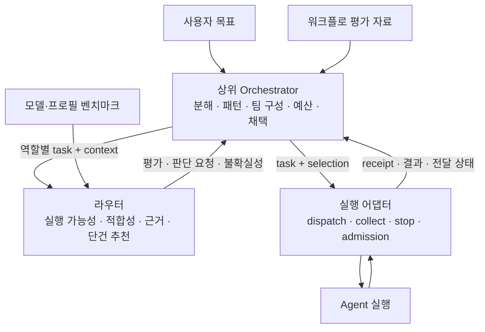

# 상위 오케스트레이션과 라우터의 책임 경계

갱신: 2026-10-24. 2026-10-22/23의 두 설계안 교차 검토를 현재 구현에 맞춰 정리했다. 공개 후보 평가·외부 선택·반복 selection·group 전달 상태는 구현됐다. 패턴 선택·워크플로 품질 평가·전체 예산은 상위 책임이다. 상세 CLI 계약은 [상위 연동](orchestrator.md)을 따른다.

2026-10-25 실행 수단 확장 제안은 [Herdr 없는 실행 경계](execution-boundary.md)에 정리했다. 기존 선택 전용 경로를 재사용하고 실제 API·subprocess·호스트 도구 호출은 상위가 소유하며, Herdr live는 선택 가능한 편의 경로로 유지하는 설계다. 선택 전용 절차와 profiles 2.0(상위 소유 프로필)은 구현됐고, 외부 가용성 계약은 아직 구현되지 않았다.

## 1. 판단의 단위와 책임

| 판단 | 소유자 | 접점 |
|---|---|---|
| 목표 해석·저장소 조사·하위 작업·의존성·공유 상태 분석 | 상위 Orchestrator | 작업 설명·요구사항으로 전달 |
| 패턴 후보·팀 구성·집계·종료 정책 | 상위 | 역할별 task/context와 명시적 selection 목록 |
| 주어진 작업의 facet·추론 요구·자율성·완성 기준 | 라우터 analysis | 작업을 분해하거나 worker를 추가하지 않음 |
| 벤더별 모델·effort 시작점과 적합성 | 라우터 guidance | 정책 6의 벤더별 원문, 벤더마다 요청 한 번 |
| 비교 가능한 benchmark·관련성·단건 추천 | 라우터 | unit별 관측·조건·관련성; 복수 적합 후보는 상위 선택 |
| 전체 예산·deadline·재계획 | 상위 | 호출별 allowance·timeout·group 구성 |
| 실행 인자·admission·가용성·receipt·결과 계약 | 실행 어댑터 | herdr.py·coordination.py·parallel.py |
| 실질적 정확성·채택·병합·후속 검토·재시도 | 상위 | 결과와 전달 상태를 읽고 다음 요청 결정 |

작업 단위는 상위가 한 프로필에 위임하기로 정한 책임 범위다. LLM API 한 번이나 최소 하위 작업을 뜻하지 않는다. analysis의 난도 판단은 주어진 작업의 적합성을 위한 것이며 실행 구조를 만드는 분석과 구분한다. 파일 경로는 파일 본문 조사 결과가 아니다.

경계는 역할명으로 실행 흐름을 바꾸는지로 판단한다. reviewer 업무를 prompt에 담는 것은 가능하지만 router가 pattern=debate로 반복 수·발언 순서·집계를 결정하지 않는다. role/pattern/DAG enum이나 workflow 제어 metadata를 task에 추가하지 않는다.

Jev/native bench-decider는 제한된 의미 판단 수단이다. 판단 agent 호출 자체를 사용자 작업의 multi-agent 협업 패턴으로 해석하지 않는다. 이 경계에 별도 서비스·플러그인 프레임워크가 필요하지는 않다.

## 2. 현재 구현의 접점과 한계

| 접점 | 보장·제한 |
|---|---|
| [routing.evaluate](../bench_router/routing.py) | 기본 schema 2.0의 ID순 facts·제약·category quality/coverage. 의미 적합성 완료 목록이 아님 |
| [evidence.build](../bench_router/evidence.py) | facet별 관측·조건·결측·freshness, 표시 기본 12 unit. 조회 순서는 모델 순위가 아님 |
| [decision.evaluate](../bench_router/decision.py) | evaluate --format 3은 schema 4.0의 전 후보·suitability·관측·진단·추천/기권 공개 |
| selection 5.0 | 정책 6의 단일 추천과 전체 판단 재검증; profile만 변경할 수 없음 |
| select / selection 6.0 | 적합 후보 중 상위 선택. provisional/alternative 수용은 pending 조건을 해소하지 않음 |
| selection 2.0 / --profile | 의미 override 경로. vendor-guided 검증과 구분해 경고하며 hard 제약은 동일 |
| [parallel group 2.0](../bench_router/parallel.py) | task별 context·순서 있는 selection 목록, 동일 profile 반복, task 8·group 16·max_parallel 1–4 |
| parallel plan/run_group | 전체 선택 확인 후 실행 준비·plan 동결·복구. 모든 worker의 트랜잭션·자원 예약은 아님 |
| [herdr.output](../bench_router/herdr.py) | receipt·worktree·delivery_state·reassignment; group member rounds에도 전달 |
| [coordination.reserve](../bench_router/coordination.py) | 공유 상태 디렉터리 기준 활성 4·경로 중첩 거절·제출 의도 기록 |

같거나 상하위 cwd의 활성 작업은 admission에서 거절한다. 병렬은 별도 worktree·receipt 공간을 사용한다. 실제 Agent worktree는 Projects가 보고한 위치이며 router member worktree와 구분한다. [Projects](projects.md)를 따른다.

## 3. 상위 호출 흐름

1. 상위가 작업·환경을 분석하고 소수의 패턴 후보와 역할을 만든다. 단일 agent도 후보로 남긴다.
2. 역할마다 실제 맡길 일을 task로 구체화한다. checker에게 원래 구현 지시를 그대로 보내지 않는다.
3. evaluate --format 3의 단계별 패킷을 해결해 적합성과 근거를 얻는다. 기본 evaluate/evidence는 별도 사실 조회로 사용한다.
4. 상위가 패턴·역할 배치·집계·총비용을 검토한다. 필요한 후보가 없으면 작업 구조나 제약을 다시 검토한다.
5. select로 selection 6.0을 만들고 준비된 실행 묶음만 route/group에 전달한다.
6. 결과를 검증·채택하고 후속 task를 만든다. 입력이 늦게 생기는 checker/synthesizer는 입력 준비 후 평가한다.

자동 단일 추천은 route --dry-run의 단계를 완료해 selection 5.0을 재사용한다. 출력 전용 source는 제거한다. 외부 구성 결정은 format 3 → select의 6.0을 기본으로 하며, 의미 override를 의도하면 별도 2.0 경로로 기록한다. 과거 vendor-guided selection 3.0·4.0은 재평가해야 한다.

단건 추천을 모은 결과가 팀 전체 최적이라는 보장은 없다. 라우터는 복수 적합 후보를 비용·priority·다수결로 축소하거나 불확실성 때문에 worker를 늘리지 않는다. 다른 후보를 택하면 기존 profile만 변조하지 않고 외부 선택으로 기록한다.

## 4. 반복·패턴·상위 계획

group 2.0의 selections는 실행 인스턴스 목록이다. 같은 selection 두 개도 별도 label·worktree·receipt·사용량·한도를 갖는다. 같은 task/context는 근거를 공유할 수 있다. 지시·입력·allowance가 다르면 별도 task를 쓴다. 동결 후 목록 재정렬·추가는 conflict다. 격리된 문맥이 통계적인 오류 독립성을 보장하지 않는다.

| 상위 패턴 | 단건 계약의 사용 | 상위 추가 책임 |
|---|---|---|
| maker-checker | 구현 task 이후 산출물을 넣은 검토 task | 인수 조건·수정 루프·종료 |
| best-of-N / voting | 명시적 반복 selection·독립 worktree | 표본 수·집계·품질 평가 |
| 병렬 전문가 | 역할별 task·selection | 역할 분담·충돌 해결·통합 |
| 순차 handoff / debate | 새 task 또는 tell/resume 제약 안의 메시지 | 문맥 전달·순서·라운드·종료 |

이는 호출 조합이며 router 내장 패턴이 아니다. headless는 tell을 받지 않는다. 상위 계획은 plan/step/instance/attempt와 실제 cwd·task_id·round·run_id를 연결한다. pattern·after·role·집계·budget ledger는 상위에 두고 task의 미등록 필드로 넣지 않는다.

새 역할은 새 task ID, 같은 논리 작업의 의도적 재실행은 새 round를 사용한다. collect에는 identity를 바꾸지 않는다. 같은 task/round는 새 판단보다 receipt 회수가 우선하고 불확실 전송은 collect_first를 따른다. timeout은 중단이나 재전송 허가가 아니다.

## 5. 근거와 예산의 경계

프로필 근거는 unit별 raw 관측·exact/proxy·model/effort/harness·조건·revision·freshness·결측이다. format 3의 공유 evidence와 후보 진단으로 전달하며 팀 점수로 합치지 않는다. suitability와 hard eligibility, 추천 기권과 판단 미완료를 구분한다.

workflow 근거는 패턴·정책 버전·역할별 프로필·반복 수·문맥 공유·집계·환경·평가 집합·품질/비용/지연을 별도로 기록한다. 검토된 JSON/문서 참조로 시작하고 profile snapshot에 가상 팀 프로필을 만들지 않는다. 표본 수·revision·불확실성을 보존한다.

현재 workflow_gain은 평가가 필요한 effort의 pending 진단이며 null·workflow_gain_unverified로 남는다. 벤치마크 우세로 자동 해소하거나 multi-agent 이득을 계산하지 않는다. 상위가 실제 작업에서 비교·수용한다. judge 능력도 generator pool·정답 비율·집계에 의존하면 조건을 workflow 자료에 남긴다.

context.max_estimated_cost_usd는 호출 allowance다. 같은 잔여 예산을 모든 worker에 주어도 총합이 제한되지 않는다. 판단 호출·재시도·재개·후속 작업도 상위 예산에 포함한다. CodeBurn probe는 provider 상태·보고된 window 소진을 확인할 뿐 팀 quota를 예약하지 않는다. 같은 provider의 profile별 quota를 합산하지 않는다.

decision digest는 workspace 파일 본문 전체를 고정하지 않는다. 상위가 artifact·commit을 기록하고 실제 후속 prompt가 바뀌면 재평가한다. 내부 worker의 check_digest 조정을 공개 우회 옵션으로 쓰지 않는다.

## 6. 설계 선택과 검증 상태

라우터 내부의 pattern enum·DAG·투표·재시도 엔진은 단건 정책과 workflow 상태를 결합한다. 원시 벤치마크 조회만 남기면 소비자마다 적합성·비교·재생을 다시 구현해야 한다. 현재는 단건 라우터 + 상위 패턴 정책 + 실행 어댑터의 경계를 따른다. 같은 연결 코드가 반복될 때 얇은 client를 추출할 수 있다.

2026-10-23 가정 실험에서만 확인했던 반복 selection은 이제 정규 validator와 회귀 테스트로 지원한다. 공개 평가·외부 선택·전달 상태도 구현됐다. 현재 검증·live 한계는 [implementation-status](implementation-status.md)에 있다. 다음 과제는 상위 workflow의 대표 과제·기준선·총비용 평가이며 자동 패턴 선택은 구현된 기능이 아니다.

검토 배경은 [다른 agent의 경계 설계안](../wiki/projects/bench-router/synthesis/router-orchestrator-boundary.md), [패턴 연구](../wiki/projects/bench-router/synthesis/multi-agent-pattern-selection.md)다. 원 조사에서 참고한 [Anthropic Building effective agents](https://www.anthropic.com/research/building-effective-agents), [Microsoft orchestration patterns](https://learn.microsoft.com/en-us/azure/architecture/ai-ml/guide/ai-agent-design-patterns)는 2026-10-22 확인 기록이며 이번에 재검증하지 않았다. 경계 적용은 프로젝트의 설계 판단이며 특정 패턴의 정량적 우수성 주장이 아니다.
