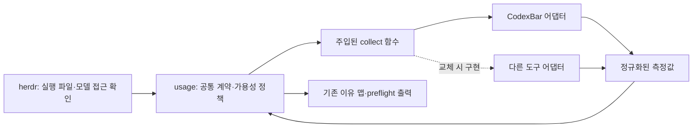

# 사용량 측정 도구 교체 경계

상태: 구현됨. `usage.py`의 공통 정책에 CodexBar와 CodeBurn 수집기를 함수로 주입한다.
공통 프로세스 수명 관리는 `usage_process.py`에 두고, 도구별 JSON은 각 어댑터 안에서만 해석한다.

## 결정

**Adapter + 함수 주입 방식의 Strategy**를 적용한다. 외부 도구의 응답은
프로젝트가 소유한 측정 계약으로 변환하고, 실행 허용 정책은 공통 코드에서 판단한다.
Python 표준 라이브러리의 데이터 클래스와 함수로 구현할 수 있다.
기본 수집기는 CodexBar이며 CodeBurn 0.9.27의 실제 CLI와 정규화 응답 비교로 교체 가능성을 검증했다.

분리 전 결합 지점은 다음과 같았다.

* `herdr.probe_profiles()`가 `codexbar.Availability`와 `codexbar.availability()`에 의존한다.
* `codexbar.py`의 `query()`와 `windows()`는 CLI 옵션·JSON 키·도구의 bucket ID를 해석한다.
* 같은 파일의 `availability()`는 조회, 계정 대조, 크레딧 검사, 잔여량 기준을 함께 처리한다.
* `routing.py`, `decision.py`, `parallel.py`는 이미 이유 맵과 `details`를 전달한다.
  이 소비자들이 외부 도구의 원본 JSON을 알 필요는 없다.

## 목표 구조



| 위치 | 소유하는 책임 |
|---|---|
| `bench_router/usage.py` | 공통 측정 타입, 계약 검증, freshness·계정·reserve·크레딧·지출 한도 정책, 출력 직렬화, `Availability` |
| `bench_router/codexbar.py` | CLI 실행·취소·자원 정리, 공급자별 조회·대체 소스, JSON 검증·변환, 도구의 scope를 실제 적용 모델로 해석 |
| `bench_router/herdr.py` | 기존 정적 조건 필터, 실행 파일·`agy models` 확인, `usage.probe()` 호출 |
| `eval/codexbar.py` | CodexBar 고유 비용 분석·대시보드 명령의 직접 전달 |

공통 정책이 읽는 값에는 `usedPercent`, `providerCost`, CodexBar bucket ID가 없다.
외부 프로세스의 정리 책임은 해당 프로세스를 만든 어댑터에 둔다.
CLI가 아닌 API 도구로 교체해도 공통 정책에 subprocess 분기가 추가되지 않는다.

## 공통 수집 접점

접점은 다음 두 함수다. 수집기 선택과 프로세스 테스트 주입용 선택 인자는 아래에서 생략했다.

```python
def collect(profiles, *, now) -> dict[str, UsageObservation]:
    """프로필별 정규화 측정값. 같은 공급자/계정 조회는 배치 내부에서 재사용한다."""

def probe(profiles, *, collector=None, now=None) -> Availability:
    """collector 기본값은 한 곳에서 codexbar.collect로 연결한다."""
```

테스트는 `probe(profiles, collector=fake_collect, now=fixed_now)`로 외부 실행을 대체한다.
외부 도구를 교체할 때는 새 `collect` 함수를 구현하고 기본 연결 한 곳을 바꾼다.
`BENCH_ROUTER_USAGE_COLLECTOR=codexbar|codeburn`으로 실제 두 수집기 중 하나를 선택한다.
동적 모듈 로딩·플러그인 레지스트리·추상 클래스·팩터리는 현재 필요하지 않다.

## 측정 계약

작은 데이터 클래스들로 표현한다. 수집기가 허용/차단 결과를 반환하지 않도록 한다.

| 데이터 | 필수 의미 |
|---|---|
| `UsageObservation` | 요청한 profile/provider/model, plan 사실, 공급자 조회 상태, 측정 항목 목록 |
| `QuotaWindow` | 측정/미확인 상태, 사용률, 적용 모델 또는 공유 pool, 측정 시각, 초기화 시각 |
| `Balance` | 측정/미확인/미지원 상태, 잔액, 단위, 잔액 종류, 별도 측정 시각 |
| `SpendCap` | 사용액·상한·통화, 적용 대상, 별도 측정 시각 |
| `Pace` | 적용 window, 도구가 제공한 소진 예상 시간·초기화까지 유지 가능 여부 |
| 각 측정 항목의 출처 | collector ID, 실제 source, 계정 대조 상태, 해당 계정·공유 자원의 내부 식별자 |

각 항목은 독립된 측정 시각과 계정 상태를 갖는다. OAuth 할당량이 새롭다는 이유로
오래된 Web 잔액을 새 잔액으로 취급하지 않는다. 내부 계정 식별자는 대조에만 사용하고
공개 `preflight`에는 이메일·토큰·원본 오류를 포함하지 않는다.

계정 상태는 현재 동작처럼 `matched`, `ambient_cli`, `mismatch`, `unverified`를 구별한다.
`matched`가 로컬 로그인 메타데이터 대조인지 공급자의 직접 확인인지 출처도 보존한다.
`ambient_cli`를 직접 확인된 계정으로 승격하지 않는다.

잔액 종류는 `claude_usage_credits`, `api_console_balance`처럼 구분한다.
같은 USD라도 서로 대체하지 않는다. 가격 추정 비용도 실제 잔액과 분리한다.
측정된 0, 응답 누락, 기능 미지원, 조회 실패는 각각 다른 상태로 유지한다.

공유 pool 식별자는 collector 이름과 독립된 공급자/계정/한도 자원을 나타내야 한다.
window를 프로필별로 표시하더라도 같은 pool의 잔여량을 합산하지 않는다.
적용 범위를 확정할 수 없는 모델별 제한은 추측으로 다른 모델에 적용하지 않는다.
필수 제한의 적용 여부가 불명확하면 공통 정책은 검증 불가로 처리한다.

## 정책과 기능 차이 처리

수집기는 실제 제공하는 항목만 반환한다. 공통 정책이 필요한 사실을 결정한다.
예를 들어 Claude Pro Fable의 Usage credits 필요 여부는 공급자·모델·plan에 관한
공통 규칙이다. CodexBar 전용 JSON 파싱 규칙과 함께 두지 않는다.
이 순수 규칙은 어댑터도 재사용해 불필요한 추가 Web 조회를 피할 수 있다.
이후 공통 정책이 필수 항목의 충족 여부를 다시 검사한다.

* reserve는 기본 10%이며 현재 환경변수로 조정한다. 도구별 임계값을 따로 만들지 않는다.
* 동일 계정에 적용되는 OAuth/Web의 제한은 모두 검사한다. 잔액만 있는 응답이
  기존 지출 상한을 지우거나, 한 소스의 성공이 다른 필수 소스의 실패를 숨기면 안 된다.
* 필수 잔액 기능이 미지원이면 해당 프로필을 검증 불가로 제외한다.
  선택적 pace가 미지원이면 예측만 생략하고, 예측이 있는 것처럼 값을 만들지 않는다.
* pace는 참고 정보이며 benchmark 점수나 실제 작업 비용으로 해석하지 않는다.
* collector는 자동으로 유료 실행을 시험하거나, 계정을 전환하거나, 과금을 활성화하지 않는다.

수집기가 없는 프로필 행, 다른 모델/계정의 행, 중복·충돌 행, 잘못된 숫자와
시간 값은 공통 경계에서 검사한다. 누락된 행을 허용 상태로 해석하면 안 된다.
자동으로 다른 외부 도구에 재질의하는 연쇄 fallback은 첫 단계에 추가하지 않는다.
각 도구 내부의 지원 소스 대체와 도구 자체의 교체는 서로 다른 동작이다.

## 호환성과 교체 범위

첫 리팩터링은 기존 이유 맵과 `preflight` 필드를 유지한다.
`Availability`는 공통 모듈로 이동하고 판단 코드는 도구 중립적인 내부 이유를 쓴다.
현재 공개된 `codexbar_*` 오류 문자열은 호환 직렬화 경계 한 곳에서 대응시킨다.
이는 기존 호출자 보호를 위한 역사적 식별자이며, 실제 수집기는 별도 `collector` 필드로 표시한다.
공개 이유 문자열을 중립 이름으로 바꾸는 일은 별도 버전 변경으로 진행한다.

| 변경 상황 | 변경할 위치 |
|---|---|
| CodexBar CLI 옵션·JSON 변경 | CodexBar 어댑터와 원본 응답 fixture |
| 다른 도구로 교체 | 새 어댑터, 기본 collector 연결, 설치 설정·운영 안내 |
| 잔여량 기준·freshness 정책 변경 | `usage.py`와 공통 정책 테스트 |
| 공급자의 새 모델·결제 규칙 | 공통 공급자 규칙, 필요한 어댑터 데이터 매핑 |
| 도구 고유 비용 보고서·대시보드 변경 | `eval/`의 해당 도구 명령·운영 안내 |

기능이 다른 도구를 무수정으로 대체할 수 있다는 보장은 하지 않는다.
통일할 대상은 실행 전 가용성 측정 계약이다. 보고서 전체를 공통 분모로 축소하지 않는다.
설치 파일명·지원 소스·인증 안내처럼 외부 도구 자체에 속한 운영 변경은 남는다.
실시간 관측은 기존처럼 assessment/selection digest 밖에 두고 실행 직전에 다시 검사한다.

## 적용 및 검증 순서

1. `usage.py`에 공통 계약과 정책을 만들고, 기존 정책 회귀 사례를 이쪽으로 옮긴다.
2. `codexbar.py`에서 도구 데이터 변환과 조회만 남겨 동일 계약을 반환한다.
3. `herdr.py`의 두 직접 의존점을 `usage`로 바꾸고 출력 소비자는 유지한다.
4. CodexBar 원본 fixture와 가짜 collector가 같은 의미의 데이터에 같은 결정을 내리는지 검증한다.

완료 기준은 다음과 같다.

* 공통 정책 파일에 CodexBar JSON 키나 명령 옵션이 없다.
* 가짜 collector 교체 시 CLI·라우팅·병렬 실행 코드를 수정하지 않는다.
* 10% 경계, 오래된 값, 미지원 잔액, 다른 계정, 공유 pool, 서로 다른 소스의
  지출 상한·모델 한도, 누락·잘못된 수집 결과를 회귀 테스트로 검증한다.
* 새 수집기의 필수 데이터 부족이 지급 가능·잔여량 0·무제한으로 둔갑하지 않는다.
* 관측값 변경은 선택 digest를 바꾸지 않고, 가용성 악화는 실행을 차단한다.
* 프로세스 정리 테스트는 CodexBar 어댑터에 남고, 공통 정책 테스트는 외부 실행 없이 돈다.
* 기존 전체 오프라인 테스트와 실제 읽기 전용 할당량 smoke test를 통과한다.


## CodeBurn 호환 검증 결과

`test_usage.py`는 두 어댑터를 같은 `usage.probe()`에 주입해 잔여량 10% 경계,
소진, 미지원 크레딧, 계정/잔액 종류 불일치, 잘못된·누락된 응답, 공유 pool 구분을 검증한다.
CodeBurn의 공식 `quota --format json` 계약과 0.9.27 배포본의 source map을 확인했다.
실제 0.9.27을 임시 경로에 설치하여 읽기 전용 조회 및 `herdr.probe_profiles()` 연결도 실행했다.
활성 79개 중 61개가 통과했고, 13개는 Antigravity 조회 불가, 5개는 Fable 크레딧 미지원으로 제외됐다.
이는 도구의 기능 차이를 유지한 결과이며 CodexBar와 측정 숫자 자체가 동일하다는 주장은 아니다.

CodeBurn의 공유 5-hour/Weekly, Claude 모델별 Weekly, 식별 가능한 Antigravity
공유 pool 및 정확히 일치하는 모델 label을 변환한다. 알려지지 않은 label은 다른 pool로 추정하지 않는다.
CodeBurn 응답에 별도 측정 시각이 없어 live 명령 완료 시각을 기록한다.
공급자 내부 cache의 나이까지 검증하는 기능은 제공하지 않는다.
선불 Usage credits와 계정 식별, pace가 없는 경우 이를 만들어내지 않는다.
기본 도구와 설치 작업은 CodexBar이며 CodeBurn은 사용자가 명시적으로 선택하는 선택적 호환 경로다.
기존 CodeBurn 비용 보고서·CSV export 전체를 복구하는 범위는 포함하지 않는다.
