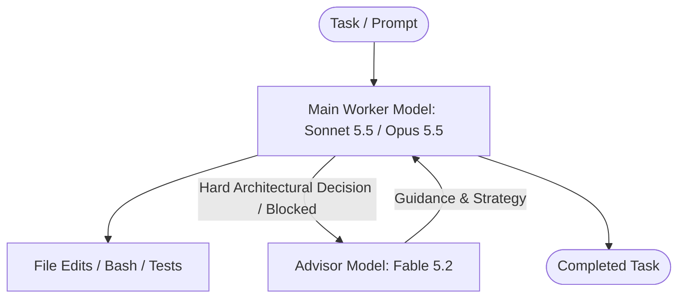

# Advisor-orchestrator pattern for frontier models

As frontier models reach extreme capabilities and higher token unit costs ($8/$40 per M tokens), running them end-to-end for routine file reads, shell commands, and syntax edits introduces unnecessary cost and latency.

The **Advisor-Orchestrator Pattern** decouples routine execution from architectural decision-making:

## Benefits

1. **Token Cost Savings:** 80-90% of session tokens run at daily-driver pricing, while Fable is invoked only on a fraction of prompts.
2. **Latency Reduction:** Sub-second to low-latency generation for routine commands; extended adaptive thinking is spent only when needed.
3. **Guardrail Compliance:** Avoids credit-depletion risks on subscription accounts while preserving frontier reasoning when an impasse occurs.
